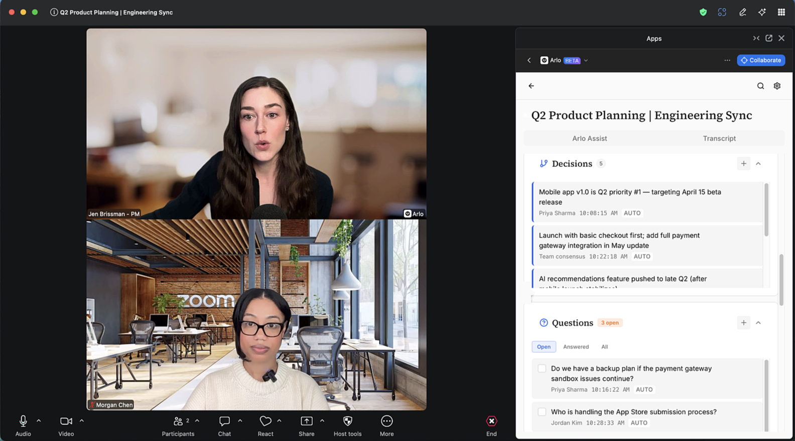
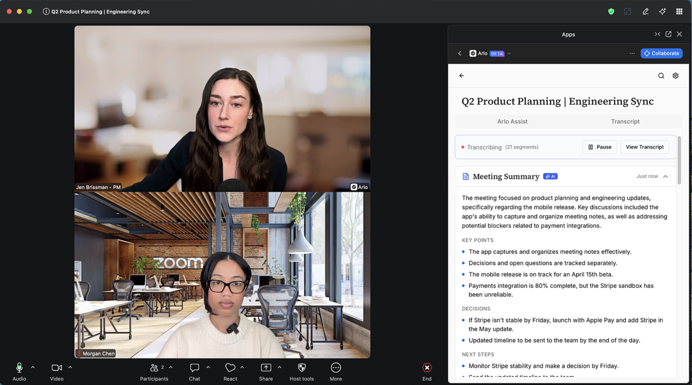
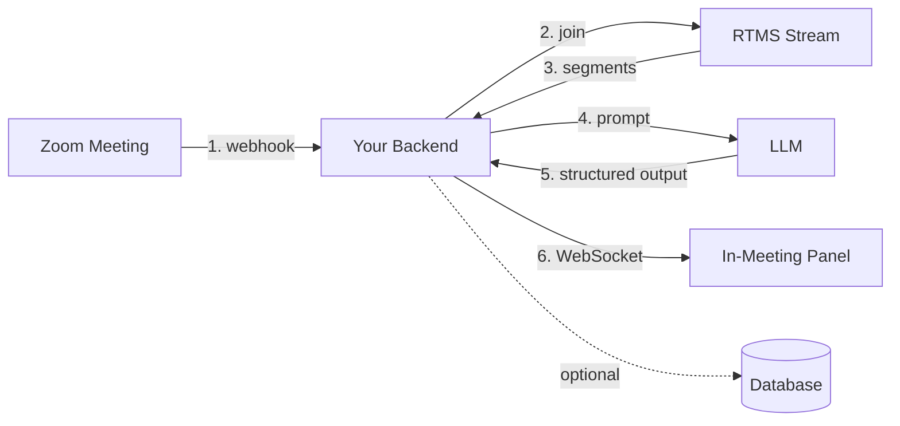

A meeting notetaker streams live transcripts from RTMS, passes them to an LLM, and displays rolling summaries, action items, and key moments in a panel visible to participants. Notes update while the meeting is still happening.

Most meeting notes happen after the call. Someone reviews the recording, writes up a summary, shares it the next day. By then everyone has moved on. A real-time notetaker captures decisions and action items while people can still correct them.

**What you'll need:**

- Transcript access via [RTMS](https://developers.zoom.us/docs/rtms/) (requires [Zoom Developer Pack](https://zoom.us/pricing/developer) credits; free trial credits are available)
- A backend to receive webhooks, persist transcripts, and call an LLM (Node/Express in this guide; any stack works)
- A [Zoom Surface App](https://developers.zoom.us/docs/zoom-apps/) to render the notes panel in-meeting
- An LLM for extraction (OpenRouter, OpenAI, Anthropic, or self-hosted)

## Features

- **Live transcription**: Stream transcripts from Zoom meetings using RTMS
- **Rolling summaries**: Generate summaries as the conversation progresses, not after
- **Action item extraction**: Capture action items with owners and deadlines as they're spoken
- **Key moments**: Highlight decisions, announcements, and open questions
- **In-meeting panel**: Surface everything in a sidebar visible to all participants

If you'd rather buy than build, Zoom offers [AI Companion](https://www.zoom.com/en/products/ai-assistant/) with similar note-taking capabilities.

Follow along as we walk through the architecture.

<div align="center">
  
  
</div>

**See it in action:**

<YouTube id="ATnbAbBV7Cs" />

---

## Architecture

RTMS delivers transcript segments over WebSocket with sub-second latency. Your backend receives each phrase as it's spoken, typically within 300-500ms. That's fast enough for live summaries and action item extraction while participants can still act on them.

### Components

| Component | Responsibility | Our stack (yours may differ) |
|-----------|----------------|------------------------------|
| **Transcript access** | Receive RTMS webhooks, join streams, normalize segments | Node service using `@zoom/rtms` SDK |
| **Backend** | Orchestrate AI calls and broadcast to clients; persist transcripts if you need history | Express + OpenRouter. Arlo runs in demo mode with no database: transcripts are broadcast, not stored |
| **Frontend** | Display transcript, summaries, action items in real time | React Surface App via Zoom Apps SDK |



When RTMS starts in a meeting, Zoom sends a webhook with stream credentials. Your backend verifies it, joins the stream, and receives transcript segments as each phrase is spoken. Segments are broadcast to the in-meeting panel in under a second. Summaries and other notes are extracted on an interval, so they follow the conversation by seconds to minutes.

**Our stack vs. your options:** We use Node/Express, but Python/FastAPI, Go, or Ruby work the same way. The requirements are a webhook endpoint Zoom can reach, a WebSocket client for RTMS, an LLM, and a way to push updates to the frontend.

### How extraction works

The backend collects recent transcript context, sends it to an LLM with a structured-output prompt, parses the JSON response, and pushes the result to the panel. We use [OpenRouter](https://openrouter.ai/) (free models work without an API key; Claude or GPT-4o need one). All extraction features follow the same pattern:

1. **Collect**: Accumulate recent transcript context (last N segments or last M minutes)
2. **Extract**: Send to an LLM with a structured-output prompt that returns JSON
3. **Deliver**: Push the parsed result to connected clients over WebSocket

### Agent integration map

If you're grafting this into an existing codebase, check what you already have before adding anything:

| Required capability | Reuse when present | Add when missing |
|--------------------|--------------------|------------------|
| Webhook endpoint | Existing API routes | Express router or equivalent |
| Signature verification | Existing HMAC middleware | `verifyWebhookSignature()` |
| WebSocket server | Existing real-time layer | ws or Socket.io server |
| Database (optional) | Existing Postgres/MySQL | Schema for transcripts, if you need history; Arlo's demo mode has none |
| LLM client | Existing OpenAI/Anthropic setup | OpenRouter client |
| Auth/JWT | Existing session tokens | JWT signing for WebSocket auth |

---

## Implementation Guide

This guide has three parts: the transcript pipeline (how to receive and process RTMS streams), the intelligence layer (how to extract meeting notes with AI), and a quickstart to run the reference implementation.

The patterns apply regardless of your stack. Code examples are from [Arlo](https://github.com/zoom/arlo), but the concepts transfer to any language or framework.

### Part 1: Building the Transcript Pipeline

#### Verify the webhook

When a user starts transcription, Zoom sends `meeting.rtms_started` to your webhook endpoint. Before acting on it, verify the request came from Zoom: compute an HMAC-SHA256 signature over `v0:{timestamp}:{rawBody}` using your app's webhook secret token, enforce a five-minute replay window, and use timing-safe comparison.

```javascript
function verifyWebhookSignature(rawBody, timestamp, signature, secret) {
  // Reject if timestamp is stale (replay protection)
  const now = Math.floor(Date.now() / 1000);
  if (Math.abs(now - parseInt(timestamp, 10)) > 300) return false;

  const message = `v0:${timestamp}:${rawBody.toString('utf8')}`;
  const expected = 'v0=' + crypto
    .createHmac('sha256', secret)
    .update(message)
    .digest('hex');

  return crypto.timingSafeEqual(Buffer.from(signature), Buffer.from(expected));
}
```

Two implementation details matter: use the raw request body (don't re-serialize JSON; the signature is over the exact bytes Zoom sent), and handle Zoom's `endpoint.url_validation` challenge separately since validation requests carry no signature.

**Other languages:** In Python, use `hmac.compare_digest`; in Go, use `crypto/subtle.ConstantTimeCompare`.

#### Stream session management

**Input:** `meeting.rtms_started` webhook payload with `meeting_uuid`, `rtms_stream_id`, `server_urls`

**Output:** Active RTMS session registered, client connected, transcript handler receiving segments

**Invariants:**

- Deduplicate by `rtms_stream_id`, not `meeting_uuid`
- If same meeting arrives with new stream ID (media server failover), tear down old session and join new
- Register transcript handlers before calling `join()`
- Clean up session on `onLeave` callback
- Track sequence counter per session for segment ordering

**Other languages:** The `@zoom/rtms` SDK supports Node.js and Python (`pip install rtms`). For other stacks, implement the WebSocket protocol directly; the [RTMS documentation](https://developers.zoom.us/docs/rtms/) covers the wire format.

See [Arlo's RTMS service](https://github.com/zoom/arlo/tree/main/rtms) for the reference implementation.

#### Transcript segment handling

**Input:** Raw transcript callback with `text`, `timestamp` (microseconds), `userId`, `userName`

**Output:** Normalized segment with `speakerId`, `speakerLabel`, `text`, `tStartMs`, `seqNo`

**Invariants:**

- Assign monotonic sequence number per session
- Convert timestamp from microseconds to milliseconds
- Broadcast to clients immediately (don't block on persistence)
- If you persist, do it asynchronously with an upsert on `(meetingId, seqNo)` for idempotency
- Handle missing userId/userName gracefully with defaults

**Databases:** In demo mode Arlo keeps nothing after the meeting. To store transcripts, use MySQL, Postgres, MongoDB, or a time-series database.

### Part 2: Building the Intelligence Layer

With the transcript pipeline in place, you have a live stream of what's being said. Now extract meeting intelligence from it.

In Arlo, the panel drives extraction over HTTP. It posts recent transcript text to `/api/ai/summary-live` after every 20 new segments, and sends segments to `/api/ai/key-moment` to detect key moments. Arlo ships with demo mode on, and in demo mode the Decisions and Open Questions panels show sample data. The contract below describes the same extraction run on the server and pushed over the WebSocket.

#### Meeting notes extraction

**Input:** Recent transcript context (last N segments or last M minutes), current notes state

**Output:** JSON with `summary` (2-3 sentences), `actionItems` (task + owner + due), `keyMoments` (decisions, questions, announcements)

**Invariants:**

- Run on debounce interval (30 seconds), not on every segment
- Track last processed sequence number to avoid redundant calls
- Parse JSON response, strip markdown fences if present
- Merge results incrementally (don't replace existing notes)
- Shorter intervals (15s) feel more responsive but cost more; longer intervals (60s) reduce costs but lag

**Prompt structure** (customize for standups, all-hands, 1:1s):

```
You are a meeting assistant analyzing a live transcript.
Extract three things:

1. Summary: 2-3 sentences capturing the current discussion topic and any conclusions.

2. Action items: Tasks assigned during the meeting.
   Format: { "task": "what", "owner": "who", "due": "when or null" }

3. Key moments: Decisions made, questions raised, announcements.
   Format: { "type": "decision|question|announcement", "text": "what was said" }

Return JSON only:
{
  "summary": "...",
  "actionItems": [...],
  "keyMoments": [...]
}
```

**Other LLMs:** Works with OpenAI, Anthropic, or self-hosted models. For reliability, use the provider's JSON mode or function calling.

See [Arlo's AI routes](https://github.com/zoom/arlo/blob/main/backend/src/routes/ai.js) for the reference implementation.

#### Frontend state management

**Input:** WebSocket stream of segments and notes updates

**Output:** React state for transcript, summary, action items, key moments

**Invariants:**

- Require valid JWT on every WebSocket connection
- Client sends `{ type: 'subscribe', meetingId }` after connecting
- Server broadcasts `{ type: 'transcript.segment', data }`; if you extract on the server, push `{ type: 'notes_update', data }` the same way
- Append segments in `seqNo` order
- Dedupe action items by task text
- Dedupe key moments by text similarity
- Show existing notes on reconnect, then apply incremental updates

Arlo rejects an invalid token but accepts a WebSocket connection with no token as a guest. Require a token before production.

**Other frameworks:** Works with Vue, Svelte, or vanilla JS. The Surface App runs inside the Zoom client via iframe; standard web tech applies.

#### Customizing prompts

The extraction prompt is your main customization point. Different meeting types benefit from different prompts:

| Meeting Type | Prompt Adjustments |
|--------------|-------------------|
| **Standups** | Focus on blockers and commitments; ignore small talk |
| **All-hands** | Capture announcements and Q&A; summarize by topic |
| **1:1s** | Track feedback given, career discussion points, follow-ups |
| **Brainstorms** | Cluster ideas by theme; note which got energy vs. dropped |

You can also add domain-specific extraction. For engineering meetings, detect technical decisions and architecture changes. For sales calls, track objections and next steps (see the [Sales Coach blueprint](../realtime-sales-coach/)).

### Part 3: Running the Reference Implementation ([Arlo](https://github.com/zoom/arlo))

Arlo is the reference implementation. It runs in demo mode: no database, and sample data in some panels. Use it to see the patterns in action, then fork and customize or use as a reference for your own build.

#### One-click deploy

| Platform | What you get |
|----------|--------------|
| [**Deploy to Render**](https://render.com/deploy?repo=https://github.com/zoom/arlo) | Backend, frontend, RTMS service, managed database |
| [**Deploy to Railway**](https://railway.app/new?repo=https://github.com/zoom/arlo) | Backend, frontend, RTMS service, managed database |

After deploying, create a Zoom App in the [Marketplace](https://marketplace.zoom.us/), add `ZOOM_CLIENT_ID`, `ZOOM_CLIENT_SECRET`, and `ZOOM_WEBHOOK_TOKEN` to the environment, and point your app's OAuth redirect URL at the deployed backend.

#### Local setup

| Requirement | Purpose |
|-------------|---------|
| [Node.js 20+](https://nodejs.org/) | Runtime for all services |
| [Docker Desktop](https://www.docker.com/products/docker-desktop/) | Runs the backend, frontend, and RTMS services |
| [ngrok](https://ngrok.com/) | Public HTTPS URL for Zoom webhooks |
| [Zoom account](https://marketplace.zoom.us/) | To create and configure your Zoom App |
| RTMS access | [Zoom Developer Pack](https://zoom.us/pricing/developer) credits on your account; free trial credits are available |

<details>
<summary><strong>Step-by-step local setup</strong></summary>

1. **Clone and configure**

   ```bash
   git clone https://github.com/zoom/arlo.git
   cd arlo
   cp .env.example .env
   ```

2. **Start ngrok** with a [free static domain](https://dashboard.ngrok.com/domains):

   ```bash
   ngrok http 3000 --domain=your-subdomain.ngrok-free.app
   ```

3. **Create your Zoom App** at [marketplace.zoom.us](https://marketplace.zoom.us/):
   - **Develop** > **Build App** > **General App**
   - Copy your **Client ID** and **Client Secret**

4. **Configure the Zoom App:**
   - OAuth Redirect URL: `https://YOUR-NGROK-URL/api/auth/callback`
   - Scopes: `zoomapp:inmeeting`, `meeting:read:meeting`, the RTMS scope `meeting:read:meeting_transcript`, optionally `user:read`
   - Surface: Home URL `https://YOUR-NGROK-URL`
   - Event Subscriptions: endpoint `https://YOUR-NGROK-URL/api/rtms/webhook`, events `meeting.rtms_started` and `meeting.rtms_stopped`

5. **Fill in `.env`:**

   ```bash
   ZOOM_CLIENT_ID=your_client_id
   ZOOM_CLIENT_SECRET=your_client_secret
   ZOOM_WEBHOOK_TOKEN=your_webhook_secret_token
   PUBLIC_URL=https://your-subdomain.ngrok-free.app

   # Generate these:
   SESSION_SECRET=$(node -e "console.log(require('crypto').randomBytes(32).toString('hex'))")
   TOKEN_ENCRYPTION_KEY=$(node -e "console.log(require('crypto').randomBytes(32).toString('hex'))")
   ```

6. **Start everything:**

   ```bash
   docker-compose up --build
   ```

7. **Test:** Start a Zoom meeting, open **Apps** > your app, select the **Notes** vertical, and choose **Start Arlo** to begin transcription.

</details>

Arlo supports multiple verticals (Notes, Healthcare, Legal, Sales, Support). The Notes vertical is the general-purpose notetaker. Switch verticals anytime from Settings.

---

## App Manifest

The [`manifest.json`](./manifest.json) in this directory pre-configures a Zoom App with Surface App capabilities and RTMS transcript access. Upload it when creating your app to skip manual configuration.

### Scopes

| Scope | Required | Purpose |
|-------|----------|---------|
| `zoomapp:inmeeting` | Yes | Render the panel inside meetings |
| `meeting:read:meeting` | Yes | Meeting metadata |
| `meeting:read:meeting_transcript` | Yes | Receive the live transcript through RTMS |
| `user:read` | Optional | User profile info |

### RTMS Configuration

RTMS access is granted through scopes that select which meeting media your app receives. They are separate from the REST API scopes above.

1. In your app settings, go to **Scopes**
2. Choose **+ Add Scopes** and search for _RTMS_
3. Add `meeting:read:meeting_transcript`

RTMS scopes cannot be marked optional, so add only the media types the app uses. RTMS needs [Zoom Developer Pack](https://zoom.us/pricing/developer) credits on your account; free trial credits are available. See [Add Realtime Media Streams to your app](https://developers.zoom.us/docs/rtms/meetings/add-features/).

### Event Subscriptions

| Event | When it fires |
|-------|---------------|
| `meeting.rtms_started` | Transcription begins; payload has stream credentials |
| `meeting.rtms_stopped` | Transcription ends |

Your webhook endpoint receives these events and manages stream connections accordingly.

---

<details>
<summary><strong>Production Considerations</strong></summary>

The patterns above work for development and moderate scale. For production deployments, consider:

| Area | Development | Production |
|------|-------------|------------|
| **Credentials** | `.env` file | Secrets manager (AWS, Vault, etc.) |
| **Token storage** | In memory, encrypted | Durable store with encryption at rest and key rotation |
| **Sessions** | In-memory | Redis (survives restarts, scales horizontally) |
| **WebSockets** | Single instance | Redis pub/sub for multi-instance broadcast |
| **HTTPS** | ngrok | Load balancer with TLS termination |

**Data retention:** Transcript data may contain sensitive information. Plan retention policies aligned with your compliance requirements and provide user controls for deletion.

**Scaling:** Each active meeting maintains an RTMS WebSocket connection. For high-volume deployments, run multiple RTMS service instances with connection distribution.

</details>

---

## Acceptance Criteria

Use this checklist to verify the implementation:

- Webhook signature verification rejects invalid or stale requests
- Duplicate `rtms_stream_id` webhooks are ignored
- Stream failover (new `rtms_stream_id`, same meeting) tears down old session and joins new
- Transcript segments broadcast to clients before persisting to database
- WebSocket connections require valid JWT
- WebSocket cleanup runs on disconnect, navigation, and page unload
- LLM extraction runs on interval, not on every segment
- Extraction results parse as valid JSON and handle malformed responses
- Action items dedupe by task text; key moments dedupe by similarity
- Panel renders existing notes on connect and updates on new extractions
- No SDK credentials in client bundles or logs

---

## Related Resources

- [Arlo Repository](https://github.com/zoom/arlo) - Reference implementation
- [RTMS Documentation](https://developers.zoom.us/docs/rtms/) - Realtime Media Streams API reference
- [Zoom Apps SDK](https://developers.zoom.us/docs/zoom-apps/) - Building in-meeting experiences
- [Zoom Developer Forum](https://devforum.zoom.us/) - Community support

