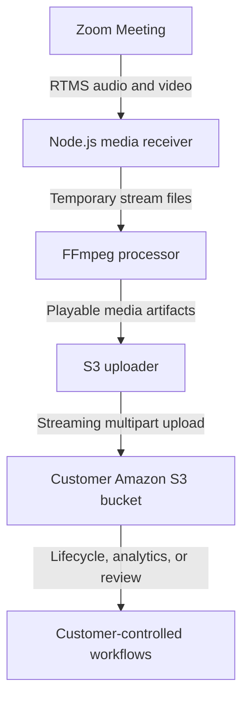

Build a customer-controlled meeting archive that turns live RTMS audio and video into playable files in Amazon S3. The archive can feed retention, quality review, media processing, or an existing data platform while the customer controls access and lifecycle policy.

[Zoom Realtime Media Streams (RTMS)](https://developers.zoom.us/docs/rtms/) sends live audio and video to your backend. The reference implementation saves the stream, uses [FFmpeg](https://ffmpeg.org/documentation.html) to create playable files, and uploads the finished files to [Amazon S3](https://docs.aws.amazon.com/AmazonS3/latest/userguide/Welcome.html). You control the bucket, encryption, access, retention period, and anything that happens to the files later.

Archive only the meetings and media your use case requires. Tell participants, get any required consent, and follow your organization's approval process.

**What you'll need:**

- [Zoom Developer Pack](https://zoom.us/pricing/developer) credits for RTMS (free trial credits are available)
- A backend with enough temporary storage for expected meeting lengths
- Node.js 22 or newer and [FFmpeg](https://ffmpeg.org/documentation.html) on the media worker
- An Amazon S3 bucket and approved AWS workload identity
- Retention, access, encryption, and participant-notice policies

## Features

- Capture mixed meeting audio and the configured RTMS video stream.
- Produce playable media after RTMS stops.
- Store each object under a stable meeting and stream path.
- Leave local media recoverable when an upload fails.
- Upload objects into a bucket where the customer configures access, encryption, and retention.

Follow along as we walk through the architecture.

<YouTube id="GZN92AdQnGY" />

---

## Architecture

### The reusable pattern

Zoom calls your webhook when RTMS starts. A media worker receives audio and video, writes bounded temporary artifacts, packages them into playable formats, uploads them to durable object storage, and records whether the upload completed before cleaning up local files.

### How the reference implementation handles it

The linked [Node.js reference implementation](https://github.com/zoom/rtms-samples/tree/main/storage/save_audio_and_video_to_aws_s3_storage_js) uses Express, RTMSManager, FFmpeg, and the AWS SDK. It captures mixed 16 kHz mono audio and a single active-speaker H.264 video stream at 25 frames per second. When `meeting.rtms_stopped` arrives, it flushes that stream's files and writes a job to a queue on local disk. The job converts and muxes the media with FFmpeg, then streams the finished files to S3, using multipart upload for large files.

The queue retries failed jobs with exponential backoff, returns interrupted jobs to pending after a restart, and periodically scans for media left behind by a crash. Every upload requests server-side encryption explicitly, and local media is deleted after a successful upload by default. The queue is a directory on one instance's disk, so persist the recordings directory, and replace the queue with your own job system if you run more than one worker.



### Agent integration map

Check what your application already provides before adding components:

| Required capability | Reuse when present | Add when missing |
| --- | --- | --- |
| Webhook endpoint | Existing public API route | HTTPS endpoint for RTMS lifecycle events |
| Signature verification | Existing Zoom webhook middleware | Raw-body HMAC verification and replay protection |
| RTMS media receiver | Existing stream service | Audio and video handlers keyed by stream |
| Temporary storage | Existing encrypted workspace | Size-bounded per-stream media directory |
| Media packaging | Existing transcoding workers | FFmpeg job with fixed arguments |
| Object storage | Existing approved archive | S3 uploader with workload identity |
| Recovery | Existing durable job system | Upload state, retries, and cleanup records |

## Implementation Guide

### Part 1: Capture and package meeting media

#### 1. Capture audio and video separately

[`index.js`](https://github.com/zoom/rtms-samples/blob/main/storage/save_audio_and_video_to_aws_s3_storage_js/index.js) configures mixed 16 kHz mono audio and one active-speaker H.264 video stream at 25 frames per second. Its handlers pass frames to [`MediaRecorder.js`](https://github.com/zoom/rtms-samples/blob/main/storage/save_audio_and_video_to_aws_s3_storage_js/MediaRecorder.js), which keeps raw audio and video in separate files per stream until conversion. The video handler creates a `VideoGapFiller` when the first frame arrives. Keep temporary storage large enough for the longest expected meeting and encrypt it according to the customer's media policy.

**Input:** RTMS audio or video frame with meeting ID, stream ID, and timestamp

**Output:** Ordered temporary media written beneath the matching stream workspace

**Invariants:**

- Audio and video state is isolated by `rtms_stream_id`
- Frame ordering and timestamps are preserved for packaging
- Temporary paths are generated from safe internal identifiers
- Disk limits and backpressure prevent one stream from exhausting the worker
- A reconnect cannot overwrite completed media from another stream

#### 2. Create the S3 destination

Create a dedicated bucket or prefix for RTMS media. Configure:

- Default encryption with a customer-approved key policy.
- Block Public Access.
- Least-privilege write access for the workload.
- Lifecycle expiration or archival tiers matching the retention policy.
- Access logging and alerts for policy changes.

The reference implementation does not set a credential provider. `S3Client` uses the AWS SDK's default credential chain, so an IAM role, web identity, IAM Identity Center, or a shared profile works without code changes. Prefer short-lived role credentials. Use static access keys only for a limited local test, and never commit them.

The workload needs `s3:PutObject` and `s3:AbortMultipartUpload`. With SSE-KMS it also needs `kms:GenerateDataKey` and `kms:Decrypt` on the key.

#### 3. Create the Zoom app

Create a Zoom General App in the [Zoom App Marketplace](https://marketplace.zoom.us/) and configure the RTMS lifecycle webhook.

| Setting | Value |
| --- | --- |
| Scopes | `meeting:read:meeting_audio`, `meeting:read:meeting_video` |
| Events | `meeting.rtms_started`, `meeting.rtms_stopped` |
| Webhook URL | `https://YOUR_DOMAIN.example.com/webhook` |

The two scopes are RTMS media scopes: they select the media your app receives. An account admin must also turn on **Share realtime meeting content with apps** under **Account Settings** > **Zoom Apps**. The [`manifest.json`](manifest.json) in this directory has the same scopes and events.

#### 4. Receive and package media

Verify the webhook signature over the raw request body, enforce a replay window, and use a timing-safe comparison. Reply before opening media sockets or starting file work. The reference implementation uses a shared `verifyZoomWebhookRequest` helper and replies with HTTP 200 before it handles the event. The check looks like this:

```javascript
import crypto from 'node:crypto';

function verifyZoomWebhook(rawBody, timestamp, signature, secret) {
  if (typeof signature !== 'string') return false;
  if (Math.abs(Math.floor(Date.now() / 1000) - Number(timestamp)) > 300) return false;
  const message = `v0:${timestamp}:${rawBody.toString('utf8')}`;
  const expected = `v0=${crypto.createHmac('sha256', secret).update(message).digest('hex')}`;
  const received = Buffer.from(signature);
  const computed = Buffer.from(expected);
  return received.length === computed.length && crypto.timingSafeEqual(received, computed);
}
```

Handle Zoom endpoint validation separately because that request follows a different path.

Open the RTMS connections in the background. Save audio and video separately, handle heartbeats and reconnects, and close each file before running FFmpeg.

[`MediaProcessingPipeline.js`](https://github.com/zoom/rtms-samples/blob/main/storage/save_audio_and_video_to_aws_s3_storage_js/MediaProcessingPipeline.js) converts the raw audio to `mixed_audio.wav`, wraps the H.264 stream as `mixed_video.mp4`, and muxes both into `mixed_final.mp4` when both tracks exist. It passes FFmpeg a fixed list of arguments. Do not build a shell command from meeting details. A nonzero FFmpeg exit code fails the job, so a broken file is never uploaded as a finished one.

**Input:** Closed raw audio and video artifacts plus trusted format settings

**Output:** Playable media artifacts and a packaging result record

**Invariants:**

- FFmpeg arguments are fixed or allowlisted, never assembled from untrusted text
- Packaging starts only after writers are closed or a durable boundary is reached
- A nonzero FFmpeg exit code marks the job failed
- Output is probed before it is eligible for upload
- Retrying packaging does not destroy the source artifacts

### Part 2: Store media safely

#### 5. Upload and recover

[`S3StorageHelper.js`](https://github.com/zoom/rtms-samples/blob/main/storage/save_audio_and_video_to_aws_s3_storage_js/S3StorageHelper.js) uploads the WAV and MP4 files from a stream's directory and sets a content type for each. Raw capture files are not uploaded. It builds the key from the configured prefix and sanitized identifiers:

```text
<S3_PREFIX>/<meeting-uuid>/<stream-id>/<filename>
```

Each file is streamed from disk with the AWS SDK's `Upload` helper, which switches to multipart upload for large files (16 MiB parts, four at a time by default) and aborts the multipart upload if it fails. Every request sets server-side encryption explicitly (`AES256` by default, or SSE-KMS) instead of relying only on the bucket default.

[`DurableUploadQueue.js`](https://github.com/zoom/rtms-samples/blob/main/storage/save_audio_and_video_to_aws_s3_storage_js/DurableUploadQueue.js) runs each job up to five times with exponential backoff and deletes local media only after a successful upload. Set `DELETE_LOCAL_AFTER_UPLOAD=false` to keep completed media for a retention period instead. A retry must never delete a file that has not been stored safely.

Add a bucket lifecycle rule that aborts incomplete multipart uploads as a backstop.

**Input:** Verified artifact, destination bucket, safe object key, and content type

**Output:** Confirmed private object plus durable upload status

**Invariants:**

- Object keys are deterministic for a meeting stream and artifact
- Retries do not create conflicting archives
- Local source files remain until object existence and integrity are confirmed
- Bucket access, encryption, and retention come from customer policy
- Failed multipart uploads are recorded and eventually removed

### Part 3: Run the reference implementation

#### 6. Install, configure, and start

```bash
git clone https://github.com/zoom/rtms-samples.git
cd rtms-samples/storage/save_audio_and_video_to_aws_s3_storage_js
npm ci
ffmpeg -version
cp .env.example .env
```

Set the Zoom and AWS values in `.env`. AWS credentials come from the SDK's default chain, so a workload with an IAM role needs no access keys. The sample's [readme](https://github.com/zoom/rtms-samples/tree/main/storage/save_audio_and_video_to_aws_s3_storage_js#configuration) lists the queue, retry, and retention settings.

```dotenv
ZOOM_CLIENT_ID=YOUR_ZOOM_CLIENT_ID
ZOOM_CLIENT_SECRET=YOUR_ZOOM_CLIENT_SECRET
ZOOM_SECRET_TOKEN=YOUR_ZOOM_WEBHOOK_SECRET_TOKEN
PORT=3000
WEBHOOK_PATH=/webhook
AWS_REGION=YOUR_AWS_REGION
S3_BUCKET=YOUR_S3_BUCKET
S3_PREFIX=rtms
S3_SERVER_SIDE_ENCRYPTION=AES256
RECORDINGS_DIR=recordings
DELETE_LOCAL_AFTER_UPLOAD=true
```

Point `RECORDINGS_DIR` at a private folder with a size limit. It holds the media and the upload queue, so it must survive restarts. Do not put participant names in object keys. Then run:

```bash
node index.js
```

Expose the configured webhook path over HTTPS. The sample includes a Dockerfile with FFmpeg installed. Build it from the repository root and mount a volume at the recordings directory so the queue survives container replacement. There is no CloudFormation, Terraform, or one-click deployment template. Your deployment must provide persistent storage for the recordings directory, a public webhook domain, and an AWS identity.

#### 7. Verify the archive workflow

Test short and long meetings, interrupted RTMS sessions, an unavailable S3 endpoint, FFmpeg failure, and an application restart. Confirm that:

- Objects are private and encrypted.
- Audio and video are synchronized and playable.
- Duplicate lifecycle events do not create conflicting objects.
- Failed uploads remain recoverable or are retried from a durable queue.
- Lifecycle rules expire test objects as expected.

### Production considerations

- Obtain legal, privacy, security, and records-management approval for the intended meetings.
- Display or deliver the required participant notification and consent experience.
- Use regional buckets and keys that satisfy data-residency requirements.
- Scan generated files and isolate untrusted downstream media processing.
- Monitor temporary-disk usage, RTMS gaps, FFmpeg duration, upload failures, and storage cost.

## App Manifest

The [`manifest.json`](manifest.json) in this directory uses the Zoom Marketplace manifest structure and pre-configures the media archive: audio and video scopes, development and production OAuth callback placeholders, and RTMS lifecycle subscriptions. Replace `your-development-domain` and `your-production-domain` before importing it.

### Scopes

- `meeting:read:meeting_audio`
- `meeting:read:meeting_video`

### Event subscriptions

- `meeting.rtms_started`
- `meeting.rtms_stopped`

### Structure

The manifest configures Zoom media access and the lifecycle webhook. S3 bucket, region, IAM, encryption, and retention settings stay in the customer environment.

The app owner must justify the collection of both media types, validate the webhook, and test account-level RTMS settings. Security and compliance owners must approve the bucket, key, consent, access, and retention policies before any production meeting is archived.

## Acceptance Criteria

- Invalid or stale webhook signatures are rejected before media capture begins.
- Simultaneous meetings use separate temporary paths and stream state.
- A test meeting produces synchronized, playable audio and video artifacts.
- FFmpeg failure prevents the artifact from being marked ready or uploaded as successful.
- Uploaded objects are private, encrypted, and stored under deterministic keys.
- Duplicate lifecycle events and upload retries do not create conflicting objects.
- An S3 outage leaves media recoverable through durable retry state.
- Local media is removed only after verified upload and according to the approved cleanup policy.
- Participant notice, access, retention, deletion, and regional storage behavior are approved for the target environment.

## Related Resources

- [Zoom RTMS documentation](https://developers.zoom.us/docs/rtms/)
- [Amazon S3 User Guide](https://docs.aws.amazon.com/AmazonS3/latest/userguide/Welcome.html)
- [FFmpeg documentation](https://ffmpeg.org/documentation.html)
- [Archive-to-S3 reference implementation](https://github.com/zoom/rtms-samples/tree/main/storage/save_audio_and_video_to_aws_s3_storage_js)
