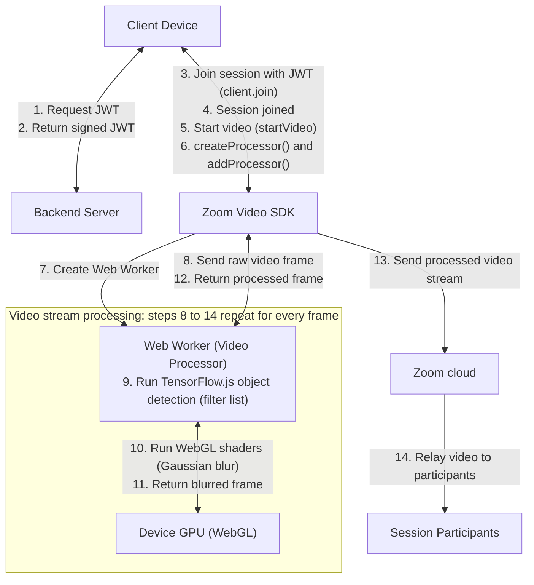
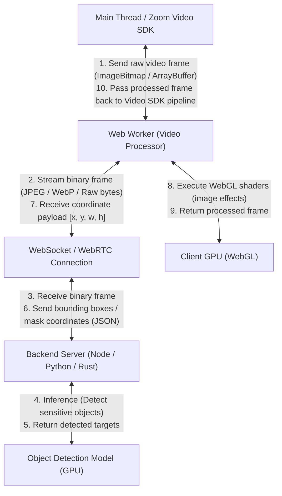

The Zoom Video SDK's video processor feature runs your code in a Web Worker and passes it each raw video frame, on the client. In this blueprint the worker runs an object detection model on the frame, then uses WebGL to blur any detected object that is on a filter list before the video leaves the device.

<YouTube id="jDxPPI-rvwc"/>

**Scenario 1:**
Platforms that feature video and audio streams such as social media and conferencing apps
rely on quick detection of offensive gestures, harmful imagery, sexually exploitative content to 
enforce their TOS guidelines. The inability to identify these actions in real-time can 
decrease application trust, increase harmful behavior, and introduce liability for the
application owners. 

**Scenario 2:**
Companies require anonymous third-party auditors to join their Zoom sessions. This is especially 
valuable in privacy-sensitive environments where outside auditors need visibility into the session 
without identifying or exposing participants, meeting locations, or sensitive objects in the frame. 
 
**What you'll need:**
- A Zoom Video SDK account (free trial credits are available) and its [credentials](https://developers.zoom.us/docs/video-sdk/get-credentials/)
- A backend that signs the session JWT (Node/Express in this guide; any stack works)
- An object detection model that runs in the browser (COCO-SSD on TensorFlow.js in this guide)

## Features
- Real-time object detection in a multi-threaded environment
- Project structure that lets you plug in your own model

<Image src="images/contentmod-shot2.png" alt="Video SDK session where a company logo on a participant's shirt is detected and outlined with a 90% confidence label" />
<Image src="images/contentmod-shot1.png" alt="The same Video SDK session with the detected logo blurred" />

## Architecture
The client requests a JWT from a backend server and passes it to the Zoom Video SDK to join the session. After joining, the client starts its video, then calls `mediaStream.createProcessor()` and `addProcessor()` to create the Web Worker that runs the video processor. From then on the SDK sends each raw video frame to the worker. The worker runs a pre-trained object detection model with TensorFlow.js on the frame and checks the results against the filter list. Detected objects on the list are covered with a Gaussian blur, using WebGL shaders that run on the device GPU. The processed frame goes back to the SDK, which sends it to Zoom, and Zoom relays it to each participant in the session.



## Implementation Guide

The code below is from the [sample repo](https://github.com/zoom/videosdk-web-videoprocessor-contentmoderation). The [Content Moderation Walkthrough](https://developers.zoom.us/blog/content-moderator-with-videosdk-web-processor/) on the Zoom developer blog covers the same app step by step.

### Frontend - Video SDK Configuration
Implement the Video SDK with at least video capabilities for the host and session participants. Request a JWT from your backend before calling `client.join()`. After joining and starting video, call `createProcessor()` to create the video processor and `addProcessor()` to start it.
```ts
const client = ZoomVideo.createClient();
await client.init("en-US", "Global", { patchJsMedia: true });

const startCall = async () => {
    // ask the server which token endpoint to use, since it is the one reading the .env file
    const configResponse = await fetch("/api/config");
    const { endpointUrl } = await configResponse.json();

    // get a token to join the session from the backend, or prompt for one if no endpoint is configured
    let token: string;
    if (endpointUrl) {
        const response = await fetch(endpointUrl, {
            method: "POST",
            headers: { "Content-Type": "application/json" },
            body: JSON.stringify({ sessionName, role }),
        });
        const data = await response.json();
        token = data.token;
    } else {
        token = window.prompt("Enter JWT Token") ?? "";
    }
    // call the renderVideo function whenever a user joins or leaves
    client.on("peer-video-state-change", renderVideo);
    await client.join(sessionName, token, username);
    const mediaStream = client.getMediaStream();
    await mediaStream.startVideo();

    const processor = await mediaStream.createProcessor({
        name: "gl-processor",
        type: "video",
        url: window.location.origin + "/od-quad.js",
    });
    // Add a processor
    await mediaStream.addProcessor(processor);
    // render the video of the current user
    await renderVideo({ action: 'Start', userId: client.getCurrentUserInfo().userId });
};
```
**For production deployments, ensure you are passing a secure https url that you own to the url field in `createProcessor()`**

### Model Integration via Web Worker
The sample's processor is [`public/od-quad.js`](https://github.com/zoom/videosdk-web-videoprocessor-contentmoderation/blob/main/public/od-quad.js). It loads a pre-trained TensorFlow.js port of the COCO-SSD model when the processor starts; nothing is trained. COCO-SSD detects the object classes in the COCO dataset. Any object detection model can run in the Web Worker, but a fast vision model (YOLOv8/v10/v11 nano or small, MobileNet-SSD, and similar) keeps latency low. WebGL moves the image processing to the GPU.

The filter list is an array of COCO class names at the top of the file. The processor blurs up to 10 detected regions per frame whose class is on the list:

```js
const moderationLabels = ['cell phone', 'bottle', 'cup'];
```

Change the list to the classes you want to hide. To detect something COCO-SSD does not know, such as a logo, swap in a model trained for it.


### Server-side implementation strategy
For a server-side approach, one can also offload this processing to a backend server by using a WebSocket or WebRTC connection to send and receive image data. You can also keep the blurring logic on the web worker by having the server only send the bounding boxes / mask JSON coordinates of the detected objects in the processed image. This drastically frees up bandwidth and round-trip latency on the websocket connection. 



### JWT Generation
Use the [Video SDK key and secret](https://developers.zoom.us/docs/video-sdk/get-credentials/) only in the server runtime. The required claims for this application are as follows:

| Claim       | Required value                                                   |
| ----------- | ---------------------------------------------------------------- |
| `app_key`   | Your Zoom Video SDK key                                          |
| `tpc`       | The topic matching the specified 'tpc' in SDK join function      |
| `role_type` | Server-derived `1` for host or `0` for participant               |
| `version`   | `1`                                                              |
| `iat`       | Current server time with a small clock-skew allowance            |
| `exp`       | No more than two hours after issue in this architecture          |

The sample signs the JWT in [`src/server.ts`](https://github.com/zoom/videosdk-web-videoprocessor-contentmoderation/blob/main/src/server.ts) with a function like this:
```ts
function generateSignature(
	sessionName: string,
	role: number,
	expiresInHours: number = 2,
): string {
	const iat = Math.round(new Date().getTime() / 1000) - 30;
	const exp = iat + 60 * 60 * expiresInHours;
	const oHeader = { alg: "HS256", typ: "JWT" };
	const oPayload = {
		app_key: sdkKey,
		tpc: sessionName,
		role_type: role,
		version: 1,
		iat: iat,
		exp: exp,
	};
	const sHeader = JSON.stringify(oHeader);
	const sPayload = JSON.stringify(oPayload);
	const sdkJWT = KJUR.KJUR.jws.JWS.sign("HS256", sHeader, sPayload, sdkSecret!);
	return sdkJWT;
}
```
**Do not expose your credentials to the client. When using the Video SDK in production, use a backend service to sign tokens. Do not store credentials in plain text. The sample app uses a `.env` file for simplicity.**

### Run the Sample

```bash
git clone https://github.com/zoom/videosdk-web-videoprocessor-contentmoderation.git
cd videosdk-web-videoprocessor-contentmoderation
npm install
cp .env.example .env
```

Set `SDK_KEY` and `SDK_SECRET` in `.env` to your Video SDK key and secret, then start the app:

```bash
npm run dev
```

The server listens on `http://localhost:3000` (set `PORT` to change it) and serves both the page and the token endpoint, `POST /zoomtoken`. Set `ENDPOINT_URL=/zoomtoken` in `.env` to have the page fetch its token from that endpoint. Without it, the page prompts for a JWT; generate one with `node generateToken.ts TestSession`, where `TestSession` is the session name set in `src/main.ts`.

Join the session, hold a cup, bottle, or phone up to the camera, and the object is blurred in the video other participants receive.


## App Manifest

Video SDK apps are not configured through a Marketplace app manifest, so this blueprint has no `manifest.json`. The app authenticates with your Video SDK key and secret instead.

## Acceptance Criteria

**General**
- Ensure SDK credentials are not exposed when producing a JWT. Keep token generation off the frontend; store credentials only on the backend and never in plain text.
- Do not log credentials or JWTs.
- Properly implement the [Video SDK Session Lifecycle](https://developers.zoom.us/docs/video-sdk/web/sessions/).
- Release and tear down the web worker.

## Related Resources
- [Content Moderation using Video SDK Processors](https://github.com/zoom/videosdk-web-videoprocessor-contentmoderation)
- [Zoom Video SDK for Web](https://developers.zoom.us/docs/video-sdk/web/) - SDK documentation
- [Zoom Video SDK Agent Skills](https://github.com/zoom/skills/tree/main/skills/video-sdk)
- [Zoom Developer Forum](https://devforum.zoom.us/)
- [Video SDK Session Lifecycle](https://developers.zoom.us/docs/video-sdk/web/sessions/)
