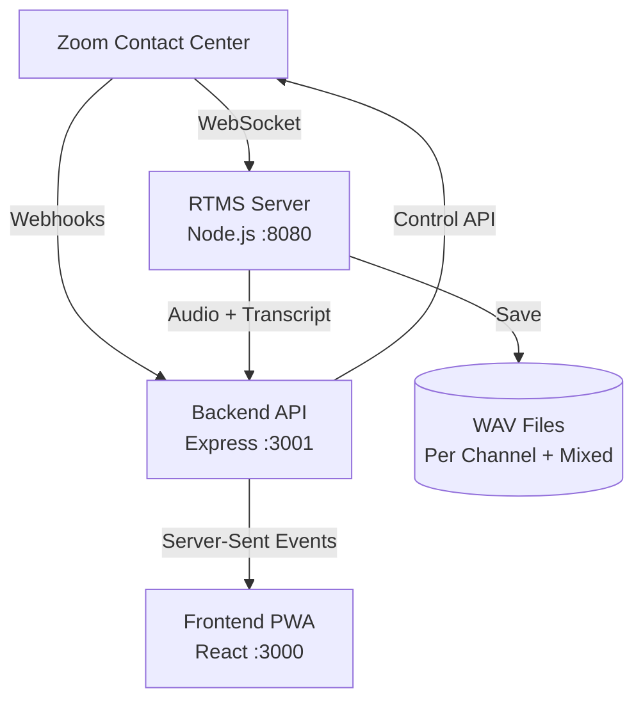

Contact Center admins can monitor active engagements by streaming live audio and transcripts from Zoom Contact Center voice calls to a browser-based dashboard. Quality monitoring typically requires admins to join calls or wait for recordings. Real-time access lets admins catch issues while agents can still course-correct.

<YouTube id="AwosG5X2dCs"/>

<Image src="images/dashboard-preview.png" alt="Engagement dashboard with Start RTMS and Stop RTMS buttons, transfer, conference and BMW counters, hold time, and a call transcript panel" />

**What you'll need:**

- Zoom Contact Center license with admin privileges
- RTMS access via Zoom Contact Center (requires a Contact Center license and [Zoom Developer Pack](https://zoom.us/pricing/developer) credits; free trial credits are available)
- A backend that Zoom can reach to deliver webhooks
- An RTMS media processor to handle WebSocket connections and audio encoding (Node.js)
- A frontend dashboard for supervisors to control capture (React PWA)
- ffmpeg for audio file conversion

## Features

- **Remote RTMS control**: Supervisor-initiated Start/Stop controls from the browser PWA for active engagements
- **Real-time audio playback**: Live audio streamed to browser via Server-Sent Events in near real time
- **Real-time transcript**: Live scrolling transcript display updated every 2 seconds
- **Event tracking**: Real-time counters for transfer, conference, and BMW (Barge/Monitor/Whisper) events
- **Hold tracking**: Live hold time display with total hold count and cumulative hold duration
- **Per-channel WAV files**: Audio saved as 16kHz 16-bit mono WAV per participant channel, merged to stereo on call end

Zoom Contact Center includes native supervisor features for live monitoring. Build custom when you need remote access without joining calls, custom metrics tracking, or integration with your quality assurance tools.

This blueprint uses [Zoom Contact Center RTMS](https://developers.zoom.us/docs/rtms/contact-center/) to access live media streams. Follow along as we walk through the architecture.

---

## Architecture

The application operates as three independent Node.js processes that communicate via HTTP APIs and Server-Sent Events:

### Components

| Component | Responsibility | Stack |
|-----------|----------------|-------|
| **RTMS Server** | Connect to Zoom WebSocket servers, receive audio frames and transcripts, save raw PCM to disk, convert to WAV files, forward live data to backend | Node.js (ES modules) + `ws` + `ffmpeg` + `express` + `axios` |
| **Backend API** | Handle OAuth 2.0 flow, receive Zoom webhooks, control RTMS start/stop, relay audio via SSE, track engagement events, serve frontend | Node.js (CommonJS) + Express + `axios` |
| **Frontend PWA** | Display live dashboard with RTMS controls, play audio via Web Audio API, show real-time transcript, render engagement metrics | React + Zoom Apps SDK + EventSource + Web Audio API |

**Engagement flow:**

1. Zoom fires `contact_center.engagement_started` webhook to the backend, which enables the Start/Stop buttons in the PWA
2. Supervisor clicks "Start RTMS" in the frontend, which calls the backend API
3. Backend invokes Zoom's RTMS control endpoint
4. Zoom sends the `contact_center.voice_rtms_started` webhook containing the signaling server URL (`server_urls`), engagement ID, and stream ID
5. Backend forwards this to the RTMS server
6. RTMS server generates an HMAC-SHA256 signature using client credentials and establishes a WebSocket connection to Zoom's signaling server
7. After the handshake, Zoom provides a media server URL where the RTMS server opens a second WebSocket
8. RTMS server requests its audio format (16kHz mono L16) and transcript preferences in the media handshake
9. RTMS server receives real-time audio frames and transcript messages

**Audio processing:**

- Audio is saved to per-channel raw PCM files
- Audio is forwarded as base64 to the backend for SSE broadcast to browsers
- Audio is converted to WAV when RTMS stops

**Transcript processing:**

- Transcripts are appended to a file per engagement and to a rolling buffer
- Transcripts are forwarded to the backend, which the frontend polls
- Frontend displays the transcript as it arrives



## Implementation Guide

This guide walks through building the three core services and their integration points: the backend (OAuth and webhook processing), the RTMS server (WebSocket media connections and audio capture), and the frontend (live audio playback and supervisor controls). Each section references actual code from the repository to demonstrate authentication, WebSocket handling, and audio processing patterns.

### Project Structure

The monorepo contains three independent Node.js applications with a shared `.env` file:

```
zcc-rtms-pwa-sample-js/
├── backend/              # Express API server (port 3001)
│   ├── server.js        # Main server with OAuth, webhooks, SSE
│   ├── controllers/
│   │   └── zoomController.js  # RTMS control logic
│   ├── helpers/
│   │   ├── zoom-api.js       # Authenticated Zoom API client with token refresh
│   │   └── token-store.js    # In-memory OAuth token storage
│   └── middleware/
│       └── security.js       # Security headers
├── rtms/                # RTMS media processor (port 8080)
│   ├── server.js        # WebSocket client for Zoom RTMS
│   └── audioHelper.js   # WAV file generation and audio processing
├── frontend/            # React PWA (port 3000)
│   └── src/
│       ├── App.js              # Router
│       ├── pages/
│       │   └── DashboardPage.js   # Main control panel
│       ├── hooks/
│       │   ├── useEngagement.js   # Active engagement polling
│       │   ├── useRtms.js         # RTMS control + live audio
│       │   ├── useTranscript.js   # Transcript polling
│       │   ├── useHoldData.js     # Hold tracking
│       │   ├── useEventCounts.js  # Transfer, conference, and BMW counters
│       │   ├── useWebhookEvents.js  # Status message polling
│       │   └── useAuthRedirect.js   # OAuth result message
│       └── utils/
│           └── format.js          # Hold time formatting
└── .env                 # Shared environment configuration
```

### 1. Backend: OAuth and Webhook Processing

The backend handles two trust boundaries: the OAuth 2.0 authorization code exchange that grants API access, and webhook verification that ensures events actually come from Zoom.

#### OAuth token exchange

**Input:** Authorization code from OAuth redirect, client ID, client secret, redirect URI

**Output:** Access token and refresh token stored in memory, user redirected to frontend

**Invariants:**

- Exchange the code as soon as the redirect arrives (codes are short-lived)
- Store the access token, refresh token, and expiry time for automatic renewal
- Use Basic Auth header with client credentials for token exchange
- Redirect to frontend URL after the exchange, with the result in the query string
- Do not log tokens or the authorization code


**Implementation:**

```javascript
// backend/server.js (OAuth callback)
app.get('/api/auth/callback', async (req, res) => {
  const { code } = req.query;

  if (!code) {
    return res.status(400).send('Missing authorization code');
  }

  const redirectUrl = new URL(process.env.FRONTEND_URL || 'http://localhost:3000');

  try {
    const params = new URLSearchParams({
      grant_type: 'authorization_code',
      code,
      redirect_uri: process.env.ZOOM_REDIRECT_URL
    });

    const authHeader = Buffer.from(
      `${process.env.ZOOM_APP_CLIENT_ID}:${process.env.ZOOM_APP_CLIENT_SECRET}`
    ).toString('base64');

    const response = await axios.post('https://zoom.us/oauth/token', params.toString(), {
      headers: {
        'Authorization': `Basic ${authHeader}`,
        'Content-Type': 'application/x-www-form-urlencoded'
      }
    });

    const { access_token, refresh_token, expires_in } = response.data;

    await setTokens({
      accessToken: access_token,
      refreshToken: refresh_token,
      expiresAt: Date.now() + ((expires_in || 3600) * 1000)
    });

    // Redirect to frontend
    redirectUrl.searchParams.set('auth', 'success');
    res.redirect(redirectUrl.toString());
  } catch (error) {
    console.error('OAuth callback error:', error.response?.status, error.message);
    redirectUrl.searchParams.set('auth', 'error');
    res.redirect(redirectUrl.toString());
  }
});
```

#### Endpoint URL validation

When you save the event subscription, and periodically afterward, Zoom sends an `endpoint.url_validation` event to confirm that you control the endpoint.

**Input:** Webhook payload with `plainToken` field, secret token from the Zoom Marketplace app

**Output:** The `plainToken` and its HMAC-SHA256 hash, returned in the response

**Invariants:**

- Use the same secret token shown in your app's event subscription settings
- Generate HMAC-SHA256 hash of the plainToken
- Return both plainToken and encryptedToken in response

**Implementation:**

```javascript
// backend/server.js (endpoint URL validation)
app.post('/api/webhooks/zoom', (req, res) => {
  const { event, payload } = req.body;

  // Handle URL validation
  if (event === 'endpoint.url_validation') {
    if (!payload?.plainToken) {
      return res.status(400).json({ error: 'Missing plainToken' });
    }

    const encryptedToken = crypto
      .createHmac('sha256', process.env.ZOOM_SECRET_TOKEN)
      .update(payload.plainToken)
      .digest('hex');

    return res.json({
      plainToken: payload.plainToken,
      encryptedToken
    });
  }

  // Process other webhook events here
  res.status(200).json({ received: true });
});
```

#### Webhook signature verification

Every other event carries an `x-zm-signature` header. Verify it before acting on the event, as described in [Verify webhook events](https://developers.zoom.us/docs/api/webhooks/#verify-webhook-events).

**Input:** Raw request body, `x-zm-request-timestamp` and `x-zm-signature` headers, secret token

**Output:** The event is processed only if the signature matches

**Invariants:**

- Hash the raw request body, not a re-serialized copy
- Build the message as `v0:{timestamp}:{raw body}` and compare `v0={hash}` with the header
- Compare with a constant-time function, after checking that the lengths match
- Reject requests whose timestamp is more than a few minutes old

**Implementation:**

```javascript
// Keep the raw body so the signature can be checked against it
app.use(express.json({
  verify: (req, _res, buf) => { req.rawBody = buf; }
}));

function isFromZoom(req) {
  const timestamp = req.headers['x-zm-request-timestamp'];
  const signature = req.headers['x-zm-signature'];
  if (typeof timestamp !== 'string' || typeof signature !== 'string' || !req.rawBody) return false;

  // Reject old requests to limit replay
  const ageSeconds = Math.abs(Date.now() / 1000 - Number(timestamp));
  if (!Number.isFinite(ageSeconds) || ageSeconds > 300) return false;

  const expected = 'v0=' + crypto
    .createHmac('sha256', process.env.ZOOM_SECRET_TOKEN)
    .update(`v0:${timestamp}:${req.rawBody}`)
    .digest('hex');

  const a = Buffer.from(expected);
  const b = Buffer.from(signature);
  return a.length === b.length && crypto.timingSafeEqual(a, b);
}

app.post('/api/webhooks/zoom', (req, res) => {
  if (!isFromZoom(req)) {
    return res.status(401).json({ error: 'Invalid signature' });
  }
  // endpoint.url_validation and event handling follow
});
```

### 2. RTMS Server: WebSocket Media Connections

RTMS uses a two-stage WebSocket handshake: first authenticate with a signaling server using HMAC credentials, then connect to a media server to receive audio frames and transcript messages. Each engagement requires fresh connections that must be cleaned up when the call ends.

#### Signaling WebSocket authentication

**Input:** `contact_center.voice_rtms_started` webhook payload with `engagement_id`, `rtms_stream_id`, and `server_urls` (the signaling server URL), plus the client ID and client secret

**Output:** Authenticated WebSocket connection to signaling server, media server URL received in handshake response

**Invariants:**

- Generate HMAC-SHA256 signature using `${CLIENT_ID},${engagement_id},${rtms_stream_id}` as message
- Send handshake message immediately on WebSocket open (msg_type: 1)
- Wait for the msg_type: 2 response with `status_code` 0 before connecting to the media server
- Reply to keep-alive requests (msg_type: 12) with msg_type: 13 on both WebSockets
- Store WebSocket reference for cleanup when RTMS stops

**Implementation:**

```javascript
// rtms/server.js (Signaling WebSocket)
function generateSignature(engagementId, rtmsStreamId) {
  const message = `${CLIENT_ID},${engagementId},${rtmsStreamId}`;
  return crypto
    .createHmac('sha256', CLIENT_SECRET)
    .update(message)
    .digest('hex');
}

function connectToSignalingWebSocket(engagementId, rtmsStreamId, serverUrl, engagementData) {
  const ws = new WebSocket(serverUrl);
  engagementData.signalingWs = ws;

  ws.on('open', () => {
    const handshake = {
      msg_type: 1,
      protocol_version: 1,
      engagement_id: engagementId,
      rtms_stream_id: rtmsStreamId,
      sequence: 0,
      signature: generateSignature(engagementId, rtmsStreamId)
    };
    
    ws.send(JSON.stringify(handshake));
  });

  ws.on('message', (data) => {
    const message = JSON.parse(data.toString());
    
    if (message.msg_type === 2) {
      // Signaling handshake response with the media server URL
      if (message.status_code === 0) {
        const mediaUrl = message.media_server?.server_urls?.audio || message.media_server?.server_urls?.all;
        if (mediaUrl) {
          connectToMediaWebSocket(mediaUrl, engagementId, rtmsStreamId, ws, engagementData);
        }
      } else {
        console.error(`[${engagementId}] Signaling handshake failed:`, message.reason);
      }
    } else if (message.msg_type === 12) {
      // Keep-alive request
      ws.send(JSON.stringify({ msg_type: 13, timestamp: message.timestamp }));
    }
  });
}
```

#### Manual RTMS start and stop control

RTMS capture is supervisor-initiated, not automatic. It starts and stops when the supervisor clicks the Start RTMS and Stop RTMS buttons.

**Input:** Engagement ID, action ("start" or "stop"), OAuth access token

**Output:** RTMS state updated in Zoom, `contact_center.voice_rtms_started` or `contact_center.voice_rtms_stopped` webhook fired

**Invariants:**

- Only call RTMS control when engagement is active (frontend checks `isActive` state)
- Include `client_id` in settings object (Zoom uses this to route RTMS data)
- Refresh the OAuth token before it expires, and on a 401 response refresh and retry once
- Wait for webhook confirmation before attempting WebSocket connection
- Close existing WebSocket connections before starting new RTMS session for same engagement

**Control flow:**

1. Supervisor clicks "Start RTMS" or "Stop RTMS" button in frontend PWA
2. Frontend sends POST to backend `/api/zoom/rtms/control` with the engagement ID and appropriate action
3. Backend calls the Zoom API [`PUT /v2/contact_center/{engagementId}/rtms_app/status`](https://developers.zoom.us/docs/api/contact-center/) with the OAuth access token
4. Zoom responds with a success status
5. Zoom sends the matching RTMS webhook (`contact_center.voice_rtms_started` or `contact_center.voice_rtms_stopped`) to the backend

**Implementation:**

Frontend implementation:

```javascript
// frontend/src/hooks/useRtms.js
export function useRtms(engagementId) {
  const [isRtmsRunning, setIsRtmsRunning] = useState(false);
  const [audioConnected, setAudioConnected] = useState(false);
  const [loading, setLoading] = useState(false);
  const [error, setError] = useState('');

  const handleStart = async () => {
    setLoading(true);
    setError('');

    try {
      const res = await fetch('/api/zoom/rtms/control', {
        method: 'POST',
        headers: { 'Content-Type': 'application/json' },
        credentials: 'include',
        body: JSON.stringify({ engagementId, action: 'start' }),
      });

      const data = await res.json();

      if (res.ok) {
        setIsRtmsRunning(true);
        // Audio stream setup happens here (see section 4)
      } else {
        setError(data.error || 'Failed to start RTMS');
      }
    } catch (err) {
      setError(`Error starting RTMS: ${err.message}`);
    } finally {
      setLoading(false);
    }
  };

  // handleStop sends { engagementId, action: 'stop' } to the same endpoint,
  // then closes the EventSource and the AudioContext

  return { isRtmsRunning, audioConnected, loading, error, handleStart, handleStop };
}
```

Backend implementation:

```javascript
// backend/controllers/zoomController.js
async function handleRtmsControl(req, res) {
  const { engagementId, action } = req.body;

  if (!engagementId || !action) {
    return res.status(400).json({ error: 'Missing engagementId or action' });
  }

  if (action !== 'start' && action !== 'stop') {
    return res.status(400).json({ error: 'Action must be "start" or "stop"' });
  }

  const tokens = await getTokens();
  if (!tokens.accessToken) {
    return res.status(401).json({ error: 'Not authenticated' });
  }

  try {
    // zoomApiRequest adds the access token and refreshes it when needed
    const data = await zoomApiRequest({
      method: 'PUT',
      url: `https://api.zoom.us/v2/contact_center/${encodeURIComponent(engagementId)}/rtms_app/status`,
      headers: { 'Content-Type': 'application/json' },
      data: {
        action,
        settings: { client_id: process.env.ZOOM_APP_CLIENT_ID }
      }
    }, tokens);

    res.json({ success: true, action, engagementId, data });
  } catch (error) {
    console.error(`RTMS ${action} failed:`, error.response?.data || error.message);
    res.status(error.response?.status || 500).json({
      error: `Failed to ${action} RTMS`,
      code: error.response?.data?.code
    });
  }
}
```

#### Media WebSocket audio processing

**Input:** Media server WebSocket URL, audio format preferences, transcript language preferences

**Output:** Real-time audio frames and transcript messages processed, saved to disk, and forwarded to backend

**Invariants:**

- Send the media handshake (msg_type: 3) immediately on WebSocket open, with the same signature as the signaling handshake
- After a successful media handshake response (msg_type: 4), send the client ready acknowledgment (msg_type: 7) on the signaling WebSocket
- Audio arrives as msg_type 14 and transcripts as msg_type 17; each participant's audio has its own `channel_id`
- Base64-decode audio data before appending it to that channel's raw PCM file
- Forward only one channel's audio to the backend for live playback (avoid overlapping streams)
- Append every transcript to the engagement's transcript file and forward its text to the backend

**Implementation:**

```javascript
// rtms/server.js (media WebSocket handler)
ws.on('message', (data) => {
  const message = JSON.parse(data.toString());

  if (message.msg_type === 14) {
    // Audio frame
    const audioBuffer = Buffer.from(message.content.data, 'base64');
    const channelId = message.content.channel_id;

    if (!engagementData.channelPaths.has(channelId)) {
      const rawPath = getChannelRawPath(engagementData.sessionDir, channelId);
      const wavPath = getChannelWavPath(engagementData.sessionDir, channelId);
      engagementData.channelPaths.set(channelId, { rawPath, wavPath });
    }

    // Save to this channel's raw PCM file
    saveRawAudio(audioBuffer, engagementData.channelPaths.get(channelId).rawPath);

    // Forward to backend for live playback (first channel only)
    if (engagementData.streamChannelId === null) {
      engagementData.streamChannelId = channelId;
    }

    if (channelId === engagementData.streamChannelId) {
      sendAudioChunk(message.content.data);  // Forward base64 to backend
    }
  } else if (message.msg_type === 17) {
    // Transcript
    const text = message.content.data;
    saveTranscript(engagementId, text);
    sendTranscriptLine(engagementId, text);
  } else if (message.msg_type === 12) {
    // Keep-alive request
    ws.send(JSON.stringify({ msg_type: 13, timestamp: message.timestamp }));
  }
});
```

### 3. Audio File Generation

Audio arrives as raw PCM data that is saved incrementally during streaming, then converted to WAV format after RTMS stops. ffmpeg converts each channel, and the two channels are interleaved into one stereo file.

#### Raw PCM to WAV conversion

**Input:** Raw PCM files per channel, engagement session directory, channel IDs

**Output:** Per-channel WAV files, interleaved stereo `mixed.wav` file combining the first two channels

**Invariants:**

- Create unique session directory per engagement using timestamp
- Append audio data to raw PCM files during streaming (don't buffer in memory)
- Convert raw PCM to WAV only after RTMS stops and the write streams are closed (prevents file corruption)
- Pass file paths to ffmpeg as arguments, not inside a shell command string
- For `mixed.wav`, interleave the first two channels sample by sample (left, right) and write a WAV header
- If only one channel exists, write it to `mixed.wav` as mono
- Delete raw PCM files after successful WAV conversion (optional)

**Implementation:**

```javascript
// rtms/audioHelper.js
import fs from 'fs';
import path from 'path';
import { execFile } from 'child_process';
import { promisify } from 'util';

const execFileAsync = promisify(execFile);

// Open write streams keyed by file path
const writeStreams = new Map();

export function getChannelRawPath(sessionDir, channelId) {
  return path.join(sessionDir, `channel_${channelId}.raw`);
}

export function saveRawAudio(chunk, rawPath) {
  fs.mkdirSync(path.dirname(rawPath), { recursive: true });

  let stream = writeStreams.get(rawPath);
  if (!stream) {
    stream = fs.createWriteStream(rawPath, { flags: 'a' });
    writeStreams.set(rawPath, stream);
  }
  stream.write(chunk);
}

export async function convertRawToWav(rawPath, wavPath) {
  // ffmpeg: raw 16kHz 16-bit mono L16 → WAV
  await execFileAsync('ffmpeg', ['-y', '-f', 's16le', '-ar', '16000', '-ac', '1', '-i', rawPath, wavPath]);
}

// Interleave two mono 16-bit PCM buffers into stereo L-R-L-R...
export function interleaveStereo(left, right) {
  const nSamples = Math.max(Math.floor(left.length / 2), Math.floor(right.length / 2));
  const result = Buffer.alloc(nSamples * 4, 0);
  for (let i = 0; i < nSamples; i++) {
    const off = i * 4;
    if (i * 2 + 1 < left.length) left.copy(result, off, i * 2, i * 2 + 2);
    if (i * 2 + 1 < right.length) right.copy(result, off + 2, i * 2, i * 2 + 2);
  }
  return result;
}
```

`finalizeInterleavedWav` in the same file reads the per-channel raw files, calls `interleaveStereo`, and writes `mixed.wav` with a 44-byte WAV header.

### 4. Frontend: Live Media Rendering

Supervisors need to experience the engagement as it happens. This means hearing the conversation in real time, reading the transcript as words are spoken, and watching metrics update live. The frontend achieves this through three independent data streams: Server-Sent Events for audio, HTTP polling for transcript and metrics, and client-side calculations for smooth visual updates.

#### Server-Sent Events audio streaming

Audio playback is the most time-sensitive of the live data streams. Server-Sent Events (SSE) provide a one-way persistent connection from backend to browser, which suits streaming audio chunks as they arrive from the RTMS server. The Web Audio API handles playback scheduling, so audio plays without gaps even when chunks arrive with slight timing variations.

**Input:** Base64-encoded L16 audio chunks via SSE, Web Audio API context

**Output:** Near real-time audio playback in the browser

**Invariants:**

- Initialize AudioContext only when RTMS starts, from the button click (avoids autoplay policy issues)
- Decode base64 to Uint8Array, then to Int16Array (L16 format)
- Normalize Int16 samples to Float32 range [-1, 1] by dividing by 32768
- Create new AudioBuffer for each chunk with correct sample rate (16000 Hz)
- Schedule each chunk to start when the previous one ends, keeping a small lead over the current time
- Close the EventSource connection and the AudioContext when RTMS stops (prevents memory leaks)
- Handle EventSource `onerror` to detect disconnections and update UI

**Implementation:**

```javascript
// frontend/src/hooks/useRtms.js (audio streaming, inside handleStart)
const ctx = new AudioContext({ sampleRate: 16000 });
audioCtxRef.current = ctx;
nextPlayTimeRef.current = ctx.currentTime + 0.2;

// Open Server-Sent Events connection
const es = new EventSource('/api/rtms/audio/stream');
audioSourceRef.current = es;
es.onopen = () => setAudioConnected(true);
es.onerror = () => setAudioConnected(false);

es.onmessage = (event) => {
  const { data: b64 } = JSON.parse(event.data);

  // Decode base64 → Int16Array → Float32Array
  const binary = atob(b64);
  const bytes = new Uint8Array(binary.length);
  for (let i = 0; i < binary.length; i++) bytes[i] = binary.charCodeAt(i);

  const int16 = new Int16Array(bytes.buffer);
  const float32 = new Float32Array(int16.length);
  for (let i = 0; i < int16.length; i++) float32[i] = int16[i] / 32768;  // Normalize to [-1, 1]

  // Create audio buffer
  const buf = ctx.createBuffer(1, float32.length, 16000);
  buf.getChannelData(0).set(float32);

  const source = ctx.createBufferSource();
  source.buffer = buf;
  source.connect(ctx.destination);

  // Schedule this chunk right after the previous one
  const now = ctx.currentTime;
  if (nextPlayTimeRef.current < now + 0.05) nextPlayTimeRef.current = now + 0.05;
  source.start(nextPlayTimeRef.current);
  nextPlayTimeRef.current += buf.duration;
};
```

#### Live transcript display with auto-scroll

Transcript data arrives from Zoom in segments, gets forwarded from the RTMS server to the backend, and needs to appear in the browser with minimal delay. Transcripts use simple HTTP polling every 2 seconds. The auto-scroll behavior keeps the most recent text visible.

**Input:** Transcript endpoint that returns an array of `{ text, timestamp }` objects

**Output:** Real-time transcript display with auto-scroll behavior

**Invariants:**

- Poll backend every 2 seconds (balances responsiveness with API load)
- Auto-scroll the transcript box to the bottom when the transcript updates
- Store transcript lines in state array
- The backend clears the transcript lines when a new engagement starts
- Use `useRef` for scroll container to access DOM node

**Implementation:**

```javascript
// frontend/src/hooks/useTranscript.js
export function useTranscript() {
  const [transcript, setTranscript] = useState([]);
  const transcriptBoxRef = useRef(null);

  useEffect(() => {
    const fetchTranscript = async () => {
      try {
        const res = await fetch('/api/engagement/transcript');
        setTranscript(await res.json());
      } catch (err) {
        console.error('Error fetching transcript:', err);
      }
    };
    
    fetchTranscript();
    const interval = setInterval(fetchTranscript, 2000);
    return () => clearInterval(interval);
  }, []);

  // Auto-scroll to bottom when transcript updates
  useEffect(() => {
    if (transcriptBoxRef.current) {
      transcriptBoxRef.current.scrollTop = transcriptBoxRef.current.scrollHeight;
    }
  }, [transcript]);

  return { transcript, transcriptBoxRef };
}
```

#### Live hold tracking and event counters

Engagement metrics like hold duration, transfer count, and BMW events provide monitoring context. Hold tracking is the most time-sensitive: when an agent places a customer on hold, the supervisor needs to see a live ticking timer. The backend keeps the hold state from the `contact_center.engagement_user_hold` and `contact_center.engagement_user_unhold` webhooks (hold count, total hold time, and when the current hold started). The browser polls that state every 2 seconds and, while a hold is in progress, recalculates the displayed time every second.

**Input:** Contact Center webhook events, HTTP polling endpoints for frontend retrieval

**Output:** Live updating metrics displayed in dashboard

**Invariants:**

- Poll the hold endpoint every 2 seconds
- While on hold, calculate the displayed duration client-side every second: total hold time plus the time since the current hold started
- Display hold timer in MM:SS format for readability
- Poll event counts every 2 seconds (transfers, conferences, BMW events)
- Reset all counters when engagement ends

**Implementation:**

```javascript
// frontend/src/hooks/useHoldData.js
export function useHoldData() {
  const [holdCount, setHoldCount] = useState(0);
  const [totalHoldMs, setTotalHoldMs] = useState(0);
  const [isOnHold, setIsOnHold] = useState(false);
  const [holdStartedAt, setHoldStartedAt] = useState(null);
  const [liveHoldMs, setLiveHoldMs] = useState(0);

  useEffect(() => {
    const fetchHold = async () => {
      try {
        const res = await fetch('/api/engagement/hold');
        const data = await res.json();
        setHoldCount(data.count);
        setIsOnHold(data.isOnHold);
        setTotalHoldMs(data.totalHoldMs);
        setHoldStartedAt(data.holdStartedAt);
      } catch (err) {
        console.error('Error fetching hold data:', err);
      }
    };

    fetchHold();
    const interval = setInterval(fetchHold, 2000);
    return () => clearInterval(interval);
  }, []);

  // Tick every second while on hold
  useEffect(() => {
    if (!isOnHold || !holdStartedAt) {
      setLiveHoldMs(totalHoldMs);
      return;
    }

    const update = () => setLiveHoldMs(totalHoldMs + (Date.now() - holdStartedAt));
    update();
    const interval = setInterval(update, 1000);
    return () => clearInterval(interval);
  }, [isOnHold, holdStartedAt, totalHoldMs]);

  return { holdCount, totalHoldMs, isOnHold, holdStartedAt, liveHoldMs };
}
```

### 5. Run the Sample

This section walks through starting all three services (frontend, backend, RTMS server) locally, exposing the backend via ngrok for webhook delivery, and configuring the Zoom Marketplace app.

**Prerequisites:**

- Node.js ≥ 18.0.0
- ffmpeg installed (`brew install ffmpeg` on macOS)
- ngrok account for webhook delivery
- Zoom Contact Center account with [Zoom Developer Pack](https://zoom.us/pricing/developer) credits for RTMS

**Quick Start:**

```bash
# Clone and install
git clone https://github.com/zoom/zcc-rtms-pwa-sample-js
cd zcc-rtms-pwa-sample-js
npm run install:all

# Configure environment
cp .env.example .env
# Edit .env with your Zoom app credentials

# Start all services
npm start
# Frontend: http://localhost:3000
# Backend: http://localhost:3001
# RTMS: http://localhost:8080

# In separate terminal, expose backend with ngrok
npm run ngrok
# Copy the HTTPS URL and update .env:
#   PUBLIC_URL=https://YOUR_ID_HERE.ngrok-free.app
#   FRONTEND_URL=https://YOUR_ID_HERE.ngrok-free.app
#   ZOOM_REDIRECT_URL=https://YOUR_ID_HERE.ngrok-free.app/api/auth/callback
# Restart: Ctrl+C, then npm start

# Configure Zoom Marketplace app with ngrok URL
# Install app via OAuth to authorize
# Start a Contact Center voice call
# Click "Start RTMS" in the PWA
```

**Environment Variables:**

Required in `.env`:

- `ZOOM_APP_CLIENT_ID`: from Zoom Marketplace app credentials
- `ZOOM_APP_CLIENT_SECRET`: from Zoom Marketplace app credentials
- `ZOOM_SECRET_TOKEN`: the secret token from the app's event subscription settings
- `PUBLIC_URL`: ngrok HTTPS URL (e.g. `https://YOUR_ID_HERE.ngrok-free.app`)
- `FRONTEND_URL`: the same ngrok URL; the backend proxies the frontend and redirects here after OAuth
- `ZOOM_REDIRECT_URL`: `${PUBLIC_URL}/api/auth/callback`
- `BACKEND_URL`: URL the RTMS server uses to reach the backend (`http://localhost:3001` locally)
- `RTMS_SERVER_URL`: URL the backend uses to reach the RTMS server (`http://localhost:8080` locally)

## App Manifest

This application requires a Zoom Marketplace **General App** configured as **admin-managed** to receive Contact Center engagement lifecycle events. For quick set-up, use the manifest.json file. 

**Scopes:**

| Scope | Why it's needed |
|-------|-----------------|
| `contact_center:read:zcc_voice_audio` | Receive live audio from Contact Center voice engagements through RTMS |
| `contact_center:read:zcc_voice_transcript` | Receive live transcripts from Contact Center voice engagements through RTMS |
| `contact_center:update:engagement_rtms_app_status` | Start and stop RTMS for an engagement through the REST API |

The first two are RTMS media scopes. Add them under **Scopes** > **+ Add Scopes**, as described in [Add Realtime Media Streams features to your app](https://developers.zoom.us/docs/rtms/contact-center/add-features/).

**Event Subscription:**

Under **Access**, turn on **Event Subscription** and set:

- Method: **Webhook**
- Event notification endpoint URL: `https://YOUR_NGROK_URL_HERE.ngrok-free.app/api/webhooks/zoom`
- Secret Token: copy to `.env` as `ZOOM_SECRET_TOKEN`

| Event | Used for |
|-------|----------|
| `contact_center.engagement_started` | Enables the Start RTMS and Stop RTMS buttons |
| `contact_center.engagement_ended` | Resets engagement state and counters |
| `contact_center.engagement_user_hold` | Hold count and hold timer |
| `contact_center.engagement_user_unhold` | Hold timer and total hold time |
| `contact_center.voice_rtms_started` | Opens the RTMS WebSocket connections |
| `contact_center.voice_rtms_stopped` | Closes the connections and converts audio to WAV |
| `contact_center.engagement_transfer_initiated` | Transfer tracking |

**Contact Center Configuration:**

- In the Zoom Contact Center admin portal, assign the app to the queues whose engagements supervisors will monitor. See [Configuring Zoom Apps for Zoom Contact Center](https://support.zoom.com/hc/en/article?id=zm_kb&sysparm_article=KB0075271).
- Leave auto-start off for those queues (capture is supervisor-initiated via the PWA)
- Ensure the app is **admin-managed** so the engagement events are delivered

**OAuth Flow:**

The app uses authorization code flow with automatic token refresh:

1. User clicks "Add App" in Zoom Marketplace Local Test menu
2. Zoom redirects to app with authorization code
3. Backend exchanges code for access + refresh tokens at `POST https://zoom.us/oauth/token`
4. Tokens stored in memory (cleared on backend restart)
5. Tokens automatically refreshed when access token expires

## Acceptance Criteria

**Access control**
- Only an authenticated supervisor can call `/api/zoom/rtms/control`, open `/api/rtms/audio/stream`, or read the transcript, hold, and event count endpoints.
- The endpoints the RTMS server posts to (`/api/rtms/audio`, `/api/rtms/transcript`, `/api/rtms/status`) accept requests only from the RTMS server.
- OAuth tokens, the client secret, and the webhook secret token stay on the backend and never appear in logs.

**Webhooks**
- `endpoint.url_validation` returns the `plainToken` and its HMAC-SHA256 hash.
- Every other event is rejected unless its `x-zm-signature` matches.
- The backend responds to each webhook right away and forwards RTMS events to the RTMS server asynchronously.

**RTMS**
- Starting RTMS for an active engagement results in `contact_center.voice_rtms_started`, a signaling connection, and a media connection.
- Keep-alive requests are answered on both WebSockets.
- Stopping RTMS, or the engagement ending, closes both WebSockets and finalizes the audio files.

**Dashboard**
- Live audio starts after the supervisor clicks Start RTMS and stops when they click Stop RTMS.
- The transcript, hold timer, and counters update while the engagement is active and reset when it ends.

**Data handling**
- Audio and transcript content is not written to application logs.
- Saved audio and transcript files have restricted access and a defined retention period.

## Related Resources

- [Sample repository](https://github.com/zoom/zcc-rtms-pwa-sample-js)
- [Realtime Media Streams for Contact Center](https://developers.zoom.us/docs/rtms/contact-center/)
- [Add Realtime Media Streams features to your app](https://developers.zoom.us/docs/rtms/contact-center/add-features/)
- [Working with streams](https://developers.zoom.us/docs/rtms/contact-center/work-with-streams/)
- [Failover and reconnection](https://developers.zoom.us/docs/rtms/contact-center/failover-reconnection/)
- [Verify webhook events](https://developers.zoom.us/docs/api/webhooks/#verify-webhook-events)
