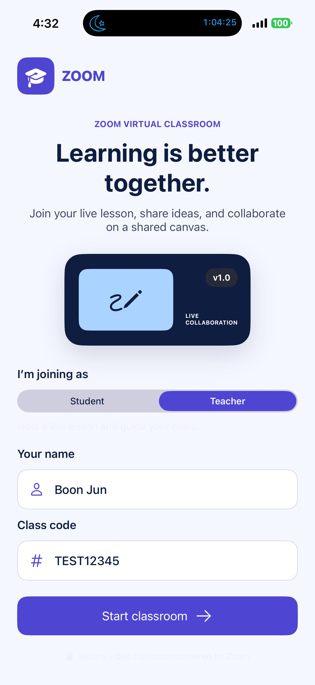
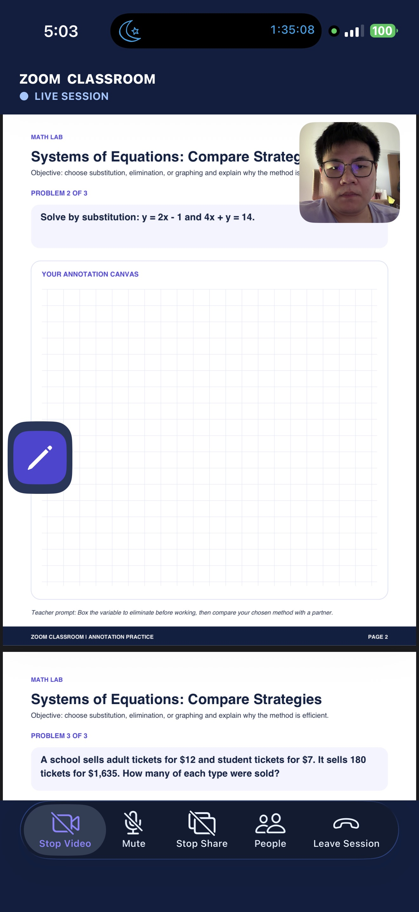
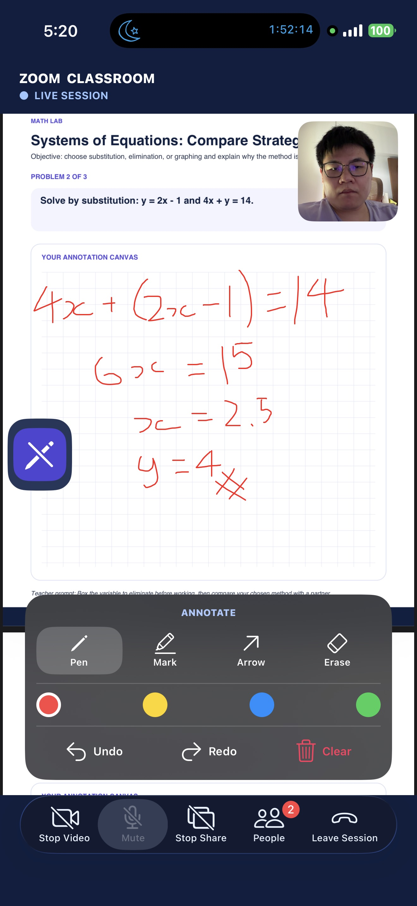
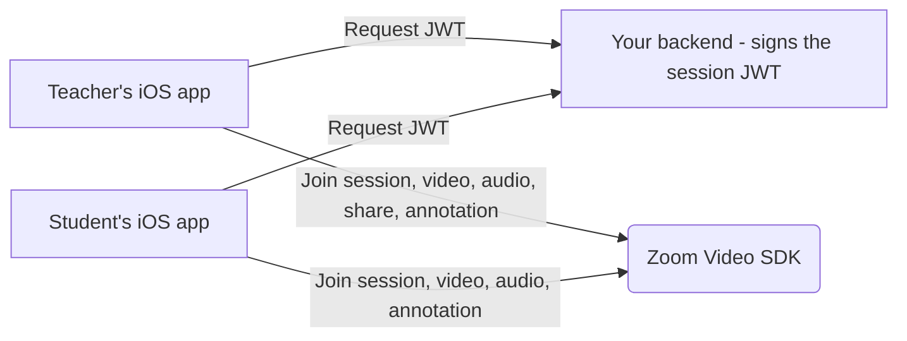
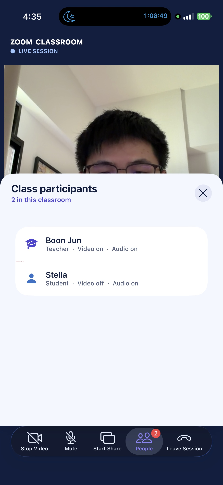

An interactive virtual classroom app built with the Zoom Video SDK for iOS. Live screen sharing and annotation tools give teachers and students a shared visual workspace, so they can collaborate through real-time annotations without leaving your platform.

Remote learning often falls apart at exactly this moment: the teacher is explaining something on screen, but students have no way to point, highlight, or annotate what they're seeing. Switching to a separate whiteboard tool breaks the flow and severs the real-time connection between explanation and markup.

**What you'll need:**

- A Zoom Video SDK account and its SDK key and secret ([get credentials](https://developers.zoom.us/docs/video-sdk/get-credentials/))
- Xcode and an Apple developer account to build and run on devices
- At least two iPhones or iPads running iOS 15.6 or later (video does not work in the iOS Simulator)

## Features

- **Screen sharing**: Broadcast the teacher's screen or any in-app content view to all participants in real time
- **Live annotation**: Renders a synchronized annotation canvas overlaid on the shared screen, visible to all participants
- **Annotation tools**: Pen, highlighter, arrow, and eraser, with four colors so contributions are easy to tell apart, plus undo, redo, and clear all
- **In-session controls**: Camera, microphone, sharing, participants, and leave in one tab bar

<div align="center">
  
  
  
</div>

**See it in action:**

<YouTube id="lwNA4Yj-G5Q" />

---

## Architecture

Each device runs the same iOS app. The app joins a Video SDK session with a JWT, and the Zoom Video SDK carries video, audio, the shared screen, and annotations between the devices. In production your backend signs the JWT, so the SDK secret never ships in the app.



### Components

| Component | Responsibility |
|-----------|----------------|
| **Zoom Video SDK** | Handles video, audio, screen sharing, annotation, and participant state |
| **iOS app (UIKit)** | Displays participants' video, the shared screen, and annotations; manages audio controls and the participant list |
| **JWT signer** | Signs the session JWT with the SDK key and secret. A backend service in production; a local script in the sample |

## Implementation Guide

This guide shows how to build a UIKit-based virtual classroom using the Zoom Video SDK for iOS. The app collects a participant’s (teacher or student) display name and class code, joins a Video SDK session, renders everyone's video and audio, shares either the app screen or a bundled sample maths handout, and exposes Zoom’s live annotation tools in a classroom-oriented interface.

| File | Responsibility |
|------|----------------|
| `StartViewController.swift` | Collects the participant's name and class code, initializes the SDK, and opens the session screen. |
| `SessionViewController.swift` | Owns the Video SDK session lifecycle, video/audio/share controls, and SDK delegate callbacks. |
| `SessionViewControllerExtension.swift` | Builds the classroom UI, participant sheet, PDF sharing, and annotation controls. |
| `Scripts/JWTGenerator.swift` | A command-line JWT generator for starting or joining a Video SDK session during development. |
| `Linear_Equations_Annotation_Lab.pdf`, `Quadratic_Functions_Challenge.pdf`, `Systems_of_Equations_Investigation.pdf` | Sample PDF files for screen sharing and annotation. |

### Part 1: Start the application in StartViewController

`StartViewController` is the initial classroom entry screen. It owns the two user inputs that define a lesson (session) join.

```swift
private let nameField = UITextField()
private let classCodeField = UITextField()
```

The name becomes the Video SDK display name. The class code becomes the Video SDK session name. 

The controller initializes the Video SDK by calling `setupSDK()` in `viewDidLoad()`:

```swift
override func viewDidLoad() {
    super.viewDidLoad()
    setupAppearance()
    setupLayout()
    updateRoleCopy()
    setupSDK()
}
```

`setupSDK()` configures the Zoom domain and initializes the Video SDK instance:

```swift
private func setupSDK() {
    let initParams = ZoomVideoSDKInitParams()
    initParams.domain = "zoom.us"

    let status = ZoomVideoSDK.shareInstance()?.initialize(initParams)

    if status != .Errors_Success {
        print("SDK initialization failed: \(String(describing: status))")
    }
}
```

### Part 2: Collect classroom details, validate and hand off to SessionViewController

The session JWT is generated from three pieces of information:
- Role: Student (`role_type` 0, participant) or Teacher (`role_type` 1, host; once a host exists, others who join with role 1 become managers)
- Username (display name)
- Class code (the `tpc` claim)

The `roleControl` changes the message and button label shown in the UI:

```swift
private let roleControl = UISegmentedControl(items: ["Student", "Teacher"])
```

The Video SDK determines actual host and participant privileges from the JWT used to join the session, not from the selected segment. The SDK later exposes those privileges through `ZoomVideoSDKUser.isHost()`.

In production, sign the JWT with a backend service. For development, `Scripts/JWTGenerator.swift` generates one from the command line (see [Run the Sample](#last-step-run-the-sample)). The class code entered in the app must match the session name used to generate the JWT.

`StartViewController` then hands the name and class code to a new `SessionViewController`, which uses them to start or join the session.

```swift
@IBAction private func enterButtonTapped(_: UIButton) {
    view.endEditing(true)

    let enteredName = nameField.text?
        .trimmingCharacters(in: .whitespacesAndNewlines) ?? ""

    let enteredSessionName = classCodeField.text?
        .trimmingCharacters(in: .whitespacesAndNewlines) ?? ""

    guard !enteredName.isEmpty, !enteredSessionName.isEmpty else {
        let alert = UIAlertController(
            title: "Complete your details",
            message: "Enter both your name and class code to join the classroom.",
            preferredStyle: .alert
        )
        alert.addAction(UIAlertAction(title: "OK", style: .default))
        present(alert, animated: true)
        return
    }

    let sessionViewController = SessionViewController()
    sessionViewController.username = enteredName
    sessionViewController.sessionname = enteredSessionName
    sessionViewController.modalPresentationStyle = .fullScreen

    present(sessionViewController, animated: false)
}
```

<div align="center">
  
</div>

### Part 3: Join the classroom

`SessionViewController.swift` receives the values from the entry screen.

When the controller appears, `presentJWTAlert()` is called from `viewDidAppear(_:)`. For the demo, you can paste a generated JWT into the alert, which stores it in `userInputJWT`. Alternatively, set the `jwtToken` constant in code; `joinSession()` uses it whenever it is not empty. In production, fetch the JWT from your backend service instead.

```swift
let jwtToken = ""        // In the sample this is the Xcode placeholder <#JWT#>; replace it before building
var sessionname = ""
var username = ""
var userInputJWT = ""
```

`joinSession()` then creates a `ZoomVideoSDKSessionContext`:

```swift
func joinSession() {
    let sessionContext = ZoomVideoSDKSessionContext()
    sessionContext.token = jwtToken.isEmpty ? userInputJWT : jwtToken
    sessionContext.sessionName = sessionname
    sessionContext.userName = username

    if ZoomVideoSDK.shareInstance()?.joinSession(sessionContext) == nil {
        showError(message: "Failed to join session", dismiss: true)
    }
}
```

The JWT must contain a `tpc` claim that exactly matches `sessionname`. If a student or teacher enters `ALGEBRA101`, the JWT must be generated with `ALGEBRA101` as its session name. The class code field capitalizes letters as you type.

`Scripts/JWTGenerator.swift` creates a development JWT with the required claims. The token is valid for two hours:

```swift
let payload: [String: Any] = [
    "app_key": sdkKey,
    "tpc": sessionName,
    "role_type": role,
    "version": 1,
    "iat": iat,
    "exp": exp
]
```

For production, generate and sign JWTs on a backend service. Do not embed SDK secrets in the iOS app or commit long-lived JWTs.

Output: The SDK invokes `onSessionJoin()` after the participant has joined successfully.

### Part 4: Build the classroom after joining

`SessionViewController` registers as the Zoom Video SDK delegate in `viewDidLoad()`:

```swift
override func viewDidLoad() {
    super.viewDidLoad()
    setupUI()
    ZoomVideoSDK.shareInstance()?.delegate = self
}
```

The UI setup is implemented in `MyVideoSDKApp/SessionViewControllerExtension.swift`:

```swift
func setupUI() {
    setupViews()
    setupConstraints()
    setupTabBar()
    setupAnnotationPanel()
    setupParticipantsPanel()
}
```

`setupUI()` composes the session screen from these persistent views:
- `sessionHeader`: Classroom identity and live-state header.
- `scrollView` and `videoStackView`: Camera grid.
- `sharerView`: Remote participant’s shared content.
- `sharedPDFView`: The sharer's PDF presentation surface.
- `localViewDuringShare`: Floating local picture-in-picture tile.
- `tabBar`: Camera, microphone, sharing, participants, and leave controls.
- `annotationPanel`: Annotation tools shown only when drawing is active.
- `participantsPanel`: Bottom sheet containing `participantsTableView`.

The app uses this view hierarchy:

```
SessionViewController.view
├── sessionHeader
├── scrollView
│   └── videoStackView
├── sharerView / sharedPDFView
├── localViewDuringShare
├── shareBtnStackView
├── annotationPanel
├── participantsPanel
└── tabBar
```

After the SDK joins the session, `onSessionJoin()` creates the local classroom view:

```swift
func onSessionJoin() {
    addLocalViewToGrid()
    actualLocalViewDuringShare = addLocalViewDuringShare()
    loadingLabel.isHidden = true
    tabBar.isHidden = false
    refreshParticipants()
}
```

The local camera canvas is attached to `localView`. A second square preview is attached to `localViewDuringShare`, which remains visible while a user is sharing content.

In the same callback, the host unlocks sharing and limits the session to one share at a time. Until a host has joined, the share button reads "Share Locked".

```swift
if let localUserIsHost = ZoomVideoSDK.shareInstance()?.getSession()?.getMySelf()?.isHost(), localUserIsHost {
    ZoomVideoSDK.shareInstance()?.getShareHelper()?.enableMultiShare(false)
    ZoomVideoSDK.shareInstance()?.getShareHelper()?.lockShare(false)
}
```

### Part 5: Render remote participants and maintain the participants list

When another user (teacher or student) joins, `onUserJoin(_:users:)` creates a tile and subscribes the SDK canvas:

```swift
remoteUserVideoCanvas.subscribe(
    with: views.view,
    aspectMode: .panAndScan,
    andResolution: ._Auto
)
```

The controller tracks each tile in:

```swift
var remoteUserViews: [Int: (view: UIView, placeholder: UIView)] = [:]
```

This gives the app a reliable way to unsubscribe and remove UI when `onUserLeave(_:users:)` fires.

The People tab is backed by:

```swift
var participants: [ZoomVideoSDKUser] = []
```

`refreshParticipants()` rebuilds the roster from the session’s current users:

```swift
participants = ([myself] + (session.getRemoteUsers() ?? [])).sorted {
    participantRoleRank($0) < participantRoleRank($1)
}
```

Hosts and managers rank first and are labelled Teacher. Other users are labelled Student.

Call `refreshParticipants()` whenever user state changes. The sample already does this for joins, leaves, video changes, audio changes, name changes, host changes, and manager changes.

<div align="center">
  
</div>

### Part 6: Control video, audio, sharing, and participants

The bottom tab bar uses `ControlOption`:

```swift
enum ControlOption: Int {
    case toggleVideo, toggleAudio, toggleShare, participants, leaveSession
}
```

`tabBar(_:didSelect:)` routes each item to its matching action:

```swift
switch item.tag {
case ControlOption.toggleVideo.rawValue:
    handleVideoToggle(tabBar)
case ControlOption.toggleAudio.rawValue:
    handleAudioToggle(tabBar)
case ControlOption.toggleShare.rawValue:
    handleShareToggle(tabBar)
case ControlOption.participants.rawValue:
    toggleParticipantsPanel()
case ControlOption.leaveSession.rawValue:
    ZoomVideoSDK.shareInstance()?.leaveSession(false)
default:
    break
}
```

`handleVideoToggle(_:)` uses `ZoomVideoSDKVideoHelper` to start or stop the camera. `handleAudioToggle(_:)` uses `ZoomVideoSDKAudioHelper` to start, mute, or unmute audio.

### Part 7: Share the app or a bundled lesson

Sharing is represented by `ShareSelection`:

```swift
enum ShareSelection {
    case InAppScreenShare
    case ShareWithView
}
```

`handleShareToggle(_:)` first checks for a conflicting active share and validates that in-app screen sharing is available. It then offers two choices:

- **InAppScreenShare**: shares the app screen
- **Choose Math Lab PDF**: shares one of the bundled handouts

`handleShareSelection(with:)` starts the appropriate share mode:

```swift
switch chosenShare {
case .InAppScreenShare:
    error = shareHelper.startInAppScreenShare()

case .ShareWithView:
    openBundledPDF()
    error = shareHelper.startShare(with: sharedPDFView)
}
```

The PDF route uses `presentLessonPicker()` to select one of the bundled resources:

```swift
let lessons = [
    ("Linear Equations", "Linear_Equations_Annotation_Lab"),
    ("Quadratic Functions", "Quadratic_Functions_Challenge"),
    ("Systems of Equations", "Systems_of_Equations_Investigation")
]
```

`openBundledPDF()` resolves `selectedLessonPDF` from the main bundle, creates a `PDFDocument`, and assigns it to `sharedPDFView`.

```swift
sharedPDFView.autoScales = true
sharedPDFView.document = pdfDoc
sharedPDFView.isHidden = false
```

`onUserShareStatusChanged(_:user:shareAction:)` updates the UI as sharing starts or stops. Local shares reveal the floating pencil button. Remote shares subscribe the incoming share canvas to `sharerView`.

<div align="center">
  
</div>

### Part 8: Start, stop, and control annotation

The floating pencil button calls `toggleDraw()` in `MyVideoSDKApp/SessionViewControllerExtension.swift`.

The method validates that annotation is supported and that a local or remote share is active. It then creates a `ZoomVideoSDKAnnotationHelper`.

For a local share, pass `nil`:

```swift
annotationHelper = shareHelper.createAnnotationHelper(nil)
```

For a remote share, pass the subscribed share view:

```swift
annotationHelper = shareHelper.createAnnotationHelper(sharerView)
```

The helper is started with:

```swift
guard annotationHelper.startAnnotation() == .Errors_Success else {
    showError(message: "Unable to start annotation.", dismiss: false)
    return
}
```

For `InAppScreenShare`, the application supplies the visible annotation parent view with `setAnnotationView(_:)`.

```swift
let annotationView = isLocalShare ? view : sharerView
shareHelper.setAnnotationView(annotationView)
```

The controller then reveals `annotationPanel`, which contains:
- Pen
- Highlighter
- Arrow
- Eraser
- Red, yellow, blue, and green tool colours
- Undo
- Redo
- Clear all

These controls map directly to `ZoomVideoSDKAnnotationHelper` methods. The four tools set the tool types `.pen`, `.highLighter`, `.autoArrow`, and `.ERASER`:

```swift
helper.setToolType(.pen)
helper.setToolColor(selectedAnnotationColor)
helper.undo()
helper.redo()
helper.clear(.all)
```

<div align="center">
  
</div>

### Part 9: Protect drawing from zoom and PDFView gesture conflicts

Annotation and PDF navigation should not be active at the same time. The sample disables PDFKit scrolling, pan, pinch, double-tap, and conflicting share-view zoom gestures while drawing is active.

`setPDFNavigationEnabled(_:)` locks and restores PDFKit navigation inside `sharedPDFView`.

`setShareZoomGesturesEnabled(_:)` disables pre-existing and late-added pinch or double-tap recognizers on `scrollView`, `sharerView`, and `sharedPDFView`.

When annotation starts:

```swift
setShareZoomGesturesEnabled(false)

if case .ShareWithView = chosenShareType {
    setPDFNavigationEnabled(false)
}
```

When annotation stops or sharing ends, `resetAnnotationUI(shareHelper:)` restores the normal gesture state:

```swift
setPDFNavigationEnabled(true)
setShareZoomGesturesEnabled(true)
annotationStarted = false
annotationPanel.isHidden = true
```

The active helper must be stopped before it is destroyed. Destroying a running helper leaves the SDK annotation overlay in an inconsistent state and can block taps on the pencil button or palette.

### Last step: Run the Sample

1. Clone the sample and open the project in Xcode. Xcode fetches the Zoom Video SDK through Swift Package Manager.

   ```bash
   git clone https://github.com/zoom/videosdk-ios-uikit-interactive-virtual-classroom
   cd videosdk-ios-uikit-interactive-virtual-classroom
   open MyVideoSDKApp.xcodeproj
   ```

2. In the target's **Signing & Capabilities** settings, select your Apple developer team and set a bundle identifier of your own.
3. In `MyVideoSDKApp/SessionViewController.swift`, replace the `<#JWT#>` placeholder. Use `""` to paste a JWT into the app's alert each time you join, or use a JWT string to skip the alert input. The project does not build until the placeholder is replaced.
4. Generate a JWT for each device with your Video SDK key and secret. Use the same session name for both, role `1` for the teacher and role `0` for the student:

   ```bash
   swift Scripts/JWTGenerator.swift ALGEBRA101 1 YOUR_SDK_KEY YOUR_SDK_SECRET   # teacher
   swift Scripts/JWTGenerator.swift ALGEBRA101 0 YOUR_SDK_KEY YOUR_SDK_SECRET   # student
   ```

   The script prints the JWT on one line. It is valid for two hours.
5. Build and run on two devices running iOS 15.6 or later.
6. On each device, enter a name and the class code, which must match the session name in the JWT (`ALGEBRA101` here), then paste that device's JWT into the alert and choose **Join**. Join as the teacher first, so that sharing is unlocked.
7. On the teacher's device, choose **Start Share**, pick a Math Lab PDF, then tap the pencil button to annotate.

## App Manifest

Video SDK apps are not configured through a Marketplace app manifest, so this blueprint has no `manifest.json`. The app authenticates with your Video SDK key and secret instead.

## Acceptance Criteria

**Session**
- The SDK secret is not in the app; a backend service signs the JWT in production.
- The JWT's `tpc` claim matches the class code, and its `role_type` decides who is the teacher.
- Leaving the session unsubscribes every video canvas and returns to the entry screen.

**Sharing**
- Only one participant shares at a time, and a second share attempt shows a message.
- A remote share appears in `sharerView`; the local preview tile stays visible during any share.

**Annotation**
- Annotation starts only while a share is active.
- PDF scrolling and zoom gestures are off while drawing and restored when annotation stops or the share ends.
- The annotation helper is stopped before it is destroyed.

## Related Resources

- [Zoom Video SDK](https://developers.zoom.us/docs/video-sdk/) - Zoom Video SDK reference
- [Screen Sharing Documentation](https://developers.zoom.us/docs/video-sdk/ios/share/) - Screen Sharing reference
- [Annotation Documentation](https://developers.zoom.us/docs/video-sdk/ios/share/annotation/) - Annotation reference
- [Zoom Developer Forum](https://devforum.zoom.us/) - Community support