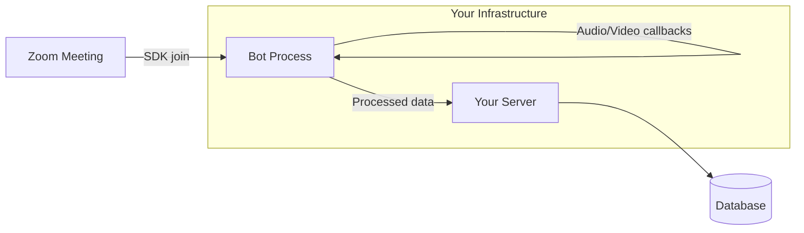
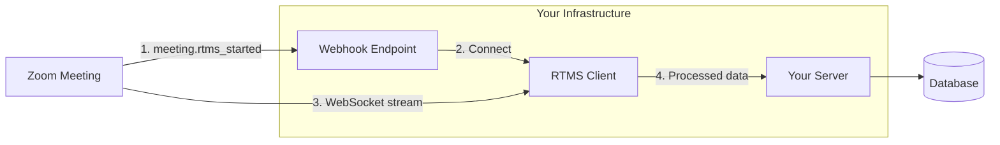

Your meeting bot works. Users see it join. Hosts admit it from the waiting room. You manage infrastructure to keep a participant connected for the duration of the call. **Zoom RTMS** gives you the same data (audio, video, transcripts, screen share) without the bot.

Meeting SDK bots join as participants. They appear in the roster, require host approval, and need compute resources to stay connected. RTMS streams meeting data directly to your backend via webhook and WebSocket. No participant tile. No waiting room. The user installs your app once, and every meeting streams automatically.

**What you'll need:**

- An existing Meeting SDK bot you want to migrate (or understanding of bot architecture)
- [RTMS access](https://developers.zoom.us/docs/rtms/) (requires a paid Zoom Workplace plan with RTMS entitlement; [request access](https://www.zoom.com/en/realtime-media-streams/#form))
- A backend to receive webhooks and maintain WebSocket connections
- A [Zoom General App](https://developers.zoom.us/docs/integrations/) with RTMS event subscriptions
- Optional: A [Zoom Surface App](https://developers.zoom.us/docs/zoom-apps/guides/building-a-surface/) for in-meeting UI

**What changes:**

- **No participant**: RTMS streams data without joining the meeting. Users see your app in the Apps panel, not the participant list.
- **Webhook-driven lifecycle**: Instead of joining via SDK, you receive `meeting.rtms_started` when streaming begins.
- **User-scoped authorization**: The app is installed per-user (or org-wide by admin). The user's presence determines stream availability.
- **Host approval model**: Hosts can require approval before RTMS starts. Configure auto-start to skip this for trusted apps.

**What stays the same:**

- Real-time transcript segments with speaker attribution
- Mixed or separated audio streams (PCM L16, 16kHz or 24kHz)
- Video frames (H.264, gallery view)
- Screen share capture
- Participant join/leave events

If you're building a new meeting integration from scratch, start with the [AI Meeting Notetaker](../ai-meeting-notetaker/) blueprint instead. This guide is for developers migrating an existing bot.

**Don't want to build?** Preferred partners [Recall.ai](https://recall.ai), [Attendee](https://attendee.dev), and [MeetStream](https://meetstream.ai) offer managed RTMS infrastructure. They handle the WebSocket connections and media processing; you receive structured data via their APIs.

Follow along as we walk through the migration path.

## Features

This migration guide covers:

- **Side-by-side architecture comparison**: Bot vs. RTMS data flow and component differences
- **Decision matrix**: When to stay on Meeting SDK vs. migrate to RTMS
- **Webhook handler setup**: Replace SDK join with event-driven stream initiation
- **WebSocket connection patterns**: Connect to RTMS streams using the `@zoom/rtms` SDK
- **Lifecycle management**: Handle stream start, stop, and reconnection scenarios
- **Data model migration**: Update session tracking from bot IDs to RTMS stream IDs
- **Chat alternatives**: Replace bot chat with REST API, Surface Apps, or pre-meeting notifications

The reference implementation is [Arlo](https://github.com/zoom/arlo), a meeting assistant that demonstrates the complete RTMS pattern.

## Architecture

Meeting SDK bots and RTMS solve the same problem differently. Understanding the architectural shift is the first step.

### Bot Architecture (before)

Your bot runs as a headless participant. It joins via Meeting SDK, authenticates with a ZAK or OAuth token, and captures media through SDK callbacks. The bot process must stay connected for the meeting duration.



**Characteristics:**
- Bot appears as a participant (visible in roster)
- Requires compute resources per concurrent meeting
- Must handle SDK lifecycle (join, reconnect, leave)
- Host may need to admit bot from waiting room

### RTMS Architecture (after)

RTMS streams data directly to your backend. Zoom sends a webhook when streaming starts, your server connects via WebSocket, and media flows without a participant joining.



**Characteristics:**
- No participant tile (app appears in Apps panel only)
- Webhook-driven: Zoom initiates the connection
- Single WebSocket per stream (not per participant)
- User installs app once; all their meetings can stream

### Migration Decision Matrix

| Capability | Meeting SDK Bot | RTMS | Notes |
|------------|-----------------|------|-------|
| Receive audio | Yes | Yes | RTMS offers mixed or per-participant |
| Receive video | Yes | Yes (gallery) | Speaker view on Zoom roadmap |
| Receive transcript | Manual (ASR) | Yes (built-in) | RTMS includes Zoom's ASR |
| Receive screen share | Yes | Yes | JPEG/PNG or H.264 |
| Send audio | Yes | No | Bots can speak; RTMS is receive-only |
| Send chat | Yes | No | Use REST API or Surface App |
| Control meeting | Yes | No | Mute, end, etc. require SDK |
| Visible participant | Yes | No | RTMS has no roster presence |
| Breakout rooms | Yes | No | RTMS main room only |
| Per-meeting compute | Required | Not required | RTMS uses shared infrastructure |

**When to stay on Meeting SDK:**
- Your bot needs to speak (voice assistant)
- Your bot sends chat messages during the meeting
- Your bot controls meeting state (mute participants, end meeting)
- You need breakout room access

**When to migrate to RTMS:**
- Receive-only workloads (transcription, recording, analysis)
- Users complain about "bot in my meeting"
- You want to reduce infrastructure costs
- You need Zoom's built-in ASR instead of running your own

## Implementation Guide

This guide covers the key migration steps. For complete code, see the [Arlo reference implementation](https://github.com/zoom/arlo).

### Part 1: Replace SDK Join with Webhook Handler

#### Bot approach (before)

Your bot joins meetings by calling the Meeting SDK with credentials:

```javascript
// Meeting SDK bot approach
const client = new ZoomMeetingSDK();
await client.join({
  meetingNumber: meetingId,
  userName: 'Recording Bot',
  zak: zakToken,
  password: meetingPassword
});

client.on('audio', (buffer) => { /* process audio */ });
client.on('video', (frame) => { /* process video */ });
```

#### RTMS approach (after)

With RTMS, Zoom calls you. Set up a webhook endpoint to receive `meeting.rtms_started`:

**Input:** `meeting.rtms_started` webhook payload

**Output:** Validated webhook, RTMS session initiated

**Invariants:**
- Verify webhook signature using HMAC-SHA256 with timing-safe comparison
- Enforce 5-minute replay window on timestamp
- Respond with 200 OK within 3 seconds (process asynchronously)
- Deduplicate by `rtms_stream_id` (not `meeting_uuid`)

```javascript
// Webhook signature verification (security-critical, keep concrete)
function verifyWebhookSignature(rawBody, timestamp, signature, secret) {
  const now = Math.floor(Date.now() / 1000);
  if (Math.abs(now - parseInt(timestamp, 10)) > 300) return false;

  const message = `v0:${timestamp}:${rawBody.toString('utf8')}`;
  const expected = 'v0=' + crypto
    .createHmac('sha256', secret)
    .update(message)
    .digest('hex');

  return crypto.timingSafeEqual(Buffer.from(signature), Buffer.from(expected));
}
```

**Other languages:** In Python, use `hmac.compare_digest`; in Go, use `crypto/subtle.ConstantTimeCompare`.

See [Arlo's webhook handler](https://github.com/zoom/arlo/blob/main/backend/routes/rtms.js) for the complete implementation.

### Part 2: Connect to RTMS WebSocket

After validating the webhook, connect to the RTMS stream using the provided `server_urls`.

**Input:** `server_urls`, `rtms_stream_id`, `meeting_uuid` from webhook payload

**Output:** Active WebSocket connection receiving media frames

**Invariants:**
- Use the `@zoom/rtms` SDK for Node.js (or implement WebSocket protocol directly for other languages)
- Register all media handlers before calling `join()`
- Handle `onLeave` callback for cleanup
- Track connection state per `rtms_stream_id`
- If stream drops mid-meeting, wait for new `meeting.rtms_started` webhook

```javascript
// RTMS connection pattern
const { RTMSClient } = require('@zoom/rtms');

async function connectToStream(payload) {
  const client = new RTMSClient({
    streamId: payload.rtms_stream_id,
    serverUrls: payload.server_urls,
    credentials: { /* from your app config */ }
  });

  // Register handlers BEFORE joining
  client.on('transcript', (segment) => {
    // segment: { text, userId, userName, timestamp }
    processTranscript(segment);
  });

  client.on('audio', (buffer) => {
    // PCM L16 audio data
    processAudio(buffer);
  });

  client.on('leave', () => {
    cleanupSession(payload.rtms_stream_id);
  });

  await client.join();
}
```

**Other languages:** The `@zoom/rtms` SDK is Node.js only. For Python, Go, or other stacks, implement the [WebSocket protocol](https://developers.zoom.us/docs/rtms/) directly.

### Part 3: Handle Lifecycle Differences

Meeting SDK bots control their own lifecycle. RTMS streams are controlled by users and hosts.

#### Stream start conditions

RTMS starts when ALL conditions are met:
- The app is installed for the user (app owner)
- Account/group/user policy allows RTMS
- Host approves (if required) or auto-start is enabled
- At least one app owner is in the meeting (or auto-start triggered before join)

#### Stream persistence

| Event | Bot Behavior | RTMS Behavior |
|-------|--------------|---------------|
| Host leaves | Bot stays | Stream continues if app owner used auto-start |
| App owner leaves | N/A | Stream stops |
| Host disables sharing | Bot unaffected | Stream stops; new `rtms_started` if re-enabled |
| Network disconnect | Bot reconnects | Wait for new `rtms_started` webhook |

**Critical for long meetings:** If the app owner is the meeting scheduler and auto-start is enabled, the stream persists regardless of whether the app owner joins or leaves. For virtual onsites or all-day meetings, ensure the scheduler has your app installed.

#### Handling multiple users

When multiple users in the same meeting have your app installed, Zoom may send multiple `meeting.rtms_started` webhooks (one per app owner). Deduplicate by `meeting_uuid`:

**Invariants:**
- Process only the first webhook per `meeting_uuid`
- Ignore subsequent webhooks while a stream is active
- If active stream drops and new webhook arrives, treat as reconnection

### Part 4: Update Your Data Model

Your existing bot likely tracks sessions by meeting ID and bot instance. RTMS uses different identifiers.

| Bot Model | RTMS Model |
|-----------|------------|
| `bot_id` (your instance) | `rtms_stream_id` (Zoom-assigned) |
| `meeting_id` (numeric) | `meeting_uuid` (string, unique per instance) |
| `participant_id` (bot's ID) | N/A (no participant) |
| Bot status (joining, connected, leaving) | Stream status (waiting, connected, ended) |

**Schema migration:**

```sql
-- Add RTMS columns to existing sessions table
ALTER TABLE meeting_sessions ADD COLUMN rtms_stream_id VARCHAR(255);
ALTER TABLE meeting_sessions ADD COLUMN stream_status ENUM('waiting', 'connected', 'ended');

-- Index for webhook deduplication
CREATE UNIQUE INDEX idx_rtms_stream ON meeting_sessions(rtms_stream_id);
```

### Part 5: Replace Chat with Alternatives

Meeting SDK bots can send chat messages. RTMS cannot. If your bot sends messages (recording consent, cancel links), you have three options:

**Option A: REST API (if continuous chat enabled)**

If the meeting has continuous chat enabled, use the [Chat Messages API](https://developers.zoom.us/docs/api/rest/reference/chat/methods/#operation/sendChatMessage):

```javascript
await zoom.chat.sendMessage({
  to_channel: meetingChatChannel,
  message: 'Recording in progress. Reply STOP to cancel.'
});
```

**Option B: Surface App**

Build a [Zoom Surface App](https://developers.zoom.us/docs/zoom-apps/guides/building-a-surface/) that displays recording status and cancel button in-meeting. The Surface App can use the Zoom Apps SDK `sendMessage()` method to send chat.

**Option C: Pre-meeting notification**

Send recording consent via email or calendar invite before the meeting starts. Less interactive but simpler.

### Run the Sample

[Arlo](https://github.com/zoom/arlo) demonstrates the complete RTMS pattern with transcript capture, AI processing, and in-meeting display.

| Platform | What you get |
|----------|--------------|
| [**Deploy to Render**](https://render.com/deploy?repo=https://github.com/zoom/arlo) | Backend, frontend, RTMS service, managed database |
| [**Deploy to Railway**](https://railway.app/new?repo=https://github.com/zoom/arlo) | Backend, frontend, RTMS service, managed database |

<details>
<summary><strong>Local setup</strong></summary>

1. Clone and configure:
   ```bash
   git clone https://github.com/zoom/arlo.git && cd arlo && cp .env.example .env
   ```

2. Start ngrok with a static domain:
   ```bash
   ngrok http 3000 --domain=your-subdomain.ngrok-free.app
   ```

3. Create a Zoom General App at [marketplace.zoom.us](https://marketplace.zoom.us/):
   - Copy Client ID and Client Secret
   - Set OAuth Redirect URL to `https://YOUR-NGROK-URL/api/auth/callback`
   - Enable RTMS under Features > Zoom App SDK > Real-Time Media Streams > Transcripts
   - Add Event Subscription for `meeting.rtms_started` and `meeting.rtms_stopped`

4. Fill in `.env` with your credentials

5. Start the services:
   ```bash
   docker-compose up --build
   ```

</details>

## App Manifest

The migration requires updating your Zoom App configuration from Meeting SDK to RTMS.

### Required Scopes

| Scope | Purpose |
|-------|---------|
| `meeting:read:meeting` | Meeting metadata |
| `user:read` | User profile for personalization |

Note: RTMS access is configured via Zoom App SDK settings, not OAuth scopes.

### RTMS Configuration

1. In your app settings, go to **Features** > **Zoom App SDK**
2. Enable **Real-Time Media Streams**
3. Select the media types you need:
   - **Transcripts**: Speech-to-text segments
   - **Audio**: PCM audio stream
   - **Video**: H.264 video frames
   - **Screen Share**: Screen capture

### Event Subscriptions

| Event | When it fires | Your action |
|-------|---------------|-------------|
| `meeting.rtms_started` | User starts RTMS or auto-start triggers | Connect to WebSocket |
| `meeting.rtms_stopped` | Stream ends (host stops, meeting ends, etc.) | Finalize recording |

### Auto-Start Configuration

For hands-free recording (no user action required each meeting):

1. Go to **Features** > **Zoom App SDK** > **Real-Time Media Streams**
2. Enable **Auto-start**
3. Optionally disable **Host approval required** (admin setting)

With auto-start enabled, RTMS begins automatically when the app owner's meeting starts.

---

## Acceptance Criteria

Use this checklist to verify your migration:

- [ ] Webhook endpoint validates signatures with timing-safe comparison
- [ ] Webhook endpoint enforces 5-minute replay window
- [ ] Duplicate `rtms_stream_id` webhooks are ignored
- [ ] WebSocket handlers registered before `join()` call
- [ ] Stream cleanup runs on `onLeave` and `meeting.rtms_stopped`
- [ ] Multiple app owners in same meeting deduplicated by `meeting_uuid`
- [ ] Session data model updated with RTMS identifiers
- [ ] Chat functionality replaced with REST API, Surface App, or pre-meeting notification
- [ ] Bot infrastructure can be decommissioned after migration validation
- [ ] Users no longer see bot participant in meetings

---

## Related Resources

- [RTMS Documentation](https://developers.zoom.us/docs/rtms/): Official API reference
- [AI Meeting Notetaker Blueprint](../ai-meeting-notetaker/): Building from scratch with RTMS
- [@zoom/rtms SDK](https://www.npmjs.com/package/@zoom/rtms): Node.js client library
- [Zoom Developer Forum](https://devforum.zoom.us/): Community support
- [Arlo Repository](https://github.com/zoom/arlo): Reference implementation
