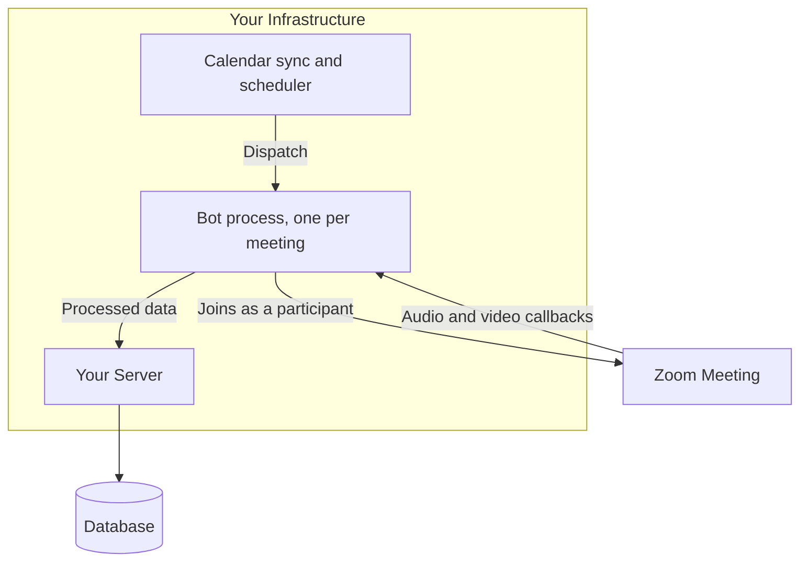
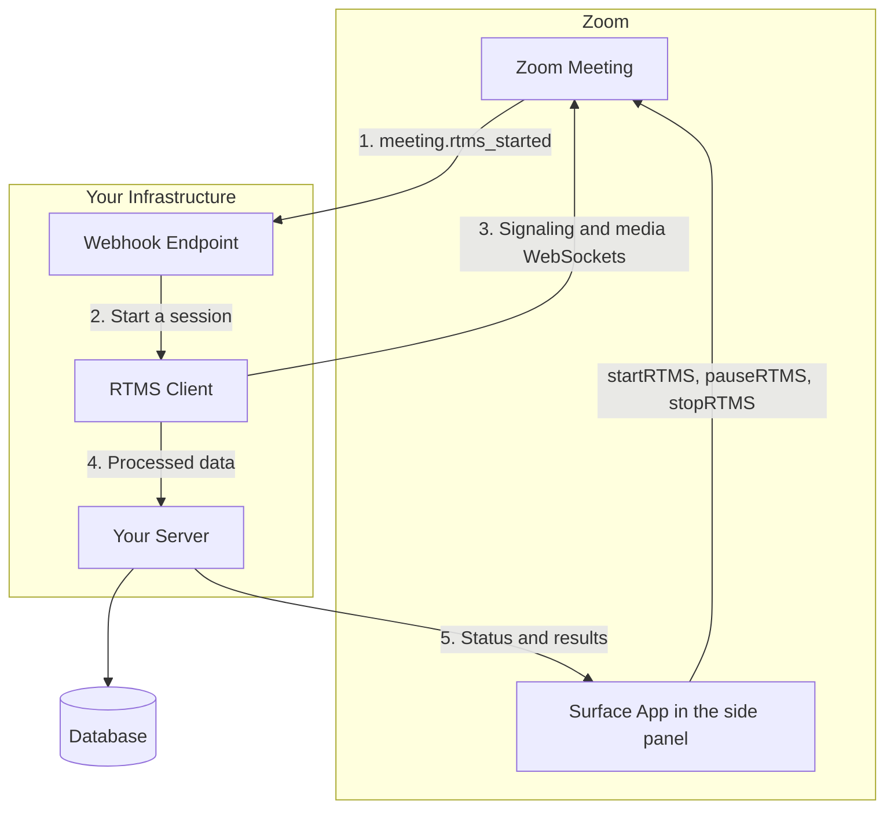
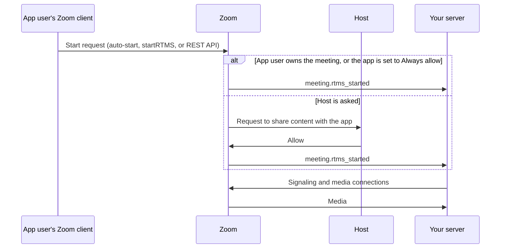

This guide takes a product built on a meeting bot through the switch to **Realtime Media Streams (RTMS)** and the **Zoom Apps SDK**, stage by stage: what to scope, how authorization and permissions work, how streams start and stop, what to rebuild, and how to roll out to customers.

RTMS replaces the bot's media capture. Your server receives audio, video, transcripts, and chat over a WebSocket, and nothing joins the meeting. The Zoom Apps SDK replaces what the bot did in the meeting: notices, status, and controls in a side panel.

<YouTube id="-Zr7LejQjgc"/>

**What you'll need:**

- A product that sends a Meeting SDK bot into meetings (or an understanding of how one works)
- Media access via [RTMS](https://developers.zoom.us/docs/rtms/) (requires [Zoom Developer Pack](https://zoom.us/pricing/developer) credits; free trial credits are available)
- A user-managed [Zoom General App](https://developers.zoom.us/docs/integrations/) with RTMS scopes and event subscriptions
- A backend with a public HTTPS webhook endpoint that can hold WebSocket connections
- A [Zoom Surface App](https://developers.zoom.us/docs/zoom-apps/) for in-meeting notices and controls (any Zoom account; starting RTMS from the app needs Zoom desktop client 6.5.5 or later)

## Features

This guide covers the switch in the order you will meet it:

- **Joining versus connecting**: How sending a bot into a meeting differs from connecting to a stream over a WebSocket
- **Capability mapping**: What your bot does today, and how RTMS and the Zoom Apps SDK do it
- **Scoping**: An inventory of your bot's behavior and the user journeys to plan for
- **App and authorization**: What to change in your Marketplace app, reauthorization, and app review
- **Permissions**: Which settings the admin, the app user, and the meeting host each control
- **Start paths**: Auto-start, the Zoom Apps SDK, and the REST API
- **Connection**: The webhook handler, the WebSocket connection, and the media you receive
- **Lifecycle**: What keeps a stream running, what stops it, and how to reconnect
- **Product logic**: Deduplication, identity, session data, and the states you show your users
- **In-meeting experience**: Notices, controls, guest mode, and chat with a Surface App
- **Failure modes**: How to detect that media access has not started or has stopped
- **Rollout**: Moving customers over in cohorts and retiring the bot

The reference implementation is [Arlo](https://github.com/zoom/arlo), a meeting assistant that uses RTMS and a Surface App together.

If you're building a new meeting integration from scratch, start with the [AI Meeting Notetaker](../ai-meeting-notetaker/) blueprint instead. This guide is for teams moving an existing bot.

> **Don't want to build?** [Recall.ai](https://recall.ai) is an RTMS Preferred Partner and offers managed RTMS infrastructure: it handles the WebSocket connections and media processing, and you receive structured data through its API. [Attendee](https://attendee.dev) and [MeetStream](https://meetstream.ai) also provide RTMS support.

Follow along as we walk through the architecture and then each stage of the switch.

## Architecture

A bot and an RTMS app get the same meeting media in different ways. A bot is a participant: your code joins the meeting. An RTMS app is a connection: Zoom tells your server that a stream has started, and your server connects to it.

### Joining a meeting and connecting to a stream

| | Meeting bot | RTMS and the Zoom Apps SDK |
|---|---|---|
| What it is | A headless Meeting SDK client that joins as a participant | An app that a user has authorized. Zoom streams meeting content to your server over WebSocket connections |
| Whose identity | The bot's own name in the roster | The app user's. The app acts for a Zoom user who is in the meeting or owns it |
| How it gets in | Your code joins with the meeting number, passcode, and a token | Nothing joins. The stream starts with the app user: auto-start, a button in your Surface App, or a REST API request |
| Who says yes | The host admits the bot | The admin enables the app, the app user chooses which meetings it starts in, and the host allows it once or sets it to always allow |
| What participants see | An extra participant | No participant. Zoom shows "The content of this meeting is being sent to one or more apps." and lists the app and the person using it |
| What you run | One client process for every meeting | A webhook endpoint and WebSocket connections |
| How you learn it worked | Your join call returns and SDK callbacks fire | Zoom sends the `meeting.rtms_started` webhook |
| In-meeting features | The bot speaks, chats, and reacts as a participant | A Surface App in a side panel shows status, notices, and controls |

A bot that joins meetings outside your own account uses an On Behalf Of (OBF) token. The user authorizes your Marketplace app, your app requests that user's OBF token, and the bot can join only once that user is in the meeting and has to leave when they leave. See [Join external meetings as a bot (OBF)](https://developers.zoom.us/docs/meeting-sdk/auth/obf/). So a bot already depends on the same two things RTMS does, user authorization and user presence, and it still adds a participant to the meeting.

### Bot architecture (before)

Your bot runs as a headless participant. It joins through the Meeting SDK and captures media through SDK callbacks. A scheduler decides which meetings to join, and one bot process stays connected for the length of each meeting.



**Characteristics:**
- The bot appears as a participant (visible in the roster)
- Compute is needed for every concurrent meeting
- Your code handles the SDK lifecycle (join, reconnect, leave)
- The host may need to admit the bot from the waiting room

### RTMS and Zoom Apps SDK architecture (after)

Zoom sends a webhook when a stream starts. Your server opens a signaling connection, then a media connection for each type of media, and data flows without a participant joining. The Surface App runs inside the Zoom client for the app user and talks to your backend.



**Characteristics:**
- No participant tile. The app is listed in Zoom's notice and in the Apps panel
- Zoom starts the exchange with a webhook; your server never joins
- One signaling connection and one or more media connections for each stream
- The user installs the app once, and it can start in their meetings from then on

### From bot to RTMS and the Zoom Apps SDK

RTMS is one half of the replacement. RTMS captures the media. The [Zoom Apps SDK](https://developers.zoom.us/docs/zoom-apps/) gives you the in-meeting experience: a Surface App in a side panel for status, notices, and controls. Together they do what a bot does without putting a participant in the meeting. [Arlo](https://github.com/zoom/arlo) uses both.

| If your bot does this | Do this instead |
|-----------------------|-----------------|
| Receives meeting audio | RTMS audio, merged or one stream for each participant |
| Receives video | RTMS video of the active speaker, of [one chosen participant](https://developers.zoom.us/docs/rtms/meetings/video-single-stream/), or of [several participants](https://developers.zoom.us/docs/rtms/meetings/video-multiple-streams/) on separate connections |
| Runs its own speech-to-text | RTMS transcripts, produced by Zoom with speaker attribution |
| Captures screen share | RTMS screen share, as its own stream |
| Reads meeting chat | RTMS chat, which delivers messages sent to everyone |
| Tracks who joins and leaves | RTMS participant events on the signaling connection |
| Shows up in the roster so people know it is there | No participant. Zoom tells everyone that an app is accessing content and lists the app; your Surface App adds your own notice |
| Posts messages in meeting chat | The REST API when the meeting uses Continuous Meeting Chat, or the Zoom Apps SDK from your Surface App (see [Stage 8](#stage-8-build-the-in-meeting-experience)) |
| Gives users start, stop, and pause commands | Zoom Apps SDK `startRTMS`, `stopRTMS`, `pauseRTMS`, and `resumeRTMS` from buttons in your Surface App, or the REST API from your own product |
| Shows status or a notice to everyone | A Surface App, with guest mode so every participant can open it |
| Joins from a calendar entry | Auto-start. The app starts when its user's meeting starts or when its user joins, including meetings that are not on a calendar |
| Runs a bot process for every meeting | No per-meeting process. Your backend holds WebSocket connections |
| Needs the host to admit it from the waiting room | Nothing joins. The host allows the app once, or sets it to always allow |

RTMS receives media. Anything your bot did to the meeting, or showed to the people in it, moves to the Surface App or the REST API.

## Implementation Guide

The guide follows the switch from first scoping to retiring the bot. Stages 1 to 4 are mostly product and configuration decisions. Stages 5 to 9 are engineering work. Stage 10 is the rollout. For complete code, see the [Arlo reference implementation](https://github.com/zoom/arlo).

### Stage 1: Scope the switch

#### Inventory what your bot does

List every behavior your product relies on, then map each one with the table in [From bot to RTMS and the Zoom Apps SDK](#from-bot-to-rtms-and-the-zoom-apps-sdk). Questions to answer:

- **Media**: Which of audio, video, screen share, transcript, and chat do you consume? Do you need audio for each participant or the merged audio?
- **Dispatch**: What decides that the bot joins a meeting today? Calendar rules, a button, an API call from another product?
- **Presence**: Who relies on seeing the bot in the roster, and what does its name tell them?
- **In-meeting actions**: Does the bot post to chat, or respond to commands?
- **Users and tenants**: Which Zoom user does each bot session belong to in your data model?
- **Customers**: Which customers install per user, and which expect an admin to deploy for a group or the whole account?

#### Plan for each user journey

A bot joins any meeting it has a link for. An RTMS app starts with its user, so each journey depends on who owns the meeting and what the host allows. Plan and test each of these.

| Journey | With a bot | With RTMS and the Zoom Apps SDK |
|---------|------------|---------------------------------|
| The user installs your product | Connects a calendar; the bot starts joining | Authorizes your app and chooses which meetings it auto-starts in. You set the default choice shown at install |
| An admin rolls out to a team | Per-user setup in your product | The admin adds the app for users or groups and sets auto-start and participant permissions for them |
| The user hosts their own meeting | Bot joins from the calendar | With auto-start on **Meetings users own**, the app starts when the meeting starts. The host is not asked |
| The user attends a meeting a colleague hosts | Bot joins; the host admits it | Auto-start sends a request to the host. If the host or their admin set the app to **Always allow** for internal participants, it starts when the user joins and the host does not need to be in the meeting |
| The user attends a meeting another company hosts | Bot joins with the link; the host admits it | Same request flow. The other company's host or admin decides, with a separate setting for external participants |
| A meeting that is not on the calendar | Usually missed | Auto-start triggers when the user joins |
| The user starts it by hand mid-meeting | "Add the bot" link or button | A button in your Surface App calls `startRTMS`, or your product calls the REST API |
| The meeting owner leaves early | Bot stays | The owner transfers host and their app keeps running. Any host can manage it |
| An app user who does not own the meeting leaves | Bot stays | That user's stream stops (`stop_reason` 3) |
| The meeting owner cannot attend | Bot attends alone | An app used by the meeting's owner can start with the meeting and run without the owner present |
| Two attendees both use your product | You send one bot | Each of them can start a stream. Your backend picks one (see [Stage 7](#stage-7-update-your-product-logic)) |
| The host pauses or stops access | Host removes the bot | The host or the app user pauses or stops the app in Zoom's controls. Your app sees the state change |
| A webinar | Bot joins as an attendee or panelist | The same flow with the `webinar.rtms_started` and `webinar.rtms_stopped` events |

#### What your team retires and builds

| Retire | Build |
|--------|-------|
| Join scheduler and calendar-driven dispatch | Webhook endpoint with signature validation |
| Headless Meeting SDK clients and their autoscaling | RTMS client that holds signaling and media connections |
| Waiting room and passcode handling, join retries | Reconnection handling and keep-alive responses |
| Bot display name and avatar | Surface App for notices, status, and controls |
| "Bot is joining" states in your product | Stream states: requested, waiting for the host, streaming, paused, stopped |
| One bot per meeting by construction | Deduplication when several users start a stream in one meeting |

Keep your calendar integration if you have one. It no longer dispatches anything, but it still tells you which meetings to expect and gives each one context such as the title and attendees.

### Stage 2: Update your app and authorization

You can add RTMS to the Marketplace app your users already authorize, or create a new General App. Either way:

- **User-managed app**: RTMS apps must be user-managed to add the RTMS events and scopes. An admin can still add a user-managed app for many users and groups (see [Enterprise deployment](#enterprise-deployment-admin-install)).
- **Granular scopes**: RTMS scopes need [granular scopes](https://developers.zoom.us/docs/integrations/oauth-scopes-granular/). New apps have them by default. An older app may need them enabled before the RTMS scopes appear.
- **Media scopes**: Add one scope for each kind of media you receive. RTMS scopes cannot be marked optional, and they are shown to hosts and participants in the meeting, so add only what your product uses.
- **Event subscriptions**: Subscribe to the RTMS events listed under [Event subscriptions](#event-subscriptions). Allow 1 to 2 minutes for a change to take effect before you test.
- **Surface**: Turn on the Zoom App SDK for **Meetings and Webinars** and add the RTMS APIs your Surface App calls.

See [Adding Realtime Media Streams to your app](https://developers.zoom.us/docs/rtms/meetings/add-features/) for the steps.

#### Reauthorization for existing users

Adding scopes to a published app changes what your users agreed to. Per [Updating an app](https://developers.zoom.us/docs/distribute/published-apps/updating/):

- The update goes through a functional review and a security review, and you provide a test plan for each new scope.
- Once the update is approved, users reauthorize the app. Existing users can keep using their current authorization for 90 days. After that, refresh tokens for the old scopes expire.
- Use the **Release Notes for User** field to explain what is changing and why.

Plan the prompts in your own product around that window: tell users before the update ships, prompt them in the product after it does, and track who has reauthorized.

#### App review and testing outside your account

An app must pass [App Review](https://developers.zoom.us/docs/rtms/meetings/submit-app-review/) before anyone outside your Zoom account can add it, whether or not you list it on the Marketplace. Reviewers authorize the app from a test account, check each RTMS feature, and confirm that each declared scope is used. Give them clear instructions for triggering RTMS.

- **Submit early.** Review time is outside your control, and every later stage that involves a customer depends on it.
- **Test from a second account before review completes.** A [beta app](https://developers.zoom.us/docs/distribute/sharing-private-and-beta-apps/) can be shared with a limited number of users outside your account through an authorization URL, once Zoom approves the request. This is how you test meetings hosted on another account.
- **Regenerate the authorization URL** after you change scopes on a beta app, and send testers the new one. See [Regenerating authorization URLs](https://developers.zoom.us/docs/distribute/app-submission/regenerating-authorization-url/).

### Stage 3: Understand who controls access

A bot needs one decision: the host admits it. An RTMS app needs several settings to line up, and different people own them. Most "it did not start" reports trace back to one of these.

| Layer | Who sets it | Where |
|-------|-------------|-------|
| RTMS is on for the account, group, or user | Account admin | Zoom web portal > **Account Settings** > **Zoom Apps** > **Share realtime meeting content with apps** |
| Your app is added for the user | The user, or an admin for users and groups | Your install link, or Marketplace > **Manage** > **Apps on account** |
| Where the app auto-starts | Admin, or the app user for their own meetings | **Apps that access content in meetings**, or the options shown when the app is installed |
| Whether hosts are asked | Meeting owner or their admin | **Always ask** or **Always allow**, set separately for internal and external participants |
| Access in this meeting | The host | **Host tools** > **Share realtime meeting content with apps**, and the request prompt |
| Credits and stream limit | You | A Developer Pack subscription on your account |

#### Auto-start choices

For each app, the admin or the app user chooses where it starts:

- **Meetings users own**: the app starts in every meeting its user owns, even when that user is not the current host.
- **Meetings users attend**, split into **Internally hosted meetings** (hosted on the same account) and **Externally hosted meetings** (hosted on another account).

A sales assistant might start in meetings its user owns and in externally hosted meetings, but not internal ones. A team notetaker might start in internally hosted meetings only. You choose the default that is suggested when someone installs your app.

#### Always ask and Always allow

In a meeting the app user owns, an app set to auto-start starts with the meeting. In anyone else's meeting, the app's request goes to the host, who chooses **Allow** or **Deny**. The host can also choose **Always allow in my meetings** so the app does not ask again in meetings they host.

Meeting owners and admins can make the same choice ahead of time by setting an app to **Always allow**, with separate settings for internal and external participants. With **Always allow** in place, the app starts when the participant joins, and the host does not need to be in the meeting or respond to a prompt.

| Meeting | Who decides | With Always ask | With Always allow |
|---------|-------------|-----------------|-------------------|
| The app user owns it | No one is asked | Starts with the meeting | Starts with the meeting |
| A colleague hosts it | The host, or your customer's admin for the whole account | The host sees a request | Starts when the app user joins |
| Another company hosts it | That company's host or admin | The host sees a request | Starts when the app user joins, if that company set it |

For internal meetings, one decision by your customer's admin covers every host on the account. For external meetings, the other company controls its own meetings. Describe your product to customers in those terms.

See [Host and admin tools and controls](https://developers.zoom.us/docs/rtms/meetings/ux-host-admin-tools-ctrls/) and [New RTMS permissions and controls for auto-start](https://developers.zoom.us/blog/rtms-permissions-and-auto-start-controls/).

### Stage 4: Start a stream

A bot starts when your code joins. An RTMS stream starts in one of three ways, and all three end the same way: Zoom sends `meeting.rtms_started` to your webhook.

| Start path | Triggered by | Requirements | Use it for |
|------------|--------------|--------------|------------|
| Auto-start | The meeting starting, or the app user joining | Auto-start set for that kind of meeting; host permission where the user is not the owner | The default. Replaces calendar-driven dispatch |
| Zoom Apps SDK `startRTMS` | A button in your Surface App, or the app opening | Surface App with the RTMS APIs added; Zoom desktop client 6.5.5 or later | Starting for one meeting at the user's choice |
| REST API | Your backend | `meeting:update:participant_rtms_app_status` scope; the participant is on the meeting's invite list and has already joined | A start button in your own product or another system |



**A start request is not a stream.** A resolved `startRTMS` call or a `204` from the REST API means Zoom accepted the request. Media is available only after `meeting.rtms_started` arrives and your server completes the handshakes. If the host is asked and does not answer, no webhook arrives.

#### Start from your Surface App

```javascript
import zoomSdk from '@zoom/appssdk';

async function startFromPanel() {
  try {
    const { runningContext } = await zoomSdk.config({
      capabilities: ['startRTMS', 'stopRTMS', 'pauseRTMS', 'resumeRTMS'],
    });
    if (runningContext === 'inMeeting') {
      await zoomSdk.callZoomApi('startRTMS');
    }
  } catch (err) {
    // Show the app user that the request did not go through
    showStartError(err);
  }
}
```

#### Start from your backend

Use [Update participant RTMS app status](https://developers.zoom.us/docs/api/meetings/#tag/meetings/patch/live_meetings/{meetingId}/rtms_app/status) with the app user's access token. The same endpoint takes `stop`, `pause`, and `resume`.

```javascript
async function requestRtmsStart(meetingId, userAccessToken) {
  const res = await fetch(
    `https://api.zoom.us/v2/live_meetings/${encodeURIComponent(meetingId)}/rtms_app/status`,
    {
      method: 'PATCH',
      headers: {
        Authorization: `Bearer ${userAccessToken}`,
        'Content-Type': 'application/json',
      },
      body: JSON.stringify({
        action: 'start',
        settings: { client_id: process.env.ZOOM_CLIENT_ID },
      }),
    }
  );

  if (res.status === 204) return { requested: true };

  // Zoom returns a numeric error code that says why the request was refused
  const { code } = await res.json().catch(() => ({}));
  return { requested: false, status: res.status, code };
}
```

| Response | Meaning | What to do |
|----------|---------|------------|
| `204` | The request was accepted | Wait for `meeting.rtms_started` |
| `3000` | The meeting has not started | Try again once the meeting is live |
| `2308` | The user is not allowed to start the app. They are not the host or an alternative host, or they joined from a shared link and are not on the invite list | For meetings hosted elsewhere, make sure the app user is on the invitation |
| `2310` | The operation failed. Common causes are no active Developer Pack subscription or a Basic account | Check the subscription and plan |
| `13262` | The app is not authorized to access meeting content on this account | An admin adds the app under **Apps that access content in meetings** |
| `13267` | RTMS is turned off | An admin turns on **Share realtime meeting content with apps** |
| `13273` | The meeting does not support RTMS apps | Do not retry |
| `13277` | `stop`, `pause`, or `resume` was sent for an app that has not started | Start first |
| `429` | Rate limited | Retry with backoff |

#### Read the request status

Subscribe to `rtms.request_status`. It tells you why a request did not turn into a stream.

| `status` | Meaning | What to do |
|---------:|---------|------------|
| `1` | The request is denied | Tell the app user. Do not retry on your own |
| `2` | The app owner is not present in the meeting | Wait for the app user to join |
| `3` | The host denied this app from starting | Tell the app user that the host declined |
| `4` | The app account license has expired, or the feature is disabled | Alert your team; check your Developer Pack subscription |
| `5` | No RTMS concurrency limit is set | Alert your team; contact Zoom |
| `6` | The RTMS server failed | Submit a request for a new stream |
| `7` | The RTMS server instance is being updated and will reboot | Read `reboot_in_minutes` and expect to reconnect |
| `8` | The server instance update was canceled | Carry on |

### Stage 5: Receive the webhook and connect

#### Bot approach (before)

Your bot joins meetings by calling the Meeting SDK with credentials:

```javascript
// Meeting SDK bot approach
const client = new ZoomMeetingSDK();
await client.join({
  meetingNumber: meetingId,
  userName: 'Notetaker Bot',
  zak: zakToken,
  password: meetingPassword
});

client.on('audio', (buffer) => { /* process audio */ });
client.on('video', (frame) => { /* process video */ });
```

#### RTMS approach (after)

With RTMS, Zoom calls you. Set up a webhook endpoint to receive `meeting.rtms_started`:

**Input:** `meeting.rtms_started` webhook payload (`meeting_uuid`, `meeting_id`, `rtms_stream_id`, `server_urls`, `operator_id`, `account_id`, `is_original_host`)

**Output:** Validated webhook, RTMS session initiated

**Invariants:**
- Verify webhook signature using HMAC-SHA256 with timing-safe comparison
- Enforce 5-minute replay window on timestamp
- Respond with 200 OK within 3 seconds (process asynchronously)
- Track streams by `rtms_stream_id` (not `meeting_uuid`), and never open a second session for a stream you already have
- Store the payload. It is the only source of the values you need to connect and reconnect

```javascript
// Webhook signature verification (security-critical, keep concrete)
function verifyWebhookSignature(rawBody, timestamp, signature, secret) {
  const now = Math.floor(Date.now() / 1000);
  if (Math.abs(now - parseInt(timestamp, 10)) > 300) return false;

  const message = `v0:${timestamp}:${rawBody.toString('utf8')}`;
  const expected = 'v0=' + crypto
    .createHmac('sha256', secret)
    .update(message)
    .digest('hex');

  // timingSafeEqual throws if the buffers differ in length, so check first.
  const received = Buffer.from(String(signature));
  const computed = Buffer.from(expected);
  if (received.length !== computed.length) return false;
  return crypto.timingSafeEqual(received, computed);
}
```

**Other languages:** In Python, use `hmac.compare_digest`; in Go, use `crypto/subtle.ConstantTimeCompare`.

See [Arlo's webhook handler](https://github.com/zoom/arlo/blob/main/backend/src/routes/rtms.js) for the complete implementation.

#### Connect to the stream

After validating the webhook, connect to the RTMS stream using the provided `server_urls`. Your server opens a signaling connection first, then a media connection for each type of media, and sends a ready message before data flows. The `@zoom/rtms` SDK does this for you. [Working with streams](https://developers.zoom.us/docs/rtms/meetings/work-with-streams/) describes each step if you implement the protocol yourself.

**Input:** `server_urls`, `rtms_stream_id`, `meeting_uuid` from webhook payload

**Output:** Active WebSocket connection receiving media frames

**Invariants:**
- Use the `@zoom/rtms` SDK for Node.js or Python (or implement the WebSocket protocol directly for other languages)
- Register all media handlers before calling `join()`
- Clean up when the `meeting.rtms_stopped` webhook arrives
- Track connection state per `rtms_stream_id`
- If a connection drops mid-meeting, reconnect as described in [Reconnection](#reconnection); do not wait for a new webhook

```javascript
// RTMS connection pattern
const rtms = require('@zoom/rtms').default;

function connectToStream(payload) {
  // payload is the meeting.rtms_started webhook payload
  const client = new rtms.Client();

  // Register handlers BEFORE joining
  client.onTranscriptData((data, size, timestamp, metadata) => {
    // data: transcript text as a Buffer; metadata: { userId, userName }
    processTranscript({ text: data.toString('utf8'), timestamp, ...metadata });
  });

  client.onAudioData((data, size, timestamp, metadata) => {
    // L16 PCM audio data
    processAudio(data);
  });

  client.join(payload);
}
```

**Other languages:** The `@zoom/rtms` SDK supports Node.js and Python (`pip install rtms`). For Go or other stacks, implement the [WebSocket protocol](https://developers.zoom.us/docs/rtms/) directly.

#### What you receive

Your app receives the media its scopes allow and its handshake asks for. See [Handling media data](https://developers.zoom.us/docs/rtms/meetings/media/).

| Media | What RTMS delivers | Notes for a bot pipeline |
|-------|--------------------|--------------------------|
| Audio | Merged audio, or one stream for each participant with `user_id` and `user_name` | L16 PCM at 48 kHz mono by default; 8, 16, 32, or 48 kHz (see the [RTMS data types](https://developers.zoom.us/docs/rtms/data-types/)). Zoom buffers up to 60 seconds of audio while you connect. No packets arrive for a muted participant |
| Video | The active speaker by default, one participant you choose, or several participants on separate connections | JPG at 5 fps or less, H.264 above that up to 30 fps. Several participants at once needs protocol version 2 and has to be enabled for your account. Video is not buffered |
| Screen share | A separate stream of the participant who is sharing | Combine with audio and video by timestamp |
| Transcript | Text for each participant with speaker attribution and detected language | Replaces your own speech-to-text if Zoom's transcript meets your needs. Request audio as well if you run your own |
| Chat | Messages sent to everyone, with edits, deletes, and reactions keyed by `message_id` | Private messages are not delivered. Delivery is best effort |
| Participant events | Join, leave, and active speaker changes on the signaling connection | Key participants on `user_id`, not on display name |

Media arrives over WebSocket connections by default. With protocol version 2, data connections can also use SRT (see [Connecting over SRT](https://developers.zoom.us/docs/rtms/srt/connecting-over-srt/)).

### Stage 6: Keep the stream running

Meeting SDK bots control their own lifecycle. RTMS streams are controlled by users and hosts. This is the most significant behavioral change in the migration.

#### Stream start conditions

RTMS starts when ALL conditions are met:
- The meeting host's organization has RTMS enabled at the account level
- The app is installed for the user (app owner)
- Account/group/user policy allows RTMS
- The host approves, or the app is set to **Always allow**, or the app user owns the meeting
- At least one app owner is in the meeting, or the meeting's owner uses the app with auto-start
- For in-meeting start through the Zoom Apps SDK, the Zoom desktop client is version 6.5.5 or later

#### Stream persistence

| Event | Bot Behavior | RTMS Behavior |
|-------|--------------|---------------|
| Meeting owner leaves and transfers host | Bot stays | The owner's app keeps running. Controls pass to the new host, and your app can still manage the stream through the REST API with the owner's access token |
| App user who is not the meeting owner leaves | N/A | **Stream stops** (`stop_reason` 3) |
| Host stops the stream | Host removes the bot | Stream stops (`stop_reason` 1); a new request is allowed |
| Host disables the app, or all apps | Bot unaffected | Stream stops (`stop_reason` 5 or 9); new `rtms_started` if re-enabled |
| Host handoff to org with RTMS disabled | Bot unaffected | Stream stops permanently |
| App owner moves to breakout room | N/A | Stream stops; may resume when returning to main room. If the app user owns the meeting, the app keeps running |
| App user or host pauses the app | N/A | The session state changes to `PAUSED`, then `RESUMED`. The stream stays open |
| Network disconnect | Bot reconnects | Your app reconnects within the window Zoom allows (see [Reconnection](#reconnection)) |

**WARNING: A stream belongs to its app user.** This is the most common migration surprise. With bots, you control when to leave. With RTMS, when an app user who does not own the meeting leaves, their stream ends even if other participants remain. Plan for this in your product flow.

#### Stream persistence for long meetings (virtual onsites)

For multi-hour meetings where participants rotate (virtual onsites, all-day workshops, interview panels), you need the stream to persist regardless of who joins or leaves. The key insight:

**If the app owner is the meeting's original scheduler AND auto-start is enabled, the RTMS stream persists for the entire meeting lifetime. The scheduler does not need to join or stay in the meeting.** An app used by the owner of a meeting can run without that user being present.

This means:
- Your app must be installed for the **meeting scheduler** (the person who created the meeting), not just the participants
- Auto-start for **Meetings users own** must be on for that user
- If your calendar sync knows who scheduled the meeting, use that user's context

The `is_original_host` field in `meeting.rtms_started` tells you whether the stream belongs to the meeting's original host.

**When the scheduler is not your user:** If an external party scheduled the meeting (candidate, external recruiter, customer), the stream belongs to a participant who is your user:
1. Use that participant's stream, and tell them in your Surface App that access ends if they leave
2. Prompt the external scheduler to install your app (may not be practical)

#### Keep-alives

Zoom sends a keep-alive request every 10 seconds on a connection with no data flowing, on the signaling connection and on each media connection. If your app misses three in a row, Zoom closes that connection (`stop_reason` 24). The `@zoom/rtms` SDK answers them. If you implement the protocol yourself, answer on every connection.

#### Reconnection

RTMS uses a signaling connection that manages the session and media connections that carry the data. What you reconnect depends on which one dropped. Zoom's [Failover and reconnection](https://developers.zoom.us/docs/rtms/meetings/failover-reconnection/) guide has the full procedure and sample code.

| Scenario | How you find out | What to do |
|----------|------------------|------------|
| RTMS server failure | `meeting.rtms_started` arrives for an `rtms_stream_id` you already have | Tear down the existing connections and reconnect with the new `server_urls`. The `meeting_uuid` and `rtms_stream_id` stay the same |
| Signaling connection dropped | `meeting.rtms_interrupted` webhook | Reconnect signaling and media. The server waits about 60 seconds |
| Media connection dropped | `MEDIA_CONNECTION_INTERRUPTED` event on the signaling connection | Reconnect the affected media connection. The server waits about 30 seconds |
| Stream terminated | `meeting.rtms_stopped` with a `stop_reason` of 10 to 19, or 24 | The reconnection window was missed. Start the RTMS connection process again from the beginning |

Retry with exponential backoff, starting at 3 seconds and doubling to a cap of 30 seconds. If the attempts run out, treat the stream as unrecoverable and stop retrying.

#### Stop reasons

`meeting.rtms_stopped` carries a [`stop_reason`](https://developers.zoom.us/docs/rtms/data-types/#rtms_stop_reason) that tells you why the stream ended. Store it with the session. The data types page also says, for each value, whether your app may make a new request.

| `stop_reason` | Meaning | New request allowed |
|--------------:|---------|---------------------|
| `1` | The host stopped the stream | Yes |
| `2` | The app user stopped the stream | No |
| `3` | The app user left the meeting | No |
| `4` | The host removed the app user | No |
| `5` | The host disabled the app | No |
| `6` | The meeting ended | No |
| `7` | A participant canceled the stream | Yes |
| `8` | The stream was revoked. Delete all stored assets immediately | Yes |
| `9` | The host disabled all apps | No |
| `10` to `19`, `24` | Connection interruptions and timeouts | Yes. See [Reconnection](#reconnection) |

Handle `stop_reason` 8 in your storage layer, not only in your connection code.

### Stage 7: Update your product logic

These are the rules inside your product that assumed a bot.

#### Which meetings to process

A bot product decides which meetings to join. With RTMS, the auto-start settings decide where the app starts, and your product decides what to do with each stream. Map the rules you have today onto the three auto-start choices in [Stage 3](#stage-3-understand-who-controls-access), and suggest that mapping as your app's default at install. For a stream your own rules exclude, stop it with `stopRTMS` or the REST API `stop` action.

#### Handling multiple users

More than one person in a meeting can start a stream. When several users in the same meeting have your app installed, Zoom may send a `meeting.rtms_started` webhook for each of them, and your app chooses which to accept. Use `meeting_uuid` to tell whether you already have a stream running for the meeting:

**Invariants:**
- Process only the first webhook per `meeting_uuid`
- Ignore subsequent webhooks while a stream is active
- A `meeting.rtms_started` with an `rtms_stream_id` you already have is a server failover, not a second user (see [Reconnection](#reconnection))
- If active stream drops and new webhook arrives, treat as reconnection
- Track which user's stream you're using; if that user leaves and a new webhook arrives from another user, you can switch
- Prefer a stream where `is_original_host` is true. An app used by the meeting's owner keeps running when other participants leave

Decide the product rule as well: whose workspace the result belongs to when two of your users were in the same meeting.

#### Identity

A bot session belonged to your service. A stream belongs to a Zoom user. `operator_id` in the webhook is the user who triggered the stream, and `account_id` is that user's Zoom account. Map both to your own user and tenant records when the webhook arrives, and apply that user's sharing and retention settings to what you produce.

#### Update your data model

Your existing bot likely tracks sessions by meeting ID and bot instance. RTMS uses different identifiers.

| Bot Model | RTMS Model |
|-----------|------------|
| `bot_id` (your instance) | `rtms_stream_id` (Zoom-assigned) |
| `meeting_id` (numeric) | `meeting_uuid` (string, unique per instance) |
| `participant_id` (bot's ID) | N/A (no participant) |
| Bot owner (your service account) | `operator_id` and `account_id` (the app user) |
| Bot status (joining, connected, leaving) | Stream status (requested, streaming, paused, interrupted, ended) |
| Leave reason | `stop_reason` |

**Schema migration:**

```sql
-- Add RTMS columns to existing sessions table
ALTER TABLE meeting_sessions ADD COLUMN meeting_uuid VARCHAR(255);
ALTER TABLE meeting_sessions ADD COLUMN rtms_stream_id VARCHAR(255);
ALTER TABLE meeting_sessions ADD COLUMN operator_id VARCHAR(255);
ALTER TABLE meeting_sessions ADD COLUMN stream_status ENUM('requested', 'streaming', 'paused', 'interrupted', 'ended');
ALTER TABLE meeting_sessions ADD COLUMN stop_reason TINYINT;

-- Index for webhook deduplication
CREATE UNIQUE INDEX idx_rtms_stream ON meeting_sessions(rtms_stream_id);
```

#### States to show your users

Replace "the bot is joining" and "the bot was removed" with states that match what happens.

| State | How you know | Message Zoom shows the app user |
|-------|--------------|---------------------------------|
| Requested, waiting for the host | Your start request was accepted and no `meeting.rtms_started` has arrived | "Request sent to the host." |
| Waiting for the host to join | No `meeting.rtms_started` | "Request to share content cannot be sent until the host has joined." |
| Declined | `rtms.request_status` with `status` 1 or 3 | "Request for app to share content denied by host." |
| Turned off for the meeting | `meeting.rtms_stopped` with `stop_reason` 5 or 9 for a running stream | "Host disabled your app from sharing content." or "Apps sharing content have been disabled." |
| Streaming | `meeting.rtms_started` and completed handshakes | The app is listed with the status _sharing_ |
| Paused | Session state `PAUSED`, then `RESUMED` | |
| Ended | `meeting.rtms_stopped` with a `stop_reason` | |

In the Surface App, `onRTMSStatusChange` and `getRTMSStatus` give you the same state on the client.

#### Concurrent streams

A bot fleet scales with compute. RTMS has a concurrent stream limit on your account: 5 on the free trial and 2,000 with a Developer Pack, with higher limits by request. Each RTMS session ID counts as one stream, and opening a separate connection for another media type in the same meeting counts as another. Audio and video on separate connections for one meeting is two.

- Subscribe to `rtms.concurrency_near_limit` and `rtms.concurrency_limited`. Once the limit is reached, no new streams can start.
- Request only the media types your product uses.
- Plan capacity for the top of the hour, when many meetings start together.

### Stage 8: Build the in-meeting experience

#### Notices and controls

RTMS does not record. It makes meeting media available to your application, so Zoom notifies participants that an app is accessing content instead of showing the recording indicator. Participants see Zoom's [RTMS disclosure](https://developers.zoom.us/docs/rtms/meetings/ux-participant/), "The content of this meeting is being sent to one or more apps." They can choose **View apps** to see which app is accessing content, who is using it, and its status. The app's name also appears on its user's video tile.

A Surface App built with the Zoom Apps SDK lets you add your own in-meeting notices and controls: it can tell participants what the app is doing, and give the app user buttons to start, pause, resume, and stop it. The Surface App and your RTMS app can share the same Zoom App registration.

- **Notices**: Show the app's status and what it does with meeting content in the side panel.
- **Controls**: Call `startRTMS`, `pauseRTMS`, `resumeRTMS`, and `stopRTMS` from buttons in the panel. The app user and the host can also pause or stop the app from Zoom's own controls.
- **Everyone in the meeting**: Participants who have not installed your app do not see it in their Apps panel. Turn on [guest mode](https://developers.zoom.us/docs/zoom-apps/guides/guest-mode/) in the Zoom Apps SDK so every participant can open the same web experience as a side panel in the meeting.

To pause on your own side as well, stop processing the stream while keeping the WebSocket open, and mark the pause and resume timestamps. To stop, close the WebSocket connection; the user starts RTMS again to resume.

#### Send chat messages

RTMS delivers the messages sent to everyone in meeting chat; it does not post to chat. If your bot sends chat messages, such as a note that an app is taking notes or a link to manage it, you have three options:

**Option A: REST API (with Continuous Meeting Chat)**

When the meeting uses Continuous Meeting Chat, the meeting chat is a Team Chat channel, and you can post to it with the [Chat Messages API](https://developers.zoom.us/docs/api/rest/reference/chat/methods/#operation/sendChatMessage):

```javascript
await fetch('https://api.zoom.us/v2/chat/users/me/messages', {
  method: 'POST',
  headers: {
    Authorization: `Bearer ${userAccessToken}`,
    'Content-Type': 'application/json',
  },
  body: JSON.stringify({
    to_channel: meetingChatChannelId,
    message: "I'm using an app to take notes.",
  }),
});
```

**Option B: Surface App**

Build a [Zoom Surface App](https://developers.zoom.us/docs/zoom-apps/) that shows the app's status and a stop button in the meeting. The Zoom Apps SDK can also send chat messages from the Surface App.

**Option C: Pre-meeting notification**

Tell participants in the email or calendar invite, before the meeting starts, that an app will take notes. Less interactive but simpler.

### Stage 9: Plan for failure modes

Bots fail visibly: the bot doesn't join, or it disconnects and participants notice. RTMS fails quietly: no webhook arrives, or the stream drops. Build detection and recovery, and show the state in your Surface App so the app user knows.

#### Failure modes table

| Failure Mode | How to Detect | Mitigation |
|--------------|---------------|------------|
| RTMS not enabled for host org | No `meeting.rtms_started` webhook within 60 seconds of meeting start; REST error `13267` | Tell the app user that RTMS is not enabled for the host's organization; notify your ops team |
| App not added on the account | REST error `13262` | Ask the admin to add the app under **Apps that access content in meetings** |
| Zoom client too old for in-meeting start (< 6.5.5) | `startRTMS` fails, or no `meeting.rtms_started` arrives after an in-meeting start | Prompt the user to update Zoom |
| Host has not answered the request | No `meeting.rtms_started` after an accepted request | Show "waiting for the host"; do not send repeated requests |
| Host denies RTMS approval | `rtms.request_status` with `status` 1 or 3 | Tell the app user that the host declined |
| App user not in the meeting | `rtms.request_status` with `status` 2 | Wait for the app user to join |
| Subscription lapsed or not provisioned | `rtms.request_status` with `status` 4 or 5; REST error `2310` | Alert your team; check the Developer Pack subscription |
| Event subscription missing | Other webhooks arrive but RTMS events do not | Add the RTMS events to the subscription and wait 1 to 2 minutes |
| WebSocket connection failure | Connection error or timeout when connecting to `server_urls` | Retry with exponential backoff; tell the app user if retries are exhausted |
| Signaling connection drops | `meeting.rtms_interrupted` webhook | Log the gap timestamp; reconnect signaling and media within about 60 seconds, with backoff |
| Media connection drops | `MEDIA_CONNECTION_INTERRUPTED` event | Log the gap timestamp; reconnect the media connection within about 30 seconds |
| Reconnection window missed | `meeting.rtms_stopped` with `stop_reason` 10 to 19, or 24 | Restart the RTMS connection process; if that fails, finalize what you captured |
| App user leaves (their stream ends) | `meeting.rtms_stopped` with `stop_reason` 3 while meeting is still active | If another app owner is in the meeting, their webhook may arrive; otherwise finalize what you captured |
| Stream revoked | `meeting.rtms_stopped` with `stop_reason` 8 | Delete the stored assets for that stream |
| Duplicate webhooks | Multiple `meeting.rtms_started` for same `meeting_uuid` | Deduplicate; process only one stream; ignore others |
| RTMS server failover | `meeting.rtms_started` with an `rtms_stream_id` you already have | Tear down and reconnect with the new `server_urls` |
| RTMS server failed | `rtms.request_status` with `status` 6 | Submit a request for a new stream |
| Concurrent stream limit reached | `rtms.concurrency_limited` webhook; streams fail to start once the account is at its limit (5 on the free trial, 2,000 with a Developer Pack) | Reduce separate media connections per meeting; raise the limit with your account team |
| Surface App closed from the app menu | No callback fires and the stream may stay open | Detect stale connections on your backend and close them after a timeout |
| Webhook signature invalid | HMAC verification fails | Reject the request; log for security review |
| Webhook replay attack | Timestamp outside 5-minute window | Reject the request |

#### Decision logic

```
Meeting scheduled
  │
  ├── Is scheduler an app owner with auto-start for meetings they own?
  │     ├── YES → The scheduler's stream runs for the whole meeting
  │     └── NO  → Use first participant who is an app owner (accept stream-drop risk)
  │
Meeting starts
  │
  ├── meeting.rtms_started received within 60s?
  │     ├── YES → Connect RTMS WebSocket, start media access
  │     └── NO  → Check rtms.request_status; tell the app user that media access
  │               has not started, and why if you know
  │
RTMS stream active
  │
  ├── Stream healthy → Continue
  ├── Connection drops (meeting.rtms_interrupted or MEDIA_CONNECTION_INTERRUPTED)
  │     ├── Reconnect with backoff inside the window (about 60s signaling, 30s media), log gap
  │     └── Window missed (meeting.rtms_stopped, stop_reason 10-19 or 24)
  │           └── Restart RTMS; if that fails, finalize what you captured and tell the app user
  ├── meeting.rtms_stopped with stop_reason 8 → Delete stored assets for the stream
  ├── meeting.rtms_stopped for any other reason → Finalize the session
  │
Meeting ends → Finalize all sessions
```

### Stage 10: Roll out and retire the bot

Changing the code is the smaller part of the switch. Each customer's users have to authorize the updated app, and each customer's admin has to set it up. Move customers in cohorts.

1. **Build and submit.** Update the app, add the scopes, and submit for review as soon as the RTMS features work.
2. **Use it yourselves.** Run it across your own Zoom account, with an admin configuring auto-start and participant permissions the way a customer would.
3. **Test across accounts.** With an approved beta authorization URL, test from a second account: a meeting it hosts and your user attends, and the reverse.
4. **Design partners.** Move a few customers with their admins involved. Walk each admin through the settings in [Required Zoom account settings](#required-zoom-account-settings).
5. **Cohorts.** Switch customers over a group at a time. For each one: admin setup, user reauthorization, then confirmation that streams start in their meetings.
6. **Retire the bot.** When every customer is on RTMS, shut down the scheduler and the bot fleet.

#### What to give each customer

- **For the admin**: the settings table in [Required Zoom account settings](#required-zoom-account-settings), with the auto-start choices you recommend for your product.
- **For users**: what changes for them. No bot joins. Zoom shows a notice that an app is accessing content, and your side panel shows status and controls.
- **For people who host meetings your users attend**: why they see a request from your app, and that they can choose **Always allow in my meetings**.

#### What to measure

- **Start rate**: meetings where `meeting.rtms_started` arrived, out of meetings where a start was requested or expected
- **Time to first media**: from the webhook to the first packet
- **Requests that did not start**, by `rtms.request_status` value
- **Stops**, by `stop_reason`
- **Reauthorization**: users who have authorized the new scopes, by customer
- **Concurrent streams** against your limit

### Run the Sample

[Arlo](https://github.com/zoom/arlo) demonstrates the complete RTMS pattern with transcript capture, AI processing, and in-meeting display.

| Platform | What you get |
|----------|--------------|
| [**Deploy to Render**](https://render.com/deploy?repo=https://github.com/zoom/arlo) | Backend, frontend, RTMS service, managed database |
| [**Deploy to Railway**](https://railway.app/new?repo=https://github.com/zoom/arlo) | Backend, frontend, RTMS service, managed database |

<details>
<summary><strong>Local setup</strong></summary>

1. Clone and configure:
   ```bash
   git clone https://github.com/zoom/arlo.git && cd arlo && cp .env.example .env
   ```

2. Start ngrok with a static domain:
   ```bash
   ngrok http 3000 --domain=your-subdomain.ngrok-free.app
   ```

3. Create a Zoom General App at [marketplace.zoom.us](https://marketplace.zoom.us/):
   - Copy Client ID and Client Secret
   - Set OAuth Redirect URL to `https://YOUR-NGROK-URL/api/auth/callback`
   - Under Scopes, add `zoomapp:inmeeting`, `meeting:read:meeting`, and the RTMS scope `meeting:read:meeting_transcript`
   - Under Surface, set the Home URL to `https://YOUR-NGROK-URL`
   - Add an Event Subscription with endpoint `https://YOUR-NGROK-URL/api/rtms/webhook` for `meeting.rtms_started`, `meeting.rtms_stopped`, and `meeting.rtms_interrupted`

4. Fill in `.env` with your credentials

5. Start the services:
   ```bash
   docker-compose up --build
   ```

</details>

## App Manifest

The migration requires updating your Zoom App configuration from Meeting SDK to RTMS.

### Required Scopes

| Scope | Purpose |
|-------|---------|
| `meeting:read:meeting` | Meeting metadata |
| `user:read` | User profile for personalization |
| `meeting:read:meeting_transcript` | Receive the live transcript through RTMS |
| `meeting:read:meeting_audio` | Receive meeting audio through RTMS (only if you capture audio) |
| `meeting:update:participant_rtms_app_status` | Start, stop, pause, and resume through the REST API (only if your backend controls the stream) |

### RTMS Configuration

RTMS access is granted through scopes that select which meeting media your app receives. They are separate from the REST API scopes above, and they cannot be marked optional.

1. In your app settings, go to **Scopes**
2. Choose **+ Add Scopes** and search for _RTMS_
3. Add a scope for each media type you need:
   - **Transcripts**: Speech-to-text segments
   - **Audio**: PCM audio stream
   - **Video**: H.264 video frames
   - **Screen Share**: Screen capture
   - **Chat**: Messages sent to everyone

To start and control RTMS from your Surface App:

1. Go to **Surface** and select **Meetings and Webinars**
2. Turn on **Zoom App SDK**
3. Choose **+ Add APIs**, search for _RTMS_, and add the APIs your panel calls, such as `startRTMS`, `stopRTMS`, `pauseRTMS`, and `resumeRTMS`

### Event Subscriptions

| Event | When it fires | Your action |
|-------|---------------|-------------|
| `meeting.rtms_started` | User starts RTMS or auto-start triggers | Connect to WebSocket |
| `meeting.rtms_stopped` | Stream ends (host stops, meeting ends, etc.) | Read `stop_reason`; finalize the session, or restart if the reconnection window was missed |
| `meeting.rtms_interrupted` | The signaling connection dropped | Reconnect signaling and media |
| `rtms.request_status` | The status of a start request changes | Read `status`; update what the app user sees |
| `rtms.concurrency_near_limit` | Your account is close to its concurrent stream limit | Alert your team |
| `rtms.concurrency_limited` | Your account reached its limit; no new streams can start | Alert your team; tell affected app users |

For webinars, subscribe to the `webinar.rtms_started`, `webinar.rtms_stopped`, and `webinar.rtms_interrupted` equivalents.

### Auto-Start Configuration

For hands-free capture (no user action required each meeting), turn on auto-start. It is set where the app is used, not in the app's Marketplace build settings:

- **Account admin:** in the Zoom web portal, go to **Account Management** > **Account Settings** > **Zoom Apps** and turn on **Share realtime meeting content with apps**. Under **Apps that access content in meetings**, choose **+ Add app**, select your app, and set where it auto starts (**Meetings users own**, or **Meeting users attend** for internally or externally hosted meetings) and whether hosts are asked (**Always ask** or **Always allow**). The same settings exist for groups and users under **User Management**.
- **App user:** a user who has installed the app can also choose which meeting types trigger auto-start for them, in their Zoom Apps settings or when they install the app.
- **You:** choose the default auto-start options that are suggested when a user or admin installs your app.

See [Host and admin tools and controls](https://developers.zoom.us/docs/rtms/meetings/ux-host-admin-tools-ctrls/).

### Enterprise Deployment (Admin Install)

For enterprise customers, individual OAuth flows per user create friction. An admin can add your app for users and groups in their account and configure it for them.

#### Admin install flow

1. **Admin enables RTMS at the organization level**
   - Zoom web portal > **Account Management** > **Account Settings** > **Zoom Apps** > **Share realtime meeting content with apps**
   - This is the master switch. If disabled, RTMS will not work for any meeting hosted by this organization.

2. **Admin adds your app for the organization**
   - Admin adds the app from your Zoom Marketplace listing (or a direct install link you provide)
   - In the Marketplace, under **Manage** > **Apps on account**, the admin selects your app and uses **Users & Groups** > **+Add Users** to choose who gets it

3. **Admin configures RTMS settings**
   - Add your app under **Apps that access content in meetings** and choose where it auto starts
   - Optionally set participant permissions to **Always allow** so hosts are not asked each time
   - Optionally enable "Allow meeting to start without host". A meeting cannot begin without its host unless this is on, and the app cannot start in a meeting that has not started

#### Post-install behavior

- **First meeting starts automatically**: No user login or app interaction required. When a meeting starts for an installed user, Zoom sends `meeting.rtms_started` to your webhook.
- **No bot joins**: Participants see no additional attendee. Your app is listed in the meeting's Apps panel but does not appear as a participant.
- **Works for non-hosts**: A user who is not the host can trigger RTMS via auto-start as long as they are an app owner (the app is installed for them).

#### Required Zoom account settings

| Setting | Required Value | Where to Configure |
|---------|----------------|-------------------|
| Share realtime meeting content with apps | Enabled | Account Settings > Zoom Apps |
| Your RTMS app installed | Yes, for target users | Zoom Marketplace > Manage > Apps on account |
| Auto-start for your RTMS app | Set for the meetings you need | Account Settings > Zoom Apps > Apps that access content in meetings |
| Permissions for participants | **Always allow** (recommended) | Same app entry |
| Allow meeting to start without host | Enabled (if needed) | Zoom Admin > Meeting Settings |
| Zoom desktop client version | 6.5.5+ for starting RTMS from the Surface App | App users |

---

## Acceptance Criteria

Use this checklist to verify your migration:

**Scoping and setup:**
- Every bot behavior is mapped to RTMS, the Zoom Apps SDK, or the REST API
- Each user journey in Stage 1 has an owner and a test
- The app is user-managed, uses granular scopes, and has only the RTMS scopes the product uses
- The app update is submitted for review, with a test plan for each new scope
- Tested from a second Zoom account, in both directions

**Webhook and connection:**
- Webhook endpoint validates signatures with timing-safe comparison
- Webhook endpoint enforces 5-minute replay window
- A `meeting.rtms_started` for a stream already being handled triggers a reconnect, not a second session
- WebSocket handlers registered before `join()` call
- Stream cleanup runs on `onLeave` and `meeting.rtms_stopped`
- Multiple app owners in same meeting deduplicated by `meeting_uuid`
- Media is read only after `meeting.rtms_started`, never after a start request alone

**Data model:**
- Session data model updated with RTMS identifiers (`rtms_stream_id`, `meeting_uuid`, `operator_id`)
- Stream status tracking implemented (requested, streaming, paused, interrupted, ended)
- `stop_reason` stored with each session, and `stop_reason` 8 deletes stored assets

**Lifecycle and reliability:**
- The app user is told when media access has not started or has stopped
- `rtms.request_status` handled for each status value
- Stream persistence strategy defined for long meetings (scheduler-as-app-owner pattern)
- Gap detection and logging implemented for mid-meeting connection drops
- Reconnection tested for `meeting.rtms_interrupted`, a dropped media connection, and a restart after `stop_reason` 10 to 19 or 24
- Tested with the host set to **Always ask** and to **Always allow**, with the host absent, and with the host denying
- Concurrency webhooks handled, and capacity planned for many meetings starting together

**In-meeting notices and controls:**
- Surface App shows the app's status to the app user
- Start, pause, resume, and stop controls tested (if offered to users)
- Guest mode tested, if every participant should be able to open the panel

**User experience:**
- Chat messages sent with the REST API or the Zoom Apps SDK, or replaced with a pre-meeting notification
- Users no longer see bot participant in meetings
- Product states replaced: no "bot is joining" wording remains
- Admin install flow documented for enterprise customers

**Rollout and decommissioning:**
- Admin, user, and host explanations ready for each customer cohort
- Start rate, request status, and stop reasons tracked by customer
- Bot infrastructure decommissioned after migration validation

---

## Related Resources

- [RTMS Documentation](https://developers.zoom.us/docs/rtms/): Official API reference
- [Working with streams](https://developers.zoom.us/docs/rtms/meetings/work-with-streams/): The stream lifecycle, step by step
- [Host and admin tools and controls](https://developers.zoom.us/docs/rtms/meetings/ux-host-admin-tools-ctrls/): The settings your customers' admins use
- [Troubleshooting RTMS](https://developers.zoom.us/docs/rtms/troubleshooting/): Error codes, webhook issues, and stream limits
- [New RTMS permissions and controls for auto-start](https://developers.zoom.us/blog/rtms-permissions-and-auto-start-controls/): Auto-start choices and standing permissions
- [AI Meeting Notetaker Blueprint](../ai-meeting-notetaker/): Building from scratch with RTMS
- [@zoom/rtms SDK](https://www.npmjs.com/package/@zoom/rtms): Node.js client library
- [Zoom Developer Forum](https://devforum.zoom.us/): Community support
- [Arlo Repository](https://github.com/zoom/arlo): Reference implementation
