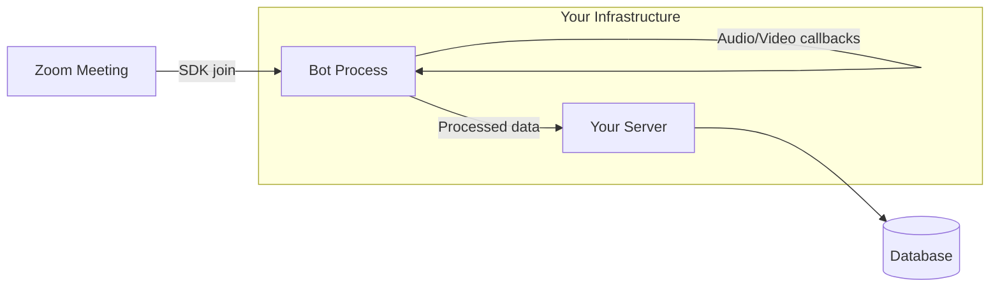
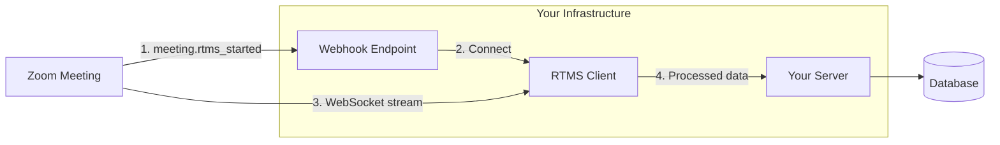

Your meeting bot works. Users see it join. Hosts admit it from the waiting room. You manage infrastructure to keep a participant connected for the duration of the call. **Zoom RTMS** gives you the same data (audio, video, transcripts, screen share) without the bot.

Meeting SDK bots join as participants. They appear in the roster, require host approval, and need compute resources to stay connected. RTMS streams meeting data directly to your backend via webhook and WebSocket. No participant tile. No waiting room. The user installs your app once, and every meeting streams automatically.

<YouTube id="-Zr7LejQjgc"/>

**What you'll need:**

- An existing Meeting SDK bot you want to migrate (or understanding of bot architecture)
- Transcript access via [RTMS](https://developers.zoom.us/docs/rtms/) (requires [Zoom Developer Pack](https://zoom.us/pricing/developer) credits; free trial credits are available)
- A backend to receive webhooks and maintain WebSocket connections
- A [Zoom General App](https://developers.zoom.us/docs/integrations/) with RTMS event subscriptions
- Optional: A [Zoom Surface App](https://developers.zoom.us/docs/zoom-apps/) for in-meeting UI

**What changes:**

- **No participant**: RTMS streams data without joining the meeting. Users see your app in the Apps panel, not the participant list.
- **Webhook-driven lifecycle**: Instead of joining via SDK, you receive `meeting.rtms_started` when streaming begins.
- **User-scoped authorization**: The app is installed per-user (or org-wide by admin). The user's presence determines stream availability.
- **Host approval model**: Hosts can allow or deny an app's request to access content. A host can choose **Always allow in my meetings**, and an admin can set an app to **Always allow**, so trusted apps are not asked each time.

**What stays the same:**

- Real-time transcript segments with speaker attribution
- Mixed or separated audio streams (L16 PCM at 8, 16, 32, or 48 kHz; see the [RTMS data types](https://developers.zoom.us/docs/rtms/data-types/))
- Video frames of the active speaker, or of one participant you choose (JPG or PNG at 5 fps or less, H.264 above that)
- Screen share capture
- Participant join/leave events

If you're building a new meeting integration from scratch, start with the [AI Meeting Notetaker](../ai-meeting-notetaker/) blueprint instead. This guide is for developers migrating an existing bot.

> **Don't want to build?** [Recall.ai](https://recall.ai) is an RTMS Preferred Partner and offers managed RTMS infrastructure: it handles the WebSocket connections and media processing, and you receive structured data through its API. [Attendee](https://attendee.dev) and [MeetStream](https://meetstream.ai) also provide RTMS support.

Follow along as we walk through the migration path.

## Features

This migration guide covers:

- **Side-by-side architecture comparison**: Bot vs. RTMS data flow and component differences
- **Capability mapping**: What your bot does today, and how RTMS and the Zoom Apps SDK do it better
- **Webhook handler setup**: Replace SDK join with event-driven stream initiation
- **WebSocket connection patterns**: Connect to RTMS streams using the `@zoom/rtms` SDK
- **Lifecycle management**: Handle stream start, stop, and reconnection scenarios
- **Stream persistence for long meetings**: The scheduler-as-app-owner pattern for virtual onsites
- **Data model migration**: Update session tracking from bot IDs to RTMS stream IDs
- **Chat**: Send meeting chat messages with the REST API or the Zoom Apps SDK
- **Failure modes**: Detect when media access has not started or has stopped, and recover
- **In-meeting notices and controls**: Use a Surface App to inform participants and give app users controls
- **Enterprise deployment**: Admin install flow for org-wide rollout

The reference implementation is [Arlo](https://github.com/zoom/arlo), a meeting assistant that demonstrates the complete RTMS pattern.

## Architecture

Meeting SDK bots and RTMS solve the same problem differently. Understanding the architectural shift is the first step.

### Bot Architecture (before)

Your bot runs as a headless participant. It joins via Meeting SDK, authenticates with a ZAK or OAuth token, and captures media through SDK callbacks. The bot process must stay connected for the meeting duration.

To join meetings outside your own account, a bot needs an On Behalf Of (OBF) token. The user authorizes your Marketplace app, your app requests that user's OBF token before the meeting, and the user has to be present in the meeting for the token to work. So a bot already depends on the same two things RTMS does, user authorization and user presence, and it still adds a participant to the meeting. See [Meeting SDK authorization](https://developers.zoom.us/docs/meeting-sdk/auth/).



**Characteristics:**
- Bot appears as a participant (visible in roster)
- Requires compute resources per concurrent meeting
- Must handle SDK lifecycle (join, reconnect, leave)
- Host may need to admit bot from waiting room

### RTMS Architecture (after)

RTMS streams data directly to your backend. Zoom sends a webhook when streaming starts, your server connects via WebSocket, and media flows without a participant joining.



**Characteristics:**
- No participant tile (app appears in Apps panel only)
- Webhook-driven: Zoom initiates the connection
- One signaling connection and one or more media connections per stream, not per participant
- User installs app once; all their meetings can stream

### From bot to RTMS and the Zoom Apps SDK

RTMS is one half of the replacement. RTMS captures the media. The [Zoom Apps SDK](https://developers.zoom.us/docs/zoom-apps/) gives you the in-meeting experience: a Surface App in a side panel for status, notices, and controls. Together they do what a bot does without putting a participant in the meeting. [Arlo](https://github.com/zoom/arlo) uses both.

| If your bot does this | Do this instead |
|-----------------------|-----------------|
| Receives meeting audio | RTMS audio, mixed or one stream per participant |
| Receives video | RTMS video of the active speaker, or of [one chosen participant](https://developers.zoom.us/docs/rtms/meetings/video-single-stream/) |
| Runs its own speech-to-text | RTMS transcripts, produced by Zoom with speaker attribution |
| Captures screen share | RTMS screen share (JPG or PNG at low frame rates, H.264 above) |
| Tracks who joins and leaves | RTMS participant events |
| Shows up in the roster so people know it is there | No participant. Zoom tells everyone that an app is accessing content and lists the app; your Surface App adds your own notice |
| Posts messages in meeting chat | The REST API when the meeting uses Continuous Meeting Chat, or the Zoom Apps SDK from your Surface App (see [Part 5](#part-5-send-chat-messages)) |
| Gives users start, stop, and pause commands | Zoom Apps SDK `startRTMS`, `stopRTMS`, `pauseRTMS`, and `resumeRTMS` from buttons in your Surface App |
| Shows status or a notice to everyone | A Surface App, with guest mode so every participant can open it |
| Runs a bot process for every meeting | No per-meeting process. Your backend holds WebSocket connections |
| Needs the host to admit it from the waiting room | Nothing joins. The host allows the app once, or sets it to always allow |

RTMS is receive-only. It does not send audio or video into the meeting, and it does not control the meeting (mute, end). RTMS captures the main session; when the meeting owner is the app user, the app keeps running if they move to a breakout room.

## Implementation Guide

This guide covers the key migration steps. For complete code, see the [Arlo reference implementation](https://github.com/zoom/arlo).

### Part 1: Replace SDK Join with Webhook Handler

#### Bot approach (before)

Your bot joins meetings by calling the Meeting SDK with credentials:

```javascript
// Meeting SDK bot approach
const client = new ZoomMeetingSDK();
await client.join({
  meetingNumber: meetingId,
  userName: 'Notetaker Bot',
  zak: zakToken,
  password: meetingPassword
});

client.on('audio', (buffer) => { /* process audio */ });
client.on('video', (frame) => { /* process video */ });
```

#### RTMS approach (after)

With RTMS, Zoom calls you. Set up a webhook endpoint to receive `meeting.rtms_started`:

**Input:** `meeting.rtms_started` webhook payload

**Output:** Validated webhook, RTMS session initiated

**Invariants:**
- Verify webhook signature using HMAC-SHA256 with timing-safe comparison
- Enforce 5-minute replay window on timestamp
- Respond with 200 OK within 3 seconds (process asynchronously)
- Track streams by `rtms_stream_id` (not `meeting_uuid`), and never open a second session for a stream you already have

```javascript
// Webhook signature verification (security-critical, keep concrete)
function verifyWebhookSignature(rawBody, timestamp, signature, secret) {
  const now = Math.floor(Date.now() / 1000);
  if (Math.abs(now - parseInt(timestamp, 10)) > 300) return false;

  const message = `v0:${timestamp}:${rawBody.toString('utf8')}`;
  const expected = 'v0=' + crypto
    .createHmac('sha256', secret)
    .update(message)
    .digest('hex');

  // timingSafeEqual throws if the buffers differ in length, so check first.
  const received = Buffer.from(String(signature));
  const computed = Buffer.from(expected);
  if (received.length !== computed.length) return false;
  return crypto.timingSafeEqual(received, computed);
}
```

**Other languages:** In Python, use `hmac.compare_digest`; in Go, use `crypto/subtle.ConstantTimeCompare`.

See [Arlo's webhook handler](https://github.com/zoom/arlo/blob/main/backend/src/routes/rtms.js) for the complete implementation.

### Part 2: Connect to RTMS WebSocket

After validating the webhook, connect to the RTMS stream using the provided `server_urls`.

**Input:** `server_urls`, `rtms_stream_id`, `meeting_uuid` from webhook payload

**Output:** Active WebSocket connection receiving media frames

**Invariants:**
- Use the `@zoom/rtms` SDK for Node.js or Python (or implement the WebSocket protocol directly for other languages)
- Register all media handlers before calling `join()`
- Clean up when the `meeting.rtms_stopped` webhook arrives
- Track connection state per `rtms_stream_id`
- If a connection drops mid-meeting, reconnect as described in [Reconnection](#reconnection); do not wait for a new webhook

```javascript
// RTMS connection pattern
const rtms = require('@zoom/rtms').default;

function connectToStream(payload) {
  // payload is the meeting.rtms_started webhook payload
  const client = new rtms.Client();

  // Register handlers BEFORE joining
  client.onTranscriptData((data, size, timestamp, metadata) => {
    // data: transcript text as a Buffer; metadata: { userId, userName }
    processTranscript({ text: data.toString('utf8'), timestamp, ...metadata });
  });

  client.onAudioData((data, size, timestamp, metadata) => {
    // L16 PCM audio data
    processAudio(data);
  });

  client.join(payload);
}
```

**Other languages:** The `@zoom/rtms` SDK supports Node.js and Python (`pip install rtms`). For Go or other stacks, implement the [WebSocket protocol](https://developers.zoom.us/docs/rtms/) directly.

### Part 3: Handle Lifecycle Differences

Meeting SDK bots control their own lifecycle. RTMS streams are controlled by users and hosts. This is the most significant behavioral change in the migration.

#### Stream start conditions

RTMS starts when ALL conditions are met:
- The meeting host's organization has RTMS enabled at the account level
- For in-meeting start through the Zoom Apps SDK, the Zoom desktop client is version 6.5.5 or later
- The app is installed for the user (app owner)
- Account/group/user policy allows RTMS
- Host approves (if required) or auto-start is enabled
- At least one app owner is in the meeting (or auto-start triggered before join)

#### Stream persistence

| Event | Bot Behavior | RTMS Behavior |
|-------|--------------|---------------|
| Host leaves | Bot stays | Stream continues IF app owner used auto-start and never joined. Stream STOPS if app owner joined the meeting. |
| App owner leaves | N/A | **Stream stops** |
| Host disables sharing | Bot unaffected | Stream stops; new `rtms_started` if re-enabled |
| Host handoff to org with RTMS disabled | Bot unaffected | Stream stops permanently |
| App owner moves to breakout room | N/A | Stream stops; may resume when returning to main room. If the app user owns the meeting, the app keeps running |
| Network disconnect | Bot reconnects | Your app reconnects within the window Zoom allows (see [Reconnection](#reconnection)) |

**WARNING: App owner leaving kills the stream.** This is the most common migration surprise. With bots, you control when to leave. With RTMS, if the app owner leaves the meeting, the stream terminates even if other participants remain. Plan for this in your product flow.

#### Stream persistence for long meetings (virtual onsites)

For multi-hour meetings where participants rotate (virtual onsites, all-day workshops, interview panels), you need the stream to persist regardless of who joins or leaves. The key insight:

**If the app owner is the meeting's original scheduler AND auto-start is enabled, the RTMS stream persists for the entire meeting lifetime. The scheduler does not need to join or stay in the meeting.** An app used by the owner of a meeting can run without that user being present.

This means:
- Your app must be installed for the **meeting scheduler** (the person who created the meeting), not just the participants
- Use the scheduler's OAuth credentials when configuring auto-start for the meeting
- If your calendar sync knows who scheduled the meeting, use that user's context

**When the scheduler is not your user:** If an external party scheduled the meeting (candidate, external recruiter, customer), you cannot use their credentials for auto-start. Options:
1. Use a participant who is your user, accepting the risk that the stream may end if they leave
2. Prompt the external scheduler to install your app (may not be practical)

#### Reconnection

RTMS uses a signaling connection that manages the session and media connections that carry the data. What you reconnect depends on which one dropped. Zoom's [Failover and reconnection](https://developers.zoom.us/docs/rtms/meetings/failover-reconnection/) guide has the full procedure and sample code.

| Scenario | How you find out | What to do |
|----------|------------------|------------|
| RTMS server failure | `meeting.rtms_started` arrives for an `rtms_stream_id` you already have | Tear down the existing connections and reconnect with the new `server_urls`. The `meeting_uuid` and `rtms_stream_id` stay the same |
| Signaling connection dropped | `meeting.rtms_interrupted` webhook | Reconnect signaling and media. The server waits about 60 seconds |
| Media connection dropped | `MEDIA_CONNECTION_INTERRUPTED` event on the signaling connection | Reconnect the affected media connection. The server waits about 30 seconds |
| Stream terminated | `meeting.rtms_stopped` with a `stop_reason` of 10 to 19, or 24 | The reconnection window was missed. Start the RTMS connection process again from the beginning |

Retry with exponential backoff, starting at 3 seconds and doubling to a cap of 30 seconds. If the attempts run out, treat the stream as unrecoverable and stop retrying.

`meeting.rtms_stopped` carries a [`stop_reason`](https://developers.zoom.us/docs/rtms/data-types/#rtms_stop_reason) that tells you why the stream ended: for example `1` (host triggered), `2` (user triggered), `3` (the app user left the meeting), `5` (host disabled the app), or `6` (meeting ended). Store it with the session.

#### Handling multiple users

More than one person in a meeting can start a stream. When several users in the same meeting have your app installed, Zoom may send a `meeting.rtms_started` webhook for each of them, and your app chooses which to accept. Use `meeting_uuid` to tell whether you already have a stream running for the meeting:

**Invariants:**
- Process only the first webhook per `meeting_uuid`
- Ignore subsequent webhooks while a stream is active
- If active stream drops and new webhook arrives, treat as reconnection
- Track which user's stream you're using; if that user leaves and a new webhook arrives from another user, you can switch

### Part 4: Update Your Data Model

Your existing bot likely tracks sessions by meeting ID and bot instance. RTMS uses different identifiers.

| Bot Model | RTMS Model |
|-----------|------------|
| `bot_id` (your instance) | `rtms_stream_id` (Zoom-assigned) |
| `meeting_id` (numeric) | `meeting_uuid` (string, unique per instance) |
| `participant_id` (bot's ID) | N/A (no participant) |
| Bot status (joining, connected, leaving) | Stream status (waiting, connected, ended) |

**Schema migration:**

```sql
-- Add RTMS columns to existing sessions table
ALTER TABLE meeting_sessions ADD COLUMN rtms_stream_id VARCHAR(255);
ALTER TABLE meeting_sessions ADD COLUMN stream_status ENUM('waiting', 'connected', 'ended');

-- Index for webhook deduplication
CREATE UNIQUE INDEX idx_rtms_stream ON meeting_sessions(rtms_stream_id);
```

### Part 5: Send Chat Messages

RTMS receives media; it does not post to chat. If your bot sends chat messages, such as a note that an app is taking notes or a link to manage it, you have three options:

**Option A: REST API (with Continuous Meeting Chat)**

When the meeting uses Continuous Meeting Chat, the meeting chat is a Team Chat channel, and you can post to it with the [Chat Messages API](https://developers.zoom.us/docs/api/rest/reference/chat/methods/#operation/sendChatMessage):

```javascript
await fetch('https://api.zoom.us/v2/chat/users/me/messages', {
  method: 'POST',
  headers: {
    Authorization: `Bearer ${userAccessToken}`,
    'Content-Type': 'application/json',
  },
  body: JSON.stringify({
    to_channel: meetingChatChannelId,
    message: "I'm using an app to take notes.",
  }),
});
```

**Option B: Surface App**

Build a [Zoom Surface App](https://developers.zoom.us/docs/zoom-apps/) that shows the app's status and a stop button in the meeting. The Zoom Apps SDK can also send chat messages from the Surface App.

**Option C: Pre-meeting notification**

Tell participants in the email or calendar invite, before the meeting starts, that an app will take notes. Less interactive but simpler.

### Part 6: Plan for Failure Modes

Bots fail visibly: the bot doesn't join, or it disconnects and participants notice. RTMS fails quietly: no webhook arrives, or the stream drops. Build detection and recovery, and show the state in your Surface App so the app user knows.

#### Failure modes table

| Failure Mode | How to Detect | Mitigation |
|--------------|---------------|------------|
| RTMS not enabled for host org | No `meeting.rtms_started` webhook within 60 seconds of meeting start | Tell the app user that RTMS is not enabled for the host's organization; notify your ops team |
| Zoom client too old (< 6.5.5) | No `meeting.rtms_started` received | Prompt the user to update Zoom |
| Host denies RTMS approval | No `meeting.rtms_started`, or `meeting.rtms_stopped` fires immediately | Tell the app user that the host declined |
| WebSocket connection failure | Connection error or timeout when connecting to `server_urls` | Retry with exponential backoff; tell the app user if retries are exhausted |
| Signaling connection drops | `meeting.rtms_interrupted` webhook | Log the gap timestamp; reconnect signaling and media within about 60 seconds, with backoff |
| Media connection drops | `MEDIA_CONNECTION_INTERRUPTED` event | Log the gap timestamp; reconnect the media connection within about 30 seconds |
| Reconnection window missed | `meeting.rtms_stopped` with `stop_reason` 10 to 19, or 24 | Restart the RTMS connection process; if that fails, finalize what you captured |
| App owner leaves (stream dies) | `meeting.rtms_stopped` with `stop_reason` 3 while meeting is still active | If another app owner is in the meeting, their webhook may arrive; otherwise finalize what you captured |
| Duplicate webhooks | Multiple `meeting.rtms_started` for same `meeting_uuid` | Deduplicate; process only one stream; ignore others |
| RTMS server failover | `meeting.rtms_started` with an `rtms_stream_id` you already have | Tear down and reconnect with the new `server_urls` |
| Concurrent stream limit reached | Streams fail to start once the account is at its limit (5 on the free trial, 2,000 with a Developer Pack) | Reduce separate media connections per meeting; raise the limit with your account team |
| Webhook signature invalid | HMAC verification fails | Reject the request; log for security review |
| Webhook replay attack | Timestamp outside 5-minute window | Reject the request |

#### Decision logic

```
Meeting scheduled
  │
  ├── Is scheduler an app owner with RTMS installed?
  │     ├── YES → Configure auto-start with scheduler's credentials
  │     └── NO  → Use first participant who is an app owner (accept stream-drop risk)
  │
Meeting starts
  │
  ├── meeting.rtms_started received within 60s?
  │     ├── YES → Connect RTMS WebSocket, start media access
  │     └── NO  → Tell the app user that media access has not started, and why if you know
  │
RTMS stream active
  │
  ├── Stream healthy → Continue
  ├── Connection drops (meeting.rtms_interrupted or MEDIA_CONNECTION_INTERRUPTED)
  │     ├── Reconnect with backoff inside the window (about 60s signaling, 30s media), log gap
  │     └── Window missed (meeting.rtms_stopped, stop_reason 10-19 or 24)
  │           └── Restart RTMS; if that fails, finalize what you captured and tell the app user
  ├── meeting.rtms_stopped for any other reason → Finalize the session
  │
Meeting ends → Finalize all sessions
```

### Run the Sample

[Arlo](https://github.com/zoom/arlo) demonstrates the complete RTMS pattern with transcript capture, AI processing, and in-meeting display.

| Platform | What you get |
|----------|--------------|
| [**Deploy to Render**](https://render.com/deploy?repo=https://github.com/zoom/arlo) | Backend, frontend, RTMS service, managed database |
| [**Deploy to Railway**](https://railway.app/new?repo=https://github.com/zoom/arlo) | Backend, frontend, RTMS service, managed database |

<details>
<summary><strong>Local setup</strong></summary>

1. Clone and configure:
   ```bash
   git clone https://github.com/zoom/arlo.git && cd arlo && cp .env.example .env
   ```

2. Start ngrok with a static domain:
   ```bash
   ngrok http 3000 --domain=your-subdomain.ngrok-free.app
   ```

3. Create a Zoom General App at [marketplace.zoom.us](https://marketplace.zoom.us/):
   - Copy Client ID and Client Secret
   - Set OAuth Redirect URL to `https://YOUR-NGROK-URL/api/auth/callback`
   - Under Scopes, add `zoomapp:inmeeting`, `meeting:read:meeting`, and the RTMS scope `meeting:read:meeting_transcript`
   - Under Surface, set the Home URL to `https://YOUR-NGROK-URL`
   - Add an Event Subscription with endpoint `https://YOUR-NGROK-URL/api/rtms/webhook` for `meeting.rtms_started`, `meeting.rtms_stopped`, and `meeting.rtms_interrupted`

4. Fill in `.env` with your credentials

5. Start the services:
   ```bash
   docker-compose up --build
   ```

</details>

## App Manifest

The migration requires updating your Zoom App configuration from Meeting SDK to RTMS.

### Required Scopes

| Scope | Purpose |
|-------|---------|
| `meeting:read:meeting` | Meeting metadata |
| `user:read` | User profile for personalization |
| `meeting:read:meeting_transcript` | Receive the live transcript through RTMS |
| `meeting:read:meeting_audio` | Receive meeting audio through RTMS (only if you capture audio) |

### RTMS Configuration

RTMS access is granted through scopes that select which meeting media your app receives. They are separate from the REST API scopes above, and they cannot be marked optional.

1. In your app settings, go to **Scopes**
2. Choose **+ Add Scopes** and search for _RTMS_
3. Add a scope for each media type you need:
   - **Transcripts**: Speech-to-text segments
   - **Audio**: PCM audio stream
   - **Video**: H.264 video frames
   - **Screen Share**: Screen capture

### Event Subscriptions

| Event | When it fires | Your action |
|-------|---------------|-------------|
| `meeting.rtms_started` | User starts RTMS or auto-start triggers | Connect to WebSocket |
| `meeting.rtms_stopped` | Stream ends (host stops, meeting ends, etc.) | Read `stop_reason`; finalize the session, or restart if the reconnection window was missed |
| `meeting.rtms_interrupted` | The signaling connection dropped | Reconnect signaling and media |

### Auto-Start Configuration

For hands-free capture (no user action required each meeting), turn on auto-start. It is set where the app is used, not in the app's Marketplace build settings:

- **Account admin:** in the Zoom web portal, go to **Account Management** > **Account Settings** > **Zoom Apps** and turn on **Share realtime meeting content with apps**. Under **Apps that access content in meetings**, choose **+ Add app**, select your app, and set where it auto starts (**Meetings users own**, or **Meeting users attend** for internally or externally hosted meetings) and whether hosts are asked (**Always ask** or **Always allow**).
- **App user:** a user who has installed the app can also choose which meeting types trigger auto-start for them.

See [Host and admin tools and controls](https://developers.zoom.us/docs/rtms/meetings/ux-host-admin-tools-ctrls/).

### Enterprise Deployment (Admin Install)

For enterprise customers, individual OAuth flows per user create friction. Zoom supports admin-level installation where an admin installs the app for their organization, and users can start using it without individual consent flows.

#### Admin install flow

1. **Admin enables RTMS at the organization level**
   - Zoom web portal > **Account Management** > **Account Settings** > **Zoom Apps** > **Share realtime meeting content with apps**
   - This is the master switch. If disabled, RTMS will not work for any meeting hosted by this organization.

2. **Admin installs your app for the organization**
   - Admin navigates to your app's Zoom Marketplace listing (or a direct install link you provide)
   - Admin approves OAuth scopes for the organization
   - Admin selects which users or groups the app is installed for (all users or a subset)

3. **Admin configures RTMS settings**
   - Add your app under **Apps that access content in meetings** and choose where it auto starts
   - Optionally set participant permissions to **Always allow** so hosts are not asked each time
   - Optionally enable "Allow meeting to start without host". A meeting cannot begin without its host unless this is on, and the app cannot start in a meeting that has not started

#### Post-install behavior

- **First meeting starts automatically**: No user login or app interaction required. When a meeting starts for an installed user, Zoom sends `meeting.rtms_started` to your webhook.
- **No bot joins**: Participants see no additional attendee. Your app is listed in the meeting's Apps panel but does not appear as a participant.
- **Works for non-hosts**: A user who is not the host can trigger RTMS via auto-start as long as they are an app owner (the app is installed for them).

#### Required Zoom account settings

| Setting | Required Value | Where to Configure |
|---------|----------------|-------------------|
| Share realtime meeting content with apps | Enabled | Account Settings > Zoom Apps |
| Your RTMS app installed | Yes, for target users | Zoom Marketplace |
| Auto-start for your RTMS app | Set for the meetings you need | Account Settings > Zoom Apps > Apps that access content in meetings |
| Permissions for participants | **Always allow** (recommended) | Same app entry |
| Allow meeting to start without host | Enabled (if needed) | Zoom Admin > Meeting Settings |
| Zoom client version | 6.5.5+ | All users |

---

## In-Meeting Notices and Controls

RTMS does not record. It makes meeting media available to your application, so Zoom notifies participants that an app is accessing content instead of showing the recording indicator. Participants see Zoom's [RTMS disclosure](https://developers.zoom.us/docs/rtms/meetings/ux-participant/), "The content of this meeting is being sent to one or more apps." They can also see which app is accessing content and who is using it.

A Surface App built with the Zoom Apps SDK lets you add your own in-meeting notices and controls: it can tell participants what the app is doing, and give the app user buttons to start, pause, resume, and stop it. The Surface App and your RTMS app can share the same Zoom App registration.

- **Notices**: Show the app's status and what it does with meeting content in the side panel.
- **Controls**: Call `startRTMS`, `pauseRTMS`, `resumeRTMS`, and `stopRTMS` from buttons in the panel. The app user and the host can also pause or stop the app from Zoom's own controls.
- **Everyone in the meeting**: Participants who have not installed your app do not see it in their Apps panel. Turn on [guest mode](https://developers.zoom.us/docs/zoom-apps/guides/guest-mode/) in the Zoom Apps SDK so every participant can open the same web experience as a side panel in the meeting.

To pause on your own side as well, stop processing the stream while keeping the WebSocket open, and mark the pause and resume timestamps. To stop, close the WebSocket connection; the user starts RTMS again to resume.

---

## Acceptance Criteria

Use this checklist to verify your migration:

**Webhook and connection:**
- Webhook endpoint validates signatures with timing-safe comparison
- Webhook endpoint enforces 5-minute replay window
- A `meeting.rtms_started` for a stream already being handled triggers a reconnect, not a second session
- WebSocket handlers registered before `join()` call
- Stream cleanup runs on `onLeave` and `meeting.rtms_stopped`
- Multiple app owners in same meeting deduplicated by `meeting_uuid`

**Data model:**
- Session data model updated with RTMS identifiers (`rtms_stream_id`, `meeting_uuid`)
- Stream status tracking implemented (waiting, connected, ended)

**Lifecycle and reliability:**
- The app user is told when media access has not started or has stopped
- Stream persistence strategy defined for long meetings (scheduler-as-app-owner pattern)
- Gap detection and logging implemented for mid-meeting connection drops
- Reconnection tested for `meeting.rtms_interrupted`, a dropped media connection, and a restart after `stop_reason` 10 to 19 or 24

**In-meeting notices and controls:**
- Surface App shows the app's status to the app user
- Start, pause, resume, and stop controls tested (if offered to users)
- Guest mode tested, if every participant should be able to open the panel

**User experience:**
- Chat messages sent with the REST API or the Zoom Apps SDK, or replaced with a pre-meeting notification
- Users no longer see bot participant in meetings
- Admin install flow documented for enterprise customers

**Decommissioning:**
- Bot infrastructure decommissioned after migration validation

---

## Related Resources

- [RTMS Documentation](https://developers.zoom.us/docs/rtms/): Official API reference
- [AI Meeting Notetaker Blueprint](../ai-meeting-notetaker/): Building from scratch with RTMS
- [@zoom/rtms SDK](https://www.npmjs.com/package/@zoom/rtms): Node.js client library
- [Zoom Developer Forum](https://devforum.zoom.us/): Community support
- [Arlo Repository](https://github.com/zoom/arlo): Reference implementation
