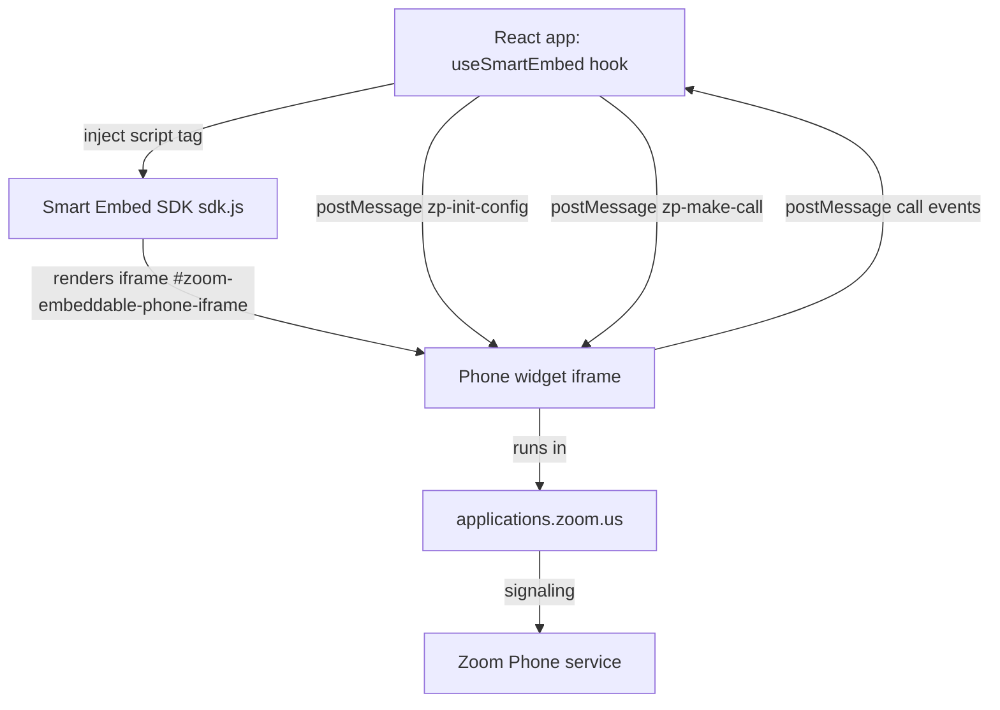
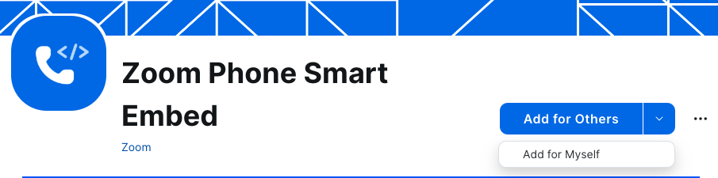
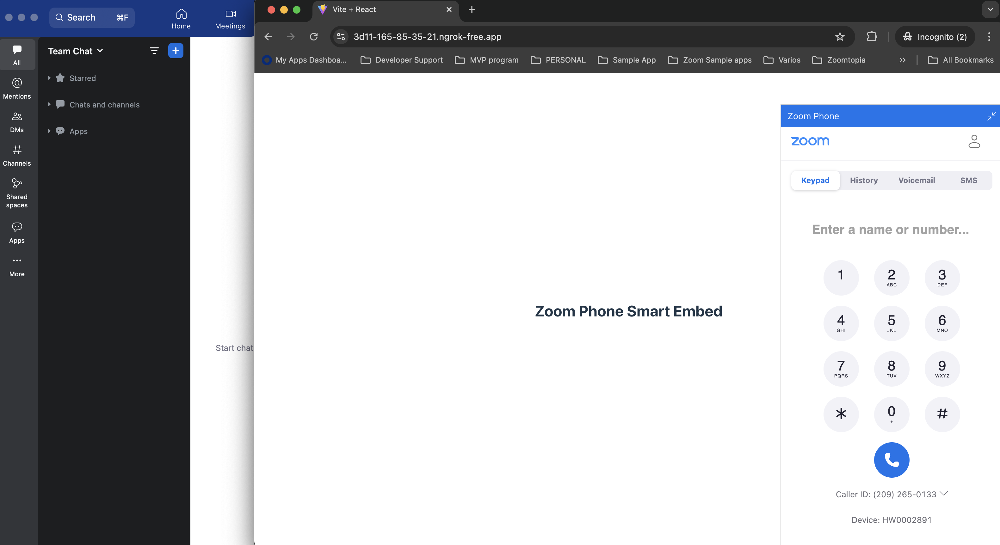

A React app embeds the Zoom Phone smart embed widget, dials numbers from its own UI, and shows call lifecycle events as they happen. Agents place calls from a CRM or support console without switching to the Zoom client, and the host app receives ringing, connected, and ended events as they occur.

Phone calls usually start in a separate window. A customer record opens in one tab and the dialer sits in another, so agents copy numbers by hand and lose context between calls. Embedding the dialer in the same page keeps the number, the record, and the call together.

**What you'll need:**

- A [Zoom Phone](https://www.zoom.com/en/products/phone/) license for the user who places calls (the widget signs in as that user)
- The [Zoom Phone Smart Embed](https://marketplace.zoom.us/apps/jnMbv3s2TaCBYMFz5yvzkA) app added to your Zoom account from the Zoom Marketplace
- Node.js 20 or later with npm
- A tunnel such as [ngrok](https://ngrok.com/) to serve the dev app over HTTPS, because the widget only runs in approved domains
- The Zoom desktop client running on the same machine, so the widget can place and receive calls
- Optional: SMS with 10DLC enabled, if you want the app to send text messages through the widget

**Features:**

- Embedded Zoom Phone dialer rendered inside a React page
- Click-to-call from a phone number input, with the number validated before dialing
- Real-time call event log with ringing, connected, ended, voicemail, and recording events
- Clean teardown when the component unmounts, so the widget does not leak listeners or script tags

Zoom offers the Zoom Phone app and its built-in dialer for agents who work inside the Zoom client. Build custom when the calling experience has to live inside your own application, with your own record lookup, your own call notes, or your own layout. The [Phone Smart Embed guide](https://developers.zoom.us/docs/phone/smart-embed-guide/) covers the embed options in full.

The architecture below shows how the React app loads the widget and exchanges messages with it.

## Architecture

The React app loads Zoom's Smart Embed SDK script at runtime. When the script loads, the SDK renders an iframe with the id `zoom-embeddable-phone-iframe` that hosts the phone widget. The app never touches the call audio or the Zoom session directly. All control goes through `window.postMessage`: the app sends configuration and commands to the iframe, and the iframe sends call events back to the app. Every message is scoped to the origin `https://applications.zoom.us`, and the app accepts incoming messages only from that origin.

A single custom hook, `useSmartEmbed`, owns the script lifecycle and the message listener. A service module wraps the outbound messages. The UI components never post messages directly.



| Component | Responsibility | Stack in this blueprint | Alternatives |
|-----------|----------------|-------------------------|--------------|
| Smart Embed SDK | Renders the phone widget iframe and handles calling | Loaded from `vaapplicationscontent.zoom.us` | Iframe embed method (same widget, different loading path) |
| `useSmartEmbed` hook | Loads the script, sends init config, attaches the event listener, cleans up | React hook in `src/components/SmartEmbed.jsx` | Any framework lifecycle hook (Vue, Svelte, Angular) |
| Smart Embed service | Builds and posts `zp-init-config` and `zp-make-call` messages | Plain module in `src/services/smartEmbedService.js` | Inline `postMessage` calls in components |
| Event log | Filters incoming events and renders them | `src/components/EventLog.jsx` | Forward events to your CRM or backend |
| Dev tunnel | Serves the Vite dev server over HTTPS for the approved domain | ngrok | Cloudflare Tunnel, or a deployed HTTPS origin |

### Message contract

Outbound messages from the app to the widget:

| Message type | When sent | Payload |
|--------------|-----------|---------|
| `zp-init-config` | Once, after the SDK script loads and the iframe exists | Feature configuration (see below) |
| `zp-make-call` | When a user clicks Call | Destination phone number and optional caller ID |

Inbound events from the widget to the app:

| Event | Meaning |
|-------|---------|
| `zp-call-ringing-event` | An inbound or outbound call is ringing |
| `zp-call-connected-event` | The call was answered and connected |
| `zp-call-ended-event` | The call ended |
| `zp-call-log-completed-event` | The call log is ready |
| `zp-call-recording-completed-event` | A call recording finished processing |
| `zp-call-voicemail-received-event` | A voicemail arrived |
| `zp-sms-log-event` | An SMS log entry was created |
| `zp-save-log-event` | The widget asked the host to save a log |

The widget reports these events whether or not your app listens to them. Subscribe only to the events the UI renders.

## Implementation Guide

This section walks through the four pieces of the app: the script hook, the message service, the click-to-call form, and the event log. Each piece lists its contract first. Code appears only where the detail matters for correct behavior or security.

### Load the SDK and manage its lifecycle

**Input:** The `SmartEmbed` component mounts in the React tree.

**Output:** The SDK script is present in the document, the widget iframe exists, the init configuration has been sent once, and the component exposes a `loaded` state.

**Invariants:**

- Create the `<script>` tag with `async`, pointing at the Smart Embed SDK URL (`https://vaapplicationscontent.zoom.us/phoneSdk/static/smart-embed/js/sdk.js`)
- Send `zp-init-config` only after the script's `load` event, and wait for the iframe to appear before posting. The reference app waits 3 seconds after load. Replace the fixed delay with a check for `#zoom-embeddable-phone-iframe` in production.
- Register the `message` listener once per mount and remove it on unmount
- Remove the script tag on unmount so a remount loads a fresh instance
- Do not render the component under `React.StrictMode` in development. StrictMode mounts effects twice, which renders two widgets. Remove `StrictMode` from `main.jsx` for this sample, or guard the effect so it runs once.

The listener must reject messages from any other origin before it reads the payload:

```javascript
const ZOOM_ORIGIN = 'https://applications.zoom.us';

function handleZoomMessage(event) {
  // Reject before reading the payload. Any page can post to this window.
  if (event.origin !== ZOOM_ORIGIN) return;

  // Confirm the event name field against the Smart Embed docs before relying on it.
  const eventName = event.data?.type;
  if (typeof eventName !== 'string') return;

  console.log('[smart-embed]', eventName, event.data);
}

window.addEventListener('message', handleZoomMessage);
// On unmount: window.removeEventListener('message', handleZoomMessage);
```

### Send the init configuration

**Input:** The widget iframe is present in the DOM.

**Output:** The widget receives a `zp-init-config` message with the feature settings for this app.

**Invariants:**

- Target the iframe by its id, `zoom-embeddable-phone-iframe`
- Post to the exact origin `https://applications.zoom.us`, never to `*`
- The reference configuration turns off save-log, auto-log, contact search, contact matching, and inactive-tab call events, and sets an empty note page configuration. Key names and allowed values are defined by the Smart Embed guide. Copy them from the guide rather than from this blueprint, because they change with the SDK.

### Place a call

**Input:** A destination phone number from the click-to-call form, and an optional caller ID.

**Output:** A `zp-make-call` message posted to the widget. The widget dials the number.

**Invariants:**

- Validate the number before posting. Accept E.164 format (`+` followed by country code and digits) and reject everything else with a visible error.
- Post only when the widget has loaded. A click before load returns an error to the user instead of silently dropping the call.
- Post to `https://applications.zoom.us` only.
- Keep caller ID optional. If the account has one primary number, the widget uses it when none is supplied.

The reference click-to-call component renders a number input and a Call button. The Call button calls `makeCall(phoneNumber, callerId)` from the service module, and the service posts the message with `autoDial` enabled.

### Show call events

**Input:** Messages from the widget whose origin is `https://applications.zoom.us` and whose event name is in the supported list.

**Output:** One entry per event in the log, each with its event type, call ID, direction, and caller name when present.

**Invariants:**

- Filter by origin first, then by event name. Drop any event name that is not in the supported list.
- Generate each entry ID once, when the event arrives. The reference app uses `Date.now()`, which can collide if two events arrive in the same millisecond. Use a counter or `crypto.randomUUID()` for production.
- Render missing fields as "N/A" (for fields that do not apply) or "Unknown" (for fields the event omits). Do not throw on a missing field.
- Remove an entry when the user closes it. Keep the log in component state. Persist it to your backend if you need an audit trail.

### Run the Sample

The sample is a Vite React app. Create it, install dependencies, and start the dev server:

```bash
npm create vite@latest zoom-phone-smart-embed -- --template react
cd zoom-phone-smart-embed
npm install
npm run dev
```

Add the tunnel host to `server.allowedHosts` in `vite.config.js`, then expose the dev server over HTTPS:

```bash
ngrok http 5173
```

Copy the HTTPS URL from ngrok. Free ngrok URLs change on each restart, so update the approved domain each time. In the Zoom Marketplace, open the Zoom Phone Smart Embed app, click **Configure App**, and add the ngrok URL under **Edit Approved Domains**.

Open the ngrok URL, sign in to the phone widget, keep the Zoom client running, enter a number, and click **Call**. Call events appear in the log as the call progresses.





**Deploy anywhere:** The sample runs on any HTTPS origin you approve in the Marketplace app. Add the production domain under **Edit Approved Domains** before you deploy.

## App Manifest

The `manifest.json` in this directory describes a Zoom General app with the Phone SDK embed enabled. Use it as a starting point when you create the app through the Zoom Marketplace manifests API or when you review the configuration in the Marketplace UI.

| Setting | Value in `manifest.json` | Purpose |
|---------|--------------------------|---------|
| `features.embed.phone_sdk.enable` | `true` | Enables the Phone SDK embed, which is what the Smart Embed widget uses |
| `features.development_home_uri` | `https://YOUR_NGROK_DOMAIN_HERE` | Home URL during development. Replace with your tunnel domain. |
| `features.production_home_uri` | `https://YOUR_PRODUCTION_DOMAIN_HERE` | Home URL in production. Replace with your deployed origin. |
| `oauth_information.development_redirect_uri` | `https://YOUR_NGROK_DOMAIN_HERE/auth/callback` | Redirect URI for development |

The Smart Embed walkthrough in Zoom's docs uses the Zoom Phone Smart Embed Marketplace app, and the article does not list OAuth scopes for it. The manifest sets no scopes. If your build adds server-side Zoom API calls (for example, to look up call logs), add the scopes those calls need and document each one here with its purpose.

**Note:** The Marketplace app's approved domains control where the widget can run. The manifest does not replace that setting.

**Validation:** Run `npm run validate-zoom-manifest -- phone-smart-embed-react` before you open a PR. The validator requires Zoom credentials in `.env`.
