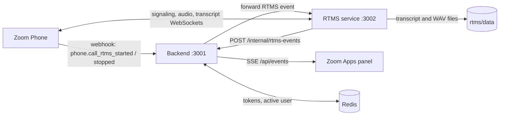
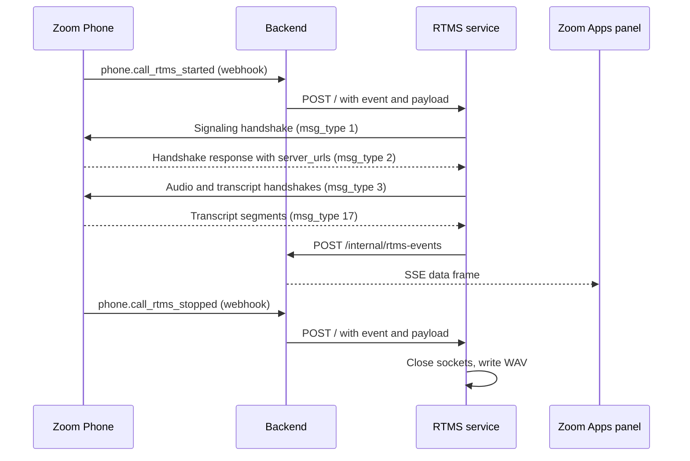

A real-time agent assistant streams call transcripts and audio from RTMS and displays them in a Zoom Surface App that runs inside the Zoom Phone client. The panel shows live call context, a speaker-labeled transcript, a summary bullet every 30 seconds, and keyword chips with suggested agent prompts. Every panel updates while the call is in progress.

Agents listen, look things up, and take notes at the same time, which makes it hard to act on information while the call is live. A real-time phone agent assistant surfaces key points as the conversation happens, so agents can stay focused on the caller instead of switching context.

**What you'll need:**

- A [Zoom Phone](https://www.zoom.com/en/products/phone/) license enabled in your account.
- Transcript and audio access via [RTMS](https://developers.zoom.us/docs/rtms/phone) (requires [Zoom Developer pack](https://zoom.us/pricing/developer?_gl=1*130nhse*_gcl_au*NTQ5ODU1MjIwLjE3OTMxMjIyMzEuMTQyMTI3MjAzLjE3OTUxMTYyOTMuMTc5NTExNjI5My42Nzg4NzIzMDkuMTc5NTExNjI5My4xNzk1MTE2Mjkz*_ga*Nzk3Mjc3MTExLjE3NzQzNjE5NjA.*_ga_L8TBF28DDX*czE3OTUxODc5ODAkbzEzMyRnMSR0MTc5NTE4Nzk4MSRqNTkkbDAkaDA.) credits; free trial credits are available)
- A [Zoom General App](https://developers.zoom.us/docs/zoom-apps/) with Surface feature enabled to display the agent assistant during the call. 
- Node.js 18 or later, Docker and Docker Compose, and [ngrok](https://ngrok.com/docs/getting-started) for a public HTTPS URL during development
- Redis for OAuth token storage (provided by Docker Compose) and FFmpeg for WAV output (included in the RTMS container image)

## Features

- **Call context**: Call ID and answer start time from the Zoom Phone client
- **Live transcript**: Streamed to the panel by speaker and saved to one text file per call
- **Keyword chips and prompts**: Mention counts for frequent terms, and live prompts that expire after 10 seconds
- **Rolling summary**: One new bullet every 30 seconds, not a summary after the call
- **Per-call audio**: A 16 kHz, 16-bit WAV written when the call ends
- **Secure access**: OAuth 2.0 with automatic token refresh and per-user token storage in Redis


<!-- SCREENSHOT PLACEHOLDER: the panel mid-call, showing all four sections. Save as images/panel-live-call.png and reference it here. -->

<!-- DEMO VIDEO PLACEHOLDER: 30 seconds to 6 minutes, linked as [Watch the demo](https://www.youtube.com/watch?v=...) -->

## Architecture

Zoom streams transcript and audio segments to the RTMS service over WebSocket. For each transcript segment, the RTMS service runs four steps: keyword detection, summary windowing, a line in the transcript file, and an event posted to the backend. The backend relays each event to the panel over Server-Sent Events (SSE).

The RTMS service keeps all per-call state in memory. Tokens and the active user ID live in Redis. The panel only receives events. It calls the backend for Zoom API requests and never talks to RTMS directly.

### Components

| Component | Responsibility | Our stack |
|-----------|----------------|-----------|
| **Transcript and audio streaming**  | Connects to Zoom's RTMS signaling, audio, and transcript WebSockets, then writes transcript and audio files | Node.js, `ws`, Express, FFmpeg. Implements the RTMS protocol. |
| **Backend**  | Verifies webhooks, runs OAuth, stores tokens and the active user ID in Redis, relays events over SSE, proxies Zoom API calls | Express, Redis |
| **Frontend**  | Renders the four panel sections inside the Zoom client in real time | React Surface App, Zoom Apps SDK |



The sequence for one call:



### Why this architecture

The RTMS service runs apart from the backend because it holds long-lived WebSocket connections and per-call state in memory. The backend handles public HTTP, webhook verification, and OAuth, and keeps only its SSE connections in memory. You can restart or replace the RTMS service without changing the webhook endpoint that Zoom calls. A restart ends calls in progress: the sample closes their sockets on shutdown and finishes their audio files, but live transcription and summaries for those calls stop. The trade-off is that every event for one stream must reach the same RTMS process. 

### Agent integration map

If you're adding this to an existing codebase, check what you already have before adding anything:

| Required capability | Reuse when present | Add when missing |
|--------------------|--------------------|------------------|
| Webhook endpoint | Existing API routes | Express route for `POST /api/webhooks/zoom` |
| Signature verification | Existing HMAC middleware that reads the raw body | `verifyZoomSignature()` from the Implementation Guide |
| WebSocket client to Zoom | Existing WebSocket client library | `ws` client in an RTMS service |
| Real-time push to the panel | Existing WebSocket or SSE layer | SSE endpoint (`/api/events`) |
| Token storage | Existing Redis or database token store | Per-user token storage keyed by Zoom user ID |
| Panel | Existing React or SPA frontend | Zoom Apps SDK initialization and an EventSource client |

## Implementation Guide

Each subsection names the file that implements it. Paths are relative to the sample repo root. Business logic uses Input, Output, and Invariants. Security-critical code stays as concrete snippets.

Code examples are from [phone-rtms-auto sample app](https://github.com/zoom/phone-rtms-auto).

### Webhook intake and forwarding

Files: `backend/server.js` (`/api/webhooks/zoom`), `backend/middleware/security.js` (`validateZoomWebhook`, `handleZoomUrlValidation`)

**Input:** `POST /api/webhooks/zoom` with headers `x-zm-request-timestamp` and `x-zm-signature`, and a JSON body of `{ event, payload }`.

**Output:** HTTP 200 for every verified event. For `phone.call_rtms_started` and `phone.call_rtms_stopped`, the body is forwarded to `RTMS_SERVER_URL` with a 2-second timeout. If the forward fails, the response is 502.

**Invariants:**

- Verify the signature before reading the event body
- Compute the HMAC over the raw request bytes. `express.json` stores them in `req.rawBody` through its `verify` callback.
- Answer `endpoint.url_validation` by returning `plainToken` and its HMAC
- Forward only the two RTMS events. Other events return 200 without forwarding.
- Reject timestamps more than 5 minutes old to limit replay

The signature check is security-critical, so it stays concrete:

```javascript
const crypto = require('crypto');

function verifyZoomSignature(rawBody, timestamp, signature, secretToken) {
  const now = Math.floor(Date.now() / 1000);
  if (Math.abs(now - parseInt(timestamp, 10)) > 300) return false;

  const message = `v0:${timestamp}:${rawBody.toString('utf8')}`;
  const expected = 'v0=' + crypto
    .createHmac('sha256', secretToken)
    .update(message)
    .digest('hex');

  const provided = Buffer.from(signature || '');
  const expectedBuffer = Buffer.from(expected);
  // timingSafeEqual throws when lengths differ, so check length first
  return provided.length === expectedBuffer.length
    && crypto.timingSafeEqual(provided, expectedBuffer);
}
```

The sample's `validateZoomWebhook` compares the signature with `!==` and does not check the timestamp age. Use the version above when you adapt it. See [Production Considerations](#production-considerations).


### RTMS session lifecycle

Files: `rtms/lib/rtmsSession.js` (`handleRTMSStart`, `handleRTMSStop`)

**Input:** phone.call_rtms_started webhook payload with `call_id`, `rtms_stream_id`, and `server_urls`.

**Output:** A session in the `sessions` map, keyed by `rtms_stream_id`. The session holds the audio, transcript, and signaling sockets and the four feature instances. If the payload is missing a required field, or the stream already has a session, the function returns without changes.

**Invariants:**

- Deduplicate by `rtms_stream_id`, not `call_id`
- The base call ID is the text before the first `_`. Folder and file names use the base ID. The session keeps the original `call_id`, because the signaling handshake signs it.
- Create the feature instances before opening any socket, so the first transcript segment has a destination
- `handleRTMSStop` returns when the session is missing. It sets `stopped = true` before closing sockets, so the socket `close` handlers do not start a second stop.
- Stop the summary timer and close the audio and transcript files on stop

### Signaling and media handshake

Files: `rtms/server.js` (`connectToSignalingWebSocket`, `connectToMediaWebSocket`), `rtms/lib/rtmsAuth.js`

Every handshake and acknowledgment carries `protocol_version: 2`. These message types drive the session:

| `msg_type` | Direction | Meaning |
|-----------|-----------|---------|
| 1 | Client to signaling | `SIGNALING_HAND_SHAKE_REQ` with `call_id`, `rtms_stream_id`, and `signature` |
| 2 | Signaling to client | Handshake response. Carries `media_server.server_urls.audio` and `.transcript` |
| 3 | Client to media | `DATA_HAND_SHAKE_REQ`. `media_type` 1 for audio, 8 for transcript |
| 4 | Media to client | Data handshake response |
| 7 | Client to signaling | `CLIENT_READY_ACK`, sent after a successful data handshake |
| 6 | Signaling to client | Event code `3000` carries the participant list, keyed by `channel_id` |
| 12, 13 | Both | Keep-alive request and response. Echo the `timestamp` in the response. |
| 14 | Media to client | `MEDIA_DATA_AUDIO`, base64 PCM in `content.data` |
| 17 | Media to client | `MEDIA_DATA_TRANSCRIPT`, text in `content.data` with `start_time` and `channel_id` |

**Invariants:**

- Each `server_urls` field is a comma-separated list. Use the first `wss://` entry and ignore `srt://`.
- If the signaling handshake fails, or either media URL is missing, stop the stream with a reason
- Set `send_rate` to 20 ms for audio. That is the minimum rate RTMS accepts.
- Compare `event_code` as a string. Zoom sends it as a number.

The signature proves the stream belongs to this app. It is security-critical, so it stays concrete. The signing key is the app's client secret.

```javascript
const crypto = require('crypto');

function generateSignature(callId, streamId, clientId, clientSecret) {
  return crypto
    .createHmac('sha256', clientSecret)
    .update(`${clientId},${callId},${streamId}`)
    .digest('hex');
}
```

**Other languages:** The sample uses `ws` for every socket. Any WebSocket client works, as long as it sends the handshakes in the order shown in the table.

### Transcript pipeline

Files: `rtms/server.js` (the `msg_type === 17` branch), `rtms/features/transcript/index.js`

**Input:** `MEDIA_DATA_TRANSCRIPT` content with `data`, `start_time` (milliseconds), and `channel_id`.

**Output:** A `transcript` event `{ speaker, text }` for the panel, and one line in `rtms/data/transcripts/<timestamp>_<callId>.txt`.

**Invariants:**

- Skip segments with empty text
- The speaker name comes from the participant map, keyed by `channel_id`. The file writer uses `Unknown` when no name is found. The panel event carries `speaker` as `undefined` in that case, so the panel needs its own fallback.
- Offsets are measured from the first segment that has a `start_time`, formatted as `[mm:ss]`. Use `--:--` before that segment arrives.
- One transcript file per base call ID. A new stream for the same call appends to the existing file.

The transcript websocket connection handles its own handshake, keep-alive, and transcript messages, so the handler checks the message type before it acts. Segments arrive as `MEDIA_DATA_TRANSCRIPT` messages (`msg_type` 17) on the socket opened with `media_type` 8. The handler below sends each segment to the panel and the transcript file. The full branch in `rtms/server.js` also runs the keyword and summary steps.

```javascript
// connectToMediaWebSocket (rtms/server.js), inside media.on('message')
media.on('message', (data) => {
  const message = JSON.parse(data.toString());

  if (message.msg_type === 4) {
    // data handshake response, then CLIENT_READY_ACK on the signaling socket
    // ...
  } else if (message.msg_type === 12) {
    // keep-alive
    // ...
  } else if (mediaType === 8 && message.msg_type === 17) { // MEDIA_DATA_TRANSCRIPT
    const speaker = session.participants?.[message.content.channel_id]?.name;
    const text = message.content?.data?.trim();
    if (text) notify(session, { type: 'transcript', speaker, text });
    session.transcriptHelper.writeTranscript(message.content, speaker);
  }
});
```

The file write is done by `writeTranscript`, a method on the helper that `createTranscriptHelper` returns. It skips empty text, computes the offset, and appends one line:

```javascript
// 65432 ms -> "01:05"
function formatOffset(ms) {
  const totalSeconds = Math.max(0, Math.floor(ms / 1000));
  const minutes = String(Math.floor(totalSeconds / 60)).padStart(2, '0');
  const seconds = String(totalSeconds % 60).padStart(2, '0');
  return `${minutes}:${seconds}`;
}

// Inside createTranscriptHelper(callId, streamId)
writeTranscript(content, speaker = 'Unknown') {
  const text = content?.data?.trim();
  if (!text) return;

  if (firstStartTime === undefined && content.start_time) firstStartTime = content.start_time;
  const offset = content.start_time && firstStartTime !== undefined
    ? formatOffset(content.start_time - firstStartTime)
    : '--:--';

  stream.write(`[${offset}] ${speaker}: ${text}\n`);
}
```

Each line in the file reads like this:

```text
[00:03] Agent: Thanks for calling. How can I help?
```

### Keyword prompts and live keywords

Files: `rtms/features/keyword-detector/index.js`, `rtms/features/keyword-detector/keywords.json`

**Input:** transcript text from each segment.

**Output:** Two event types. A `prompt` event `{ ruleId, keyword, prompt, text }` fires when a rule matches. A `keywords` event `{ keywords: [{ term, count }] }` lists the most frequent terms.

The keyword detector runs on the same transcript text as the transcript pipeline.  The handler calls the detector once per segment and sends each event it returns to the panel:

```javascript
// Inside the msg_type 17 branch of connectToMediaWebSocket (rtms/server.js)
for (const event of session.keywordDetector.process(message.content)) notify(session, event);
```

`process` is the entry point of the detector. It matches the rules, then updates the live keyword counts:

```javascript
// rtms/features/keyword-detector/index.js
process(content) {
  const original = content?.data?.trim();
  if (!original) return [];

  const text = normalize(original);
  const now = Date.now();
  const events = matchRules(text, now).map((event) => ({ ...event, text: original }));
  const keywords = extractKeywords(text, now);
  if (keywords) events.push(keywords);
  return events;
}
```

**Rule shape** in `keywords.json`:

```json
{
  "id": "billing",
  "keywords": ["refund", "overcharged", "charged twice", "billing", "invoice", "payment"],
  "prompt": "Billing topic detected. Verify the account holder, then pull up recent invoices and payment history.",
  "cooldownSeconds": 10
}
```

The sample ships five rules: `cancellation`, `billing`, `escalation`, `outage`, and `recording-consent`. They are customer-service examples. Replace them with rules for your own calls.

**Invariants:**

- Match whole phrases only. The regex is `(?<![\w'])keyword(?![\w'])` against lowercased text, with curly apostrophes normalized to straight ones.
- A rule fires at most once per `cooldownSeconds`. Cooldown is tracked per rule for each call.
- Live keywords come from words of at least `extraction.minLength` characters that are not stopwords, and that appear at least `extraction.minCount` times. The list shows the top `extraction.topN` terms.
- Emit a `keywords` event at most once per `extraction.emitIntervalMs`, and only when the list has changed
- The sample's values are `topN` 8, `minLength` 4, `minCount` 2, and `emitIntervalMs` 2000

### Rolling summary

File: `rtms/features/summarizer/index.js`

**Input:** transcript text from each segment.

**Output:** Every 30 seconds, a `summary` event with the full bullet list so far.

The summarizer runs on the same transcript text as the keyword detector and transcript pipeline. The handler passes each segment to `process`, and a timer digests the window every 30 seconds:

```javascript
// Inside the msg_type 17 branch of connectToMediaWebSocket (rtms/server.js)
session.summarizer.process(message.content);
```

The summarizer skips interim results and starts the 30-second timer:

```javascript
// rtms/features/summarizer/index.js
process(content) {
  const text = content?.data?.trim();
  if (!text || text.endsWith('…')) return;   // "…" marks an interim result
  // ...skip repeats of the last 6 lines, then queue the sentences for this window
},

start(onSummary) {
  timer = setInterval(() => tick(onSummary), SUMMARY_INTERVAL_MS); // SUMMARY_INTERVAL_MS = 30 s
},
```

**Invariants:**

- Skip interim results that end with `…`. A final result follows.
- Skip any segment whose normalized text matches one of the last 6 lines. Zoom can deliver the same utterance more than once.
- Each 30-second window adds at most one bullet. A window with no usable content adds nothing.
- A bullet has up to 3 topic terms, the most repeated non-stopword terms of 4 or more characters, followed by the most representative sentence. The sentence is cut to about 90 characters.
- Sentences shorter than 4 words are never quoted
- The timer runs for the life of the session. `stop()` clears it on stream end.

A bullet looks like this:

```text
• billing, refund, invoice — “I was charged twice on the March invoice”
```

### Audio capture

File: `rtms/features/audio/index.js`

**Input:** `MEDIA_DATA_AUDIO` with base64 `content.data` and `content.channel_id`.

**Output:** One raw PCM file per channel in `rtms/data/audio/<timestamp>_<callId>/`. When the stream stops, one WAV file is written next to them.

The audio websocket connection is opened with `media_type` 1, and the data handshake asks for audio at a 20 ms send rate. Each audio packet arrives as a `MEDIA_DATA_AUDIO` message (`msg_type` 14) with base64 PCM. The handler decodes it and writes it to the audio helper for that channel:

```javascript
// Inside connectToMediaWebSocket (rtms/server.js), inside media.on('message')
} else if (mediaType === 1 && message.msg_type === 14) { // MEDIA_DATA_AUDIO
  if (!message.content?.data) return;
  const audioBuffer = Buffer.from(message.content.data, 'base64');
  const { channel_id } = message.content;
  session.audioHelper.writeAudio(audioBuffer, channel_id, session.participants?.[channel_id]?.name);
  session.audioChunkCount++;
}
```

**Invariants:**

- Audio is 16 kHz, 16-bit little-endian PCM, one stream per `channel_id`
- One folder per base call ID. A new stream for the same call appends to the existing folder.
- One channel produces a mono WAV. Several channels are interleaved sample by sample, in 64 KB chunks, and shorter channels are padded with silence.
- FFmpeg converts raw PCM to WAV. If FFmpeg fails, the code writes the 44-byte WAV header itself.
- On startup, `recoverOrphanedAudio()` finishes any folder that has raw audio but no WAV, for example after a crash.

### Event relay to the panel

Files: `rtms/lib/eventNotifier.js`, `backend/server.js` (`/internal/rtms-events` and `/api/events`)

**Input:** An event object from the RTMS service, with `call_id` and `rtms_stream_id` added.

**Output:** One SSE `data:` frame per event, written to every connected panel.

**Invariants:**

- The RTMS service sends `x-internal-token` set to `SESSION_SECRET`. The backend compares it in constant time and returns 401 on mismatch.
- The backend accepts only four event types: `prompt`, `keywords`, `transcript`, and `summary`
- The notifier times out after 2 seconds. A failed delivery is logged. The call continues.
- The SSE endpoint sets `X-Accel-Buffering: no` so proxies do not buffer the stream

The shared-token check is security-critical, so it stays concrete:

```javascript
const expected = process.env.SESSION_SECRET;
const provided = req.get('x-internal-token') || '';
const valid = expected
  && provided.length === expected.length
  && crypto.timingSafeEqual(Buffer.from(provided), Buffer.from(expected));
if (!valid) return res.status(401).json({ message: 'Unauthorized.' });
```

### OAuth and token storage

Files: `backend/server.js` (`/api/auth/login`, `/api/auth/callback`), `backend/helpers/token-store.js`, `backend/helpers/zoom-api.js`

**Input:** An authorization code from Zoom at `/api/auth/callback`.

**Output:** Tokens stored at the Redis key `oauth:tokens:{userId}`. The most recent user ID is stored at `oauth:active_user`.

**Invariants:**

- If the flow started at `/api/auth/login`, the callback must match the stored `state`. Marketplace installs arrive without a stored state, so the callback allows them through.
- The code exchange uses HTTP Basic auth with the your app client ID and secret
- Tokens are keyed by Zoom user ID. 
- When a Zoom API call returns 401, refresh once, save the new access and refresh tokens, and retry once. If the refresh fails, return `needsAuth: true`.

The refresh path is security-critical, so it stays concrete:

```javascript
if (error.response?.status === 401 && tokens.refreshToken) {
  const tokenData = await refreshAccessToken(tokens.refreshToken);
  await setTokens(userId, {
    accessToken: tokenData.access_token,
    refreshToken: tokenData.refresh_token,
    expiresAt: Date.now() + ((tokenData.expires_in || 3600) * 1000)
  });
  // retry the original request once with tokenData.access_token
}
```

### Zoom App panel

File: `frontend/src/App.jsx`

**Input:** SSE events from `/api/events`, and the Zoom Apps SDK context.

**Output:** The four panel sections described in [Features](#features).

**Invariants:**

- Initialize the SDK with version `0.16.37` and capabilities `getRunningContext` and `getPhoneContext`
- Call `getPhoneContext` only when `getRunningContext` returns `inPhone`
- If SDK initialization fails, the panel still works from SSE. The call information section stays empty.
- Assign speaker colors on first appearance from a fixed six-color palette, so neighboring speakers are easy to tell apart
- Remove each prompt 10 seconds after it arrives. Keep transcript lines for the life of the panel.
- Scroll the newest transcript line into view on each update

### Customizing the sample

The keyword rules and the tuning constants are the main customization points.

**Keyword rules by call type.** These are starting points. Each row lists terms to add to `keywords.json` as rules with their own prompt text.

| Call type | Rule ideas | Prompt focus |
|-----------|------------|--------------|
| **Support** | Outage, billing, escalation (the sample defaults) | Verify the account, then check status or history |
| **Sales** | Competitor names, pricing objections, next-step phrases | Surface the competitor battlecard or the next question |
| **Collections** | Payment arrangement, hardship, dispute | Offer approved options, avoid promises outside policy |
| **Compliance-sensitive** | Recording consent, required disclosures | Read the approved script line |

**Tuning constants.** Change these in code, then restart the RTMS service.

| Constant | Value | File |
|----------|-------|------|
| Summary interval | 30 seconds | `rtms/features/summarizer/index.js` (`SUMMARY_INTERVAL_MS`) |
| Topic terms per bullet | 3 | `rtms/features/summarizer/index.js` (`MAX_TOPICS`) |
| Key sentence length | About 90 characters | `rtms/features/summarizer/index.js` (`MAX_QUOTE_CHARS`) |
| Audio send rate | 20 ms | `rtms/server.js` (`AUDIO_SEND_RATE_MS`) |
| Event delivery timeout | 2 seconds | `rtms/lib/eventNotifier.js` |
| Prompt lifetime in the panel | 10 seconds | `frontend/src/App.jsx` (`PROMPT_LIFETIME_MS`) |
| Keyword extraction | `topN` 8, `minLength` 4, `minCount` 2, `emitIntervalMs` 2000 | `rtms/features/keyword-detector/keywords.json` |

### Run the Sample

<details>
<summary><strong>Step-by-step local setup</strong></summary>

1. Clone the repo and create your environment file:

   ```bash
   git clone https://github.com/zoom/phone-rtms-auto.git
   cd phone-rtms-auto
   cp .env.example .env
   ```

2. Start ngrok and copy the HTTPS forwarding URL into `PUBLIC_URL`, `FRONTEND_URL`, and `ZOOM_REDIRECT_URL` in `.env`:

   ```bash
   ngrok http 3001
   ```

3. Set `ZOOM_APP_CLIENT_ID`, `ZOOM_APP_CLIENT_SECRET`, and `ZOOM_SECRET_TOKEN` from your Zoom app. Set `SESSION_SECRET` to a random value. Use the same value for the backend and the RTMS service.

4. Start the services:

   ```bash
   docker compose up
   ```

5. Open `https://YOUR-NGROK-URL/api/auth/login` in a browser and approve the app.

6. Open the app in the Zoom Phone client during a call that has RTMS enabled.

</details>

## App Manifest

The [`manifest.json`](manifest.json) in this folder describes the Zoom General App. Use it as a reference for the settings in the Zoom Marketplace, or validate it with `npm run validate-zoom-manifest -- realtime-phone-call-assistant`.

**Scopes:**

| Scope | Purpose |
|-------|---------|
| `phone:read:voice_call_audio` | Receive call audio over RTMS |
| `phone:read:voice_call_transcript` | Receive live transcript segments |
| `rtms:read:phone_rtms_started` | Receive the RTMS start event |
| `rtms:read:phone_rtms_stopped` | Receive the RTMS stop event |
| `rtms:read:phone_rtms_interrupted` | Receive the RTMS interrupted event. The sample subscribes but does not handle it yet. |
| `user:read:user` | Look up the authenticated user's Zoom user ID at OAuth callback |

**Event subscriptions:** Turn on Event Subscription under **Access**, choose **Webhook**, and set the notification URL to `https://YOUR-NGROK-URL/api/webhooks/zoom`.

| Event | When it fires |
|-------|---------------|
| `phone.call_rtms_started` | RTMS begins for a Zoom Phone call. The payload carries `call_id`, `rtms_stream_id`, and `server_urls`. |
| `phone.call_rtms_stopped` | RTMS ends for the call. The backend forwards it so the RTMS service can write the WAV file. |
| `phone.call_rtms_interrupted` | Select it from the event list in the Marketplace. The backend does not forward it to the RTMS service yet. |

**Surface and SDK:** Under **Surface**, set the Home URL to `https://YOUR-NGROK-URL/api/home`. Allow `YOUR-NGROK-URL` and `appssdk.zoom.us` in the domain list. Select **Phone** as the product, enable the Zoom Apps SDK, and add `getPhoneContext` and `getRunningContext`.

**OAuth:** Set the redirect URL to `https://YOUR-NGROK-URL/api/auth/callback`. Copy the Client ID and Client Secret from **App Credentials**. Copy the Secret Token from **Access**.

## Acceptance Criteria

Use this checklist to verify the implementation:

- [ ] Starting a phone call with RTMS enabled sends `phone.call_rtms_started`, and the RTMS service logs a successful signaling handshake
- [ ] A webhook with a bad `x-zm-signature` returns 401 and is not forwarded
- [ ] A webhook with a timestamp more than 5 minutes old is rejected
- [ ] The panel shows call ID and answer start time when opened inside a phone call
- [ ] Transcript lines appear in the panel as each segment arrives, labeled with the speaker name
- [ ] Saying "refund" twice within the cooldown window fires one billing prompt, and the prompt disappears after 10 seconds
- [ ] The summary gains one bullet about every 30 seconds while speech continues
- [ ] Ending the call creates `rtms/data/transcripts/<timestamp>_<callId>.txt` and a WAV file in `rtms/data/audio/<timestamp>_<callId>/`
- [ ] Restarting the RTMS service during a call, then recovering on the next start, produces a WAV from the leftover raw files

<details>
<summary><strong>Production Considerations</strong></summary>

Production needs these changes:

| Area | Development (sample) | Production |
|------|----------------------|------------|
| **Credentials** | `.env` file | Secrets manager |
| **Token storage** | Redis, plain JSON | Encryption at rest and key rotation |
| **RTMS sessions** | In-memory `Map` in one process | Route every event for a stream to the same process |
| **SSE clients** | In-memory `Set` in one backend | Redis pub/sub for multi-instance delivery |
| **HTTPS** | ngrok | Load balancer with TLS termination |
| **Cookies** | `secure: false` for ngrok | `secure: true` behind HTTPS |

**Zoom API proxy:** `/api/zoom/*` uses the most recently authenticated user's tokens. It checks that a user is active, but it does not check who is calling. Any client that can reach the backend can call Zoom APIs as that user. Add authentication to the proxy before you deploy.

**One active user:** The active user ID is a single global value in Redis (`oauth:active_user`). A deployment with several agents needs a mapping from each agent to their Zoom user ID.

**Webhook verification:** The sample's `validateZoomWebhook` compares signatures with `!==` and does not check the timestamp age. Use the constant-time comparison and the 5-minute window from the Implementation Guide.

**Logging:** `handleZoomUrlValidation` logs `plainToken` and `encryptedToken`. Remove that log line in production. The webhook handler also logs full payloads, which include call IDs and participant names.

**Content Security Policy:** The production branch in `backend/middleware/security.js` still allows `'unsafe-inline'` for scripts and styles. Remove it and use your deployment origin only.

**Recording and consent:** The sample saves transcripts and audio to disk. Check recording consent requirements for every jurisdiction where your agents take calls. The sample includes a `recording-consent` keyword rule, but a rule does not establish consent.

**Retention:** Transcript and audio files contain customer speech. Set a retention policy and delete files on schedule. The sample does not delete them.

**Scaling:** Each RTMS stream's state lives in memory in one RTMS process. Route all events for a stream to the same process. SSE client connections also live in memory in the backend, so more than one backend instance needs a shared pub/sub channel for event delivery.

**Redis:** Secure the Redis instance and keep it off the public internet. Tokens are stored there in plain JSON.

</details>

## Related Resources

- [RTMS documentation](https://developers.zoom.us/docs/rtms/): Real-Time Media Streams API reference
- [Zoom Apps documentation](https://developers.zoom.us/docs/zoom-apps/): Building Surface apps and the Zoom Apps SDK
- [Zoom Developer Forum](https://devforum.zoom.us/): Community support

## Related Blueprints

- [Real-time sales coach](../realtime-sales-coach/): RTMS transcript streaming with an in-meeting panel for sellers
- [AI meeting notetaker](../ai-meeting-notetaker/): Live summaries and action items from the same transcript pipeline
- [Migrate bot to RTMS](../migrate-bot-to-rtms/): Move from a bot-based meeting integration to RTMS
