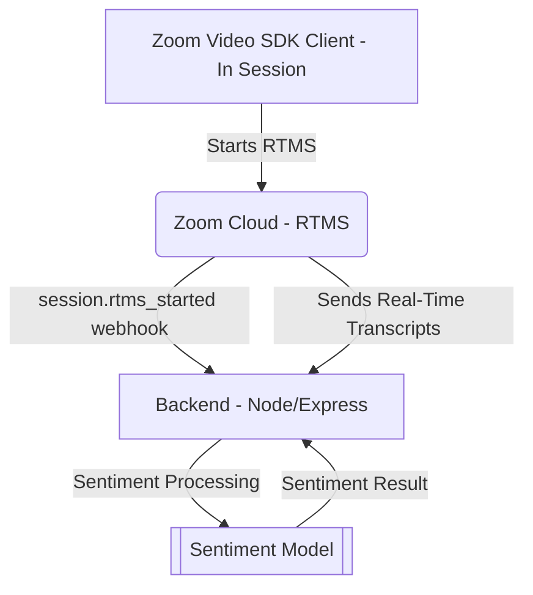
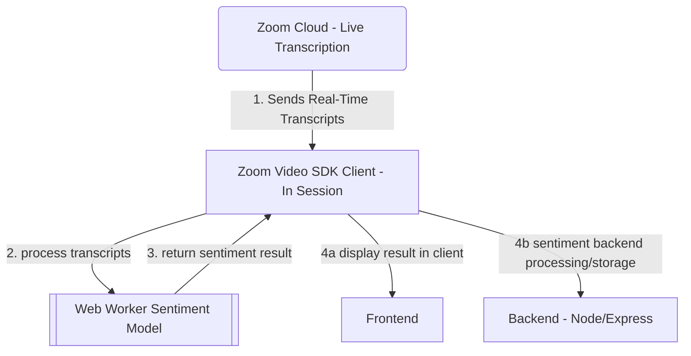

A real-time sentiment analyzer streams Video SDK transcripts to a TensorFlow
model and labels what participants say with an emotion, such as gratitude, joy,
or annoyance, as they speak. Sentiment analysis makes live or transcribed
feedback easier to understand at scale.

Support teams and product owners often rely on delayed surveys, ticket notes,
and post-conversation reviews to understand how people feel about an
experience. By the time negative sentiment is identified, the customer is
already frustrated, and the opportunity to respond in the moment is gone.

This blueprint covers two ways to build it. The server-side path receives
transcripts on your backend through Realtime Media Streams (RTMS). The
client-side path receives them in the browser through Video SDK live
transcription.

**What you'll need:**
- A Zoom Video SDK account and credentials ([Get credentials](https://developers.zoom.us/docs/video-sdk/get-credentials/))
- For the server-side path: [RTMS](https://developers.zoom.us/docs/rtms/video-sdk/) enabled for your Video SDK account, which needs Zoom Developer Pack credits (free trial credits are available, see [pricing](https://zoom.us/pricing/developer)), and a backend that Zoom can reach to deliver webhooks (Node/Express in this guide; any stack works)
- For the client-side path: live transcription enabled for your Video SDK account
- A sentiment model. The samples train a small TensorFlow.js classifier; you can plug in your own.

## Features
- Live sentiment detection in near real time
- Project structure that lets you plug in your own model

<Image src="images/sentimentpic.png" alt="Video with the live caption 'Thank you for the roses.' and the label 'Detected Sentiment: gratitude' above it" />

<YouTube id="oNI-y98B8jQ" />

---

## Architecture

### Server-Side with RTMS
A Zoom session is started through the Video SDK. The client starts RTMS for the session, and Zoom
sends a `session.rtms_started` webhook to the backend. The backend joins the stream, and once audio
is connected and participants begin to speak, **RTMS** delivers the live transcript to it. The backend
passes each transcript to the sentiment model and gets the result back.




### Client-Side with Live Transcription
A Zoom session is started through the Video SDK. Once audio is connected and participants begin to speak,
the Zoom Cloud sends transcripts to the client device through the SDK `caption-message` listener. These transcripts
are sent as strings to a web worker, which runs the sentiment model locally. The sentiment worker analyzes the
transcripts and returns the result to either the main thread or the backend.



## Implementation Guide

Each path has its own sample repository: [server-side with RTMS](https://github.com/zoom/videosdk-rtms-sentiment-analysis) and [client-side with live transcription](https://github.com/zoom/videosdk-ltt-sentiment-analysis). The [Sentiment Analysis Walkthrough](https://developers.zoom.us/blog/sentiment-analysis-with-live-transcriptions/) explains both step by step.

### Server-Side with RTMS

#### Front End - Video SDK Implementation
Implement the Video SDK with at least audio capabilities for the host and session participants. The page asks the backend for the JWT required to join or start the Zoom session (see [JWT Generation](#jwt-generation)), joins, and then starts RTMS for the session. Zoom does not send transcripts to the backend until RTMS is started.
```ts
import ZoomVideo from "@zoom/videosdk";

const client = ZoomVideo.createClient();
await client.init("en-US", "Global", { patchJsMedia: true });

const startCall = async () => {
    // authUrl is the backend's URL (VITE_AUTH_URL in the sample)
    const response = await fetch(`${authUrl}/jwt`, {
        method: "POST",
        headers: { "Content-Type": "application/json" },
        body: JSON.stringify({ sessionName, role }),
    });
    const { jwtToken } = await response.json();

    await client.join(sessionName, jwtToken, username);
    const mediaStream = client.getMediaStream();
    await mediaStream.startAudio();
};

const startRTMS = async () => {
    const rtmsClient = client.getRealTimeMediaStreamsClient();
    if (!rtmsClient.isSupportRealTimeMediaStreams()) return; // RTMS is not available on this account
    if (!rtmsClient.canStartRealTimeMediaStreams()) return;  // this user cannot start RTMS
    await rtmsClient.startRealTimeMediaStreams();
};

await startCall();
await startRTMS();
```

The same client has `pauseRealTimeMediaStreams()`, `resumeRealTimeMediaStreams()`, and `stopRealTimeMediaStreams()`. The sample wires each one to a button.

#### Backend - RTMS Implementation
In your Video SDK app, add an event subscription for the RTMS started and stopped events and point it at your backend's webhook URL. See [Add Realtime Media Streams to your app](https://developers.zoom.us/docs/rtms/video-sdk/add-features/).

On the backend Node.js server, implement RTMS using the [RTMS SDK](https://github.com/zoom/rtms). This example mounts the RTMS SDK webhook handler on the HTTP server and joins the stream when `session.rtms_started` arrives:
```js
import http from 'http';
import express from 'express';
import dotenv from 'dotenv';
import cors from 'cors';
// Import the RTMS SDK
import rtms from "@zoom/rtms";

dotenv.config({ quiet: true });
const PORT = process.env.PORT || 3012;
const ZoomSecretToken = process.env.ZOOM_SECRET_TOKEN;
const ZoomClientId = process.env.ZOOM_VIDEO_SDK_KEY;
const ZoomClientSecret = process.env.ZOOM_VIDEO_SDK_SECRET;
// Minimum transcript length, in characters, before running the model
const WordThreshold = parseInt(process.env.WORD_THRESHOLD || '35');

if (!ZoomClientId || !ZoomClientSecret || !ZoomSecretToken) {
  console.error('Missing required environment variables:');
  if (!ZoomClientId) console.error('  - ZOOM_VIDEO_SDK_KEY');
  if (!ZoomClientSecret) console.error('  - ZOOM_VIDEO_SDK_SECRET');
  if (!ZoomSecretToken) console.error('  - ZOOM_SECRET_TOKEN');
  process.exit(1);
}

const app = express();
app.use(cors());

// Create a webhook handler that can be mounted on your existing server
const webhookHandler = rtms.createWebhookHandler(
    (payload) => {
        console.log(`Received webhook: ${payload.event}`);

        if (payload.event === "session.rtms_started") {
            const client = new rtms.Client();
            const { session_id, rtms_stream_id, server_urls } = payload.payload;

            client.onTranscriptData((buffer, size, timestamp, metadata) => {
              const text = buffer.toString('utf8');
              if (text.length > WordThreshold) {
                // TODO: Run Sentiment Analysis here via worker thread
              }
            });

            client.join({
              client: ZoomClientId,
              secret: ZoomClientSecret,
              session_id,
              rtms_stream_id,
              server_urls,
            });
        }
    },
    '/zoom/webhook'
);

app.post('/zoom/webhook', webhookHandler);
app.use(express.json());

app.get('/', (req, res) => {
  res.send('RTMS for Video SDK Sample Server Running.');
});

const server = http.createServer(app);

server.listen(PORT, () => {
  console.log(`Server running at http://localhost:${PORT}`)
});
```

[Verify each event's signature](https://developers.zoom.us/docs/api/webhooks/#verify-webhook-events) with your app's secret token before acting on it.

#### Model Integration on the Server Side
On the backend Node.js server, implement, train, and integrate your model in a separate worker thread so the main event loop is not bottlenecked by sentiment processing.
```js
import path from 'node:path';
import { Worker } from 'node:worker_threads';

// Example logic for the TODO line from the previous step
if (text.length > WordThreshold) {
    const workerPath = path.resolve(import.meta.dirname, 'transcript-sentiment.js');

    // Spawn the worker thread and pass data, such as the transcript
    const worker = new Worker(workerPath, {
        workerData: { transcript: text }
    });

    // Listen for the result from the worker thread
    worker.on('message', (result) => {
        console.log(`Sentiment Result: ${result.sentiment}`);
    });

    // Handle potential errors in the worker
    worker.on('error', (error) => {
        console.log(`Error from Worker: ${error.message}`);
    });

    // Handle unexpected worker exits
    worker.on('exit', (code) => {
        if (code !== 0) {
            console.error(`Worker stopped with exit code ${code}`);
        }
    });
}
```

#### Run the Server-Side Sample
The sample needs Node.js 22.

```bash
git clone https://github.com/zoom/videosdk-rtms-sentiment-analysis
cd videosdk-rtms-sentiment-analysis
npm install
cp .env.example .env
npm run dev
```

In `.env`, set `ZOOM_VIDEO_SDK_KEY`, `ZOOM_VIDEO_SDK_SECRET`, and `ZOOM_SECRET_TOKEN` from your Video SDK app, and set `VITE_AUTH_URL` to the server's URL (`http://localhost:3012` locally). `npm run dev` starts the web page on port 5173 and the server on port 3012.

Expose port 3012 on a public URL with a tunnel and use `https://<your-host>/zoom/webhook` as the event notification endpoint URL in your event subscription. Open `http://localhost:5173`, choose **Join**, then start RTMS. As you speak, the server console prints the detected sentiment for each transcript.

### Client-Side with Live Transcription

#### Frontend - Video SDK Configuration
Implement the Video SDK with at least audio and live transcription capabilities for the host and session participants. Configure the Video SDK `caption-message` listener to receive transcript text as a `string` and run sentiment analysis on it. The page asks the backend for the JWT required to join or start the Zoom session (see [JWT Generation](#jwt-generation)).
```ts
import ZoomVideo, { LiveTranscriptionLanguage } from "@zoom/videosdk";

const client = ZoomVideo.createClient();
await client.init("en-US", "Global", { patchJsMedia: true });

const startCall = async () => {
    const response = await fetch(`${endpointUrl}/zoomtoken?session=${encodeURIComponent(sessionName)}`);
    const { token } = await response.json();

    await client.join(sessionName, token, username);
    const mediaStream = client.getMediaStream();
    await mediaStream.startAudio();

    client.on("caption-message", async (payload) => {
        if (payload.done) {
            runSentiment(payload.text);
        }
    });

    const liveTranscriptionTranslation = client.getLiveTranscriptionClient();
    await liveTranscriptionTranslation.startLiveTranscription();
    liveTranscriptionTranslation.setSpeakingLanguage(LiveTranscriptionLanguage.English);
}

await startCall();
```

#### Model Integration via Web Worker
Configure a web worker to handle sentiment processing. It can either run the model in the web worker with TensorFlow.js or make a web request to a secure backend that handles the analysis.
```ts
// In main.ts, the worker is launched after the user joins the session and is then ready to receive transcripts
const launchAI = async () => {
    sentimentWorker = new Worker(window.location.origin + "/transcript-sentiment.js");
    sentimentWorker.onmessage = (e: any) => {
        const {event, payload: {allWords, wordReference, result}} = e.data;
        switch(event) {
            case 'model-inited':
                localStorage.setItem("allWords", allWords);
                localStorage.setItem("wordReference", wordReference);
                processingPaused = false;
                aiBtn.textContent = 'Reset AI';
                aiBtn.disabled = false;
                break;
            case 'sentiment-result':
                sentimentOutput.textContent = `Detected Sentiment: ${result}`;
        }
    }
};

// Send a finished transcript to the worker, with the vocabulary the model was trained on
const runSentiment = (transcript: string) => {
    const allWords = localStorage.getItem("allWords");
    const wordReference = localStorage.getItem("wordReference");

    sentimentWorker.postMessage({
        event: 'run-detection',
        payload: { allWords, wordReference, transcript }
    });
};
```

#### Run the Client-Side Sample
The sample's scripts use [Bun](https://bun.sh/).

```bash
git clone https://github.com/zoom/videosdk-ltt-sentiment-analysis
cd videosdk-ltt-sentiment-analysis
bun install
cp .env.example .env
bun dev
```

In `.env`, set `ZOOM_SDK_KEY` and `ZOOM_SDK_SECRET` from your Video SDK app, and set `ENDPOINT_URL` to the server's URL (`http://localhost:3000` locally) so the page can fetch its token from `/zoomtoken`. Open `http://localhost:3000` and choose **Join**. The model trains in the browser the first time, then the detected sentiment appears on the page as you speak.

**The following sections apply to both client-side and server-side.**

### Use a Transcription Buffer for Better Contextual Understanding
It is recommended that you store received transcripts in a buffer, concatenating them into a single string rather than sending each one for analysis as soon as it arrives. This gives the model more context and can produce more accurate results.

### JWT Generation
Use the [Video SDK key and secret](https://developers.zoom.us/docs/video-sdk/get-credentials/) only in the server runtime. The required claims for this application are as follows:

| Claim       | Required value                                                   |
| ----------- | ---------------------------------------------------------------- |
| `app_key`   | Your Zoom Video SDK key                                          |
| `tpc`       | The topic matching the specified 'tpc' in SDK join function      |
| `role_type` | Server-derived `1` for host or `0` for participant               |
| `version`   | `1`                                                              |
| `iat`       | Current server time with a small clock-skew allowance            |
| `exp`       | No more than two hours after issue in this architecture          |

This JWT is generated with functions similar to the below:
```ts
function generateSignature(
	sessionName: string,
	role: number,
	expiresInHours: number = 2,
): string {
	const iat = Math.round(new Date().getTime() / 1000) - 30;
	const exp = iat + 60 * 60 * expiresInHours;
	const oHeader = { alg: "HS256", typ: "JWT" };
	const oPayload = {
		app_key: sdkKey,
		tpc: sessionName,
		role_type: role,
		version: 1,
		iat: iat,
		exp: exp,
	};
	const sHeader = JSON.stringify(oHeader);
	const sPayload = JSON.stringify(oPayload);
	const sdkJWT = KJUR.KJUR.jws.JWS.sign("HS256", sHeader, sPayload, sdkSecret!);
	return sdkJWT;
}
```
**Do not expose your credentials to the client. When using the Video SDK in production, use a backend service to sign tokens. Do not store credentials in plain text. The sample app uses a `.env` file for simplicity.**

### Model Training
The samples train a simple model with TensorFlow.js, based on this [sentiment example](https://github.com/tensorflow/tfjs-examples/tree/master/sentiment). The training data is `models/emotions.tsv`, and the model and its training code are in `public/transcript-sentiment.js`. The model turns each transcript into a bag-of-words vector and classifies it as one of 27 emotions.

- **Server-side:** the server trains the model on startup with `trainModel(250, 50)` (250 training samples, 50 epochs), then calls `runDetection(text)` for each transcript.
- **Client-side:** the web worker trains the model the first time it runs and saves it to IndexedDB, so later visits reuse it. The page keeps the model's vocabulary in `localStorage`. The **Reset AI** button retrains the model with the sample size and number of epochs you choose.

To use your own model, replace the training and detection functions in that file.

## App Manifest

Video SDK apps are not configured through a Marketplace app manifest, so this blueprint has no `manifest.json`. The app authenticates with your Video SDK key and secret instead.

## Acceptance Criteria

**General**
- Ensure SDK credentials are not exposed when producing a JWT. Keep token generation off the frontend; store credentials only on the backend and never in plain text.
- Do not log credentials or JWTs.
- Use a transcription buffer for better context.
- Properly implement the [Video SDK Session Lifecycle](https://developers.zoom.us/docs/video-sdk/web/sessions/).

**Server-side**
- Each webhook's signature is verified before the event is acted on.
- `session.rtms_stopped` releases the RTMS client for that stream.
- Interrupted streams are handled as described in [Failover and reconnection](https://developers.zoom.us/docs/rtms/video-sdk/failover-reconnection/).
- Sentiment processing runs off the main event loop.

**Client-side**
- Check `payload.done` before sending the transcript to the sentiment worker.
- Release and tear down the web worker.
- Properly delete transcription data from browser storage.

## Related Resources
- [Server-side sample: Sentiment Analysis with RTMS](https://github.com/zoom/videosdk-rtms-sentiment-analysis)
- [Client-side sample: Sentiment Analysis with Live Transcription](https://github.com/zoom/videosdk-ltt-sentiment-analysis)
- [Sentiment Analysis with Live Transcriptions Walkthrough](https://developers.zoom.us/blog/sentiment-analysis-with-live-transcriptions/)
- [Zoom Video SDK for Web](https://developers.zoom.us/docs/video-sdk/web/) - SDK documentation
- [Live transcription and translation](https://developers.zoom.us/docs/video-sdk/web/transcription-translation/)
- [Zoom Video SDK Agent Skills](https://github.com/zoom/skills/tree/main/skills/video-sdk)
- [Realtime Media Streams for Zoom Video SDK](https://developers.zoom.us/docs/rtms/video-sdk/)
- [Zoom Developer Forum](https://devforum.zoom.us/)
- [Video SDK Session Lifecycle](https://developers.zoom.us/docs/video-sdk/web/sessions/)
