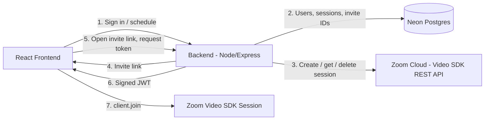

Video SDK sessions don't come with a built-in scheduler or invite flow. This blueprint
shows how to build one yourself: a signed-in host schedules a session through the
Video SDK REST API, shares a link, and guests join without ever seeing your credentials
or the session password.

**What you'll need:**
- Zoom Video SDK credentials [Get credentials](https://developers.zoom.us/docs/video-sdk/get-credentials/)
- Video SDK REST API credentials (API key and secret) for creating and managing sessions
- A Neon Postgres database (any Postgres works)
- Node.js, Express, and React

**Features:**
- Email and password accounts with hashed passwords and hashed session tokens
- Scheduled sessions created through the Video SDK REST API
- Opaque invite links for hosts and guests

<Image src="images/scheduler.png"/>

## Architecture

The React frontend never talks to Zoom directly. Every request goes through the Express
backend, which checks the user's login, reads and writes Neon, calls the Zoom REST API, and
signs the JWT the frontend needs to join.



## Implementation Guide

### Backend Server Configuration - Database Security
HTTP is stateless: every request arrives with no memory of the previous one. If you sign in
on request 1, the server has no idea who you are on request 2. Browser sessions solve this:

1. You prove who you are (email and password).
2. The server gives you a ticket: a long random string.
3. Your browser shows the ticket on every later request.
4. The server looks the ticket up to see whose it is.

Both the password and the ticket are secrets, so neither is stored as-is. The sample uses
three tables: `users`, `auth_sessions`, and `meetings`.

```sql
CREATE TABLE users (
  id            UUID PRIMARY KEY DEFAULT gen_random_uuid(),
  user_name     TEXT NOT NULL,
  user_email    TEXT NOT NULL,
  password_hash TEXT NOT NULL            -- salt:hash
);
CREATE TABLE auth_sessions (
  token_hash TEXT PRIMARY KEY,           -- hash of the cookie, never the cookie
  user_id    UUID NOT NULL REFERENCES users(id) ON DELETE CASCADE,
  expires_at TIMESTAMPTZ NOT NULL
);
```

Keep `DATABASE_URL` on the server only, and always use parameterized queries (`$1`, `$2`) so user input is never concatenated into SQL.

### Storing Passwords
Don't store passwords as plaintext. If the database leaks, every user is exposed.

- Use a one-way hash. `scrypt` is deliberately slow, which makes password guessing expensive.
- Salt it: mix in 16 random bytes so identical passwords produce different hashes.
- Store `salt:hash` in the row tied to the user's email.

```js
async function hashPassword(password) {
  const salt = randomBytes(16);
  const hash = await scryptAsync(password, salt, 64);
  return `${salt.toString('hex')}:${hash.toString('hex')}`;
}
```

To verify, look up the stored `salt:hash` by email, hash the submitted password with that
same salt, and compare. If they match, the password is correct. Use `timingSafeEqual` for the comparison.

```js
async function verifyPassword(password, stored) {
  const [saltHex, hashHex] = stored.split(':');
  const expected = Buffer.from(hashHex, 'hex');
  const actual = await scryptAsync(password, Buffer.from(saltHex, 'hex'), expected.length);
  return timingSafeEqual(actual, expected);
}
```

### Storing Login Session Tokens
The login cookie gets the same treatment as a password: the server never keeps the raw value.

1. `randomBytes(32)` creates an unguessable 256-bit token.
2. The server stores the **hash** of the token in `auth_sessions`, with the user id and an expiry (7 days).
3. The raw token goes to the browser as a cookie.

```js
async function startSession(res, userId) {
  const token = randomBytes(32).toString('hex');
  await query('INSERT INTO auth_sessions (token_hash, user_id, expires_at) VALUES ($1,$2,$3)',
    [hashToken(token), userId, new Date(Date.now() + SESSION_MS)]);
  res.cookie('session_token', token, {
    httpOnly: true, sameSite: 'lax', secure: true, maxAge: SESSION_MS, path: '/',
  });
}
```

On each request the browser sends the raw cookie. The server hashes it and looks for a
matching, unexpired row in `auth_sessions`. No row means `undefined` and a `401`. A match
returns the user, sets `req.user`, calls `next()`, and the route runs.

```js
export async function requireAuth(req, _res, next) {
  const user = await userFromRequest(req);   // hash cookie -> join users -> expires_at > now()
  if (!user) return next(new HttpError(401, 'Not signed in'));
  req.user = user;
  next();
}
```

## API Usage

### Secure Server
All Zoom calls (REST API and JWT Generation) happen on the backend. The frontend only receives the result.

### Using Keystores in Production
Set credentials as variables in your host's secret store rather than files on disk. Examples:
Vercel Environment Variables, AWS Secrets Manager or SSM, GCP Secret Manager, Azure Key Vault,
or HashiCorp Vault. You get encryption at rest, access control, audit logs, and easy rotation.

For local development with a `.env` file:
- Restrict permissions with `chmod 600 .env`.
- Keep it out of Docker images. Add `.env` to `.dockerignore` and pass values at runtime.
- Never commit it to git.

### Bearer Token Generation
The Video SDK REST API accepts a JWT as a bearer token. Generate it on the server for each request (or cache it until **shortly before** it expires).

- **Scope:** give your API credentials only the least privilege your requests need.
- **Frontend:** never bundle credentials into frontend code. Anything with a prefix like `VITE_` is shipped to the browser.
- **Logs:** never log your credentials or generated JWTs.

```js
const payload = { iss: process.env.ZOOM_API_KEY, iat, exp };   // HS256, signed with ZOOM_API_SECRET
const res = await fetch('https://api.zoom.us/v2/videosdk/sessions', {
  method: 'POST',
  headers: { 'Content-Type': 'application/json', Authorization: `Bearer ${jwt}` },
  body: JSON.stringify({ session_name, session_password, settings }),
});
```

### JWT Generation
Use the [Video SDK key and secret](https://developers.zoom.us/docs/video-sdk/get-credentials/) only in the server runtime. The JWT the client uses to join a session requires the following claims:

| Claim       | Required value                                                   |
| ----------- | ---------------------------------------------------------------- |
| `app_key`   | Your Zoom Video SDK key                                          |
| `tpc`       | The topic matching the specified 'tpc' in SDK join function      |
| `role_type` | Server-derived `1` for host or `0` for participant               |
| `version`   | `1`                                                              |
| `iat`       | Current server time with a small clock-skew allowance            |
| `exp`       | No more than two hours after issue in this architecture          |

This JWT is generated with functions similar to the below:
```js
function generateSignature(
	sessionName: string,
	role: number,
	expiresInHours: number = 2,
): string {
	const iat = Math.round(new Date().getTime() / 1000) - 30;
	const exp = iat + 60 * 60 * expiresInHours;
	const oHeader = { alg: "HS256", typ: "JWT" };
	const oPayload = {
		app_key: sdkKey,
		tpc: sessionName,
		role_type: role,
		version: 1,
		iat: iat,
		exp: exp,
	};
	const sHeader = JSON.stringify(oHeader);
	const sPayload = JSON.stringify(oPayload);
	const sdkJWT = KJUR.KJUR.jws.JWS.sign("HS256", sHeader, sPayload, sdkSecret!);
	return sdkJWT;
}
```
**Do not expose your credentials to the client. When using the Video SDK in production, use a backend service to sign tokens. Do not store credentials in plain text.**

## Scheduling Meetings
A signed-in host fills out the scheduler (name, time, agenda, password, auto-recording). The server validates the input, creates the session with `POST /videosdk/sessions`, and saves the returned `session_id` in the Databaase alongside the host's user id.

<Image src="images/scheduler.png"/>

```js
router.post('/create-session', requireAuth, async (req, res) => {
  // ...validate name, hold, startTime, password (alphanumeric, max 10)
  const created = await createVideoSession(sessionName, password, { auto_recording, hold });
  const record = { sessionId: created.session_id, inviteId: randomBytes(16).toString('base64url'), /* ... */ };
  await addSession(req.user.id, record);
  res.status(201).json(record);
});
```

### Fetching Meeting Info
The meeting list combines your Database records with session data from `GET /videosdk/sessions/{id}`.

<Image src="images/meetinglist.png"/>

- **Paginate** in the UI and API once a host has more than a handful of meetings, rather than fetching every session on each load.
- **Cache on the server.** Zoom rate-limits the REST API, so hold responses briefly (for example 30-60 seconds) and invalidate on create or delete. 
- Scope every query by `req.user.id` so hosts only ever see their own meetings.

### Link Creation
The invite link is what you hand to people, so treat it as untrusted input when it comes back.

- **Domain ownership:** build links from your own domain (an `ENDPOINT_URL` setting) and serve it over HTTPS only.
- **Opaque invite ID:** use a unique, random invite ID mapped to the `sessionName` in your database. Don't put `sessionName`, password, or role in the link.
- **Query parameters:** keep them out of the link wherever possible. Anything in a URL ends up in browser history, logs, and referrers.
- **Role and meeting access:** the link identifies *which* meeting. The server decides *what access* the caller gets.
- **Rate limit** token generation per IP and per invite ID to stop invite-ID guessing.
- **Set `Cache-Control: no-store`** on any response that carries a token.

```js
export const buildGuestLink = (base, inviteId) => `${base}/s/${encodeURIComponent(inviteId)}`;
export const buildHostLink  = (base, inviteId) => `${buildGuestLink(base, inviteId)}/host`;

// 128 bits of randomness, URL safe
const inviteId = randomBytes(16).toString('base64url');
```

## Structuring Invitations
Give each meeting two links built from the same invite ID: a guest link (`/s/:inviteId`) and a host link (`/s/:inviteId/host`). The invite message shows only the guest link and details. The host link stays in the host's own scheduler view.

<Image src="images/invite.png"/>

Send the password through a different channel than the link. Whoever has only the link still needs the password.

## Securing Meetings

### Secure Joining
The browser opens a link, posts the invite ID and a requested role to the server, and the server decides.

```js
router.post('/token', async (req, res) => {
  const invite = await findInvite(req.body.inviteId);         // 404 if unknown
  const token = generateSignature(invite.sessionName, role);

  if (role === 1) {                                           // host
    const user = await userFromRequest(req);
    if (!user) throw new HttpError(401, 'Sign in to join as host');
    if (user.user_email !== invite.ownerEmail) throw new HttpError(403, 'Not your meeting');
    return res.json({ token, sessionName: invite.sessionName, password: invite.password });
  }
  res.json({ token, sessionName: invite.sessionName, passwordRequired: invite.password !== '' });
});
```

- **Hosts** can only start a meeting as a signed-in user who owns it. That's also the only way to retrieve the host link's token and password.
- **Guests** get a `role_type: 0` token. If the meeting has a password, they're prompted for it at join. The password is never included in the invite link or the guest response.

### Secure Fetching of Meeting Data
- Put `requireAuth` on every route that lists, reads, or deletes meetings.
- Filter by the signed-in user's id, and return `404` (not `403`) for meetings they don't own, so IDs can't be probed.
- Return only what the UI needs. Never send `password_hash`, token hashes, or API credentials.
- Treat a Zoom `404` as "this session no longer exists" and clean up the matching row.

## Related Resources
- [Video SDK REST API](https://developers.zoom.us/docs/api/video-sdk/)
- [Zoom Video SDK for Web](https://developers.zoom.us/docs/video-sdk/web/)
- [Video SDK Session Lifecycle](https://developers.zoom.us/docs/video-sdk/web/sessions/)
- [Zoom Video SDK Agent Skills](https://github.com/zoom/skills/tree/main/skills/video-sdk)
- [Zoom Developer Forum](https://devforum.zoom.us/)

## App Manifest

Skip this section. Video SDK Product does not support Marketplace Manifests

## Acceptance Criteria

**General**
- [ ] Credentials and JWTs are never logged or exposed to the frontend.
- [ ] `.env` is git-ignored, `chmod 600`, and excluded from Docker images; production uses a keystore.
- [ ] Properly implement the [Video SDK Session Lifecycle](https://developers.zoom.us/docs/video-sdk/web/sessions/).

**Server-side**
- [ ] Passwords are stored as salted `scrypt` hashes (`salt:hash`).
- [ ] Login tokens are stored as hashes with a 7-day expiry; cookie is `httpOnly`, `secure`, `sameSite`.
- [ ] Invite links use a random invite ID with no session name, password, or role.
- [ ] Host tokens require a signed-in owner; guest tokens never include the password.
- [ ] Token responses send `Cache-Control: no-store` and token routes are rate limited.
- [ ] Zoom responses are cached and meeting lists are paginated.

**Client-side**
- [ ] Guests are prompted for the password at join when the meeting requires one.
- [ ] No Zoom credentials appear in the client bundle (no `VITE_` secrets).
